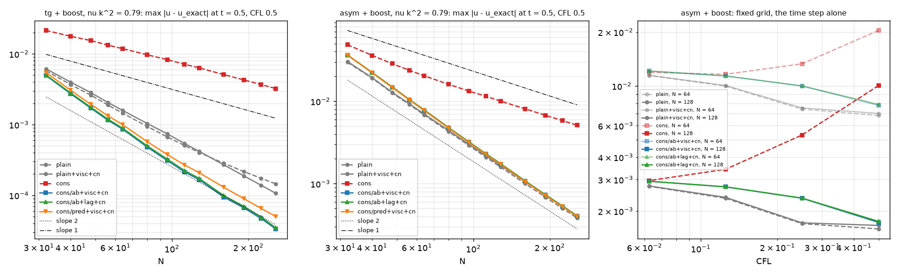

# 113 R0-P1（続き）：非定常・粘性ありの単相での時間の次数。ノート112 の修正だけでは時間 1 次のまま。原因は 3 つ（運ぶ面の速度の時間のレベル、面の値の粘性の源の項、後退 Euler）で、局所誤差の式と実測が 3 桁で一致した。3 つを同時に直すと、固定の CFL で 2 次（13 格子、N ≥ 96 の傾き 2.0〜2.3）。非保存形（BCG）も粘性ありでは時間 1 次である

新しい研究方針（ノート111）の R0-P1 の続き。Issue #141、B の指示 #145（順 1）。ライブラリ（`basilisk_cupy/`）は変えていない。全ての修正は、試験の側のフック（`cases/r0p1_unsteady_viscous.py`）と、ノート112 のゴーストセルの差し替え（`periodic_momentum_ghosts`、ライブラリへの反映は #146 でユーザーの判断待ち）で行った。

**依存**：ノート112（PR #143）の結論（面の値の圧力の源の項、ゴーストセル）の上に立つ。ノート112 は監修の「判定：OK」の前である（#145）。

```
python -m cases.r0p1_unsteady_viscous     # 全ての表（docs/figures/r0p1_unsteady_viscous.json、426 ケース、CPU 20 並列で約 50 分。途中の結果を .jsonl に追記し、再実行すると続きから行う）
python -m cases.r0p1_unsteady_viscous_plot  # 表と図（docs/figures/r0p1_unsteady_viscous.png、数秒）
pytest tests/test_r0p1_unsteady_viscous.py  # 5 件、約 15 秒（5 並列）
```

## 結論の要約
- **保存形（ライブラリ + ノート112 の 2 つの修正）は、非定常の流れでは時間 1 次のままである**（Galilean boost つきの Taylor–Green。固定の CFL で N ≥ 96 の傾き 0.90〜0.98、13 格子）。ノート112 の「約 2.8 次」は、定常・非粘性・boost なしに限った結果だった。
- **原因は 3 つで、どれも局所誤差の式と実測が一致した**（B 節の予測は測定の前に固定した）。
  - **E1** 運ぶ面の速度が tⁿ のもの（`conserving.h`）。非粘性でも出る。これが最大（N = 256 で全体の誤差の 90% 以上）。
  - **E2** 面の値の半ステップの予測に粘性の加速度が無い。大域では模様の位置のずれ `−(λ/2)ΣΔt²·(U·∇)w̃`：実測の係数 −0.395（予測 −λ/2 = −0.3948）。
  - **E3** 粘性が後退 Euler。振幅 `+(λ²/2)ΣΔt²` と位置 `+(λ/2)ΣΔt²`：実測 +0.300〜0.356（N とともに予測 0.3117 に近づく）と +0.395。
- **E2 と E3 の位置のずれは逆符号で打ち消し合う**（予測どおり、実測の和は 0.000）。そのため、**片方だけを直すとかえって悪くなる**（N = 256 で 1.16e-4 → 9.4e-4）。
- **純粋な減衰 Taylor–Green（boost なし）では、E1 と E2 は見えない**（主要項が勾配で、射影が除く。予測どおり）。この流れだけで試験していたら、後退 Euler だけが原因に見えた。
- **3 つを同時に直す最小の修正で、固定の CFL で 2 次になった**：運ぶ面の速度の外挿（射影なし）、面の値の源の項に粘性の加速度（または前のステップの全加速度）、Crank–Nicolson（陽的な半分は開始時の速度に掛ける）。13 格子・2 つの流れ・3 つの時刻・最大と RMS の全てで、N ≥ 96 の傾きは 2.01〜2.32。厳密な t^{n+1/2} の面の速度（oracle）を使った場合と同じ水準で、非保存形の同じ修正と同じか少し良い。
- **非保存形（BCG、`centered.h`）も、粘性ありでは時間 1 次である**（E2 + E3。tg + boost で N ≥ 96 の傾き 1.52〜1.59）。基準に使う側の性質として記録する。
- **Crank–Nicolson を中間の速度 `u⋆ + Δt g` にそのまま適用する形は、時間 1 次で、κ = νΔt/h² ≳ 1 で不安定**（予測した 1 次の係数 +λ/2 と一致。不安定は実測だけで、原因は未解析）。
- **固定の格子での時間刻みへの依存は、次数として読めなかった**（3 節）。2 次になった構成は、非保存形を含めて全て、Δt を小さくすると誤差が**増える**（CFL に依存する空間誤差 `h²f(CFL)`）。純粋に Δt に比例する成分は、射影の係数で分けて測った：直す前は予測どおりの定数、直した後は h² に比例して 0 に向かう。「固定の格子で Δt を半分にして 1/4」という読み方では、どの構成も合格しない。合格の条件の読み方は B の判断を求める（#150）。
- 修正は全て試験の側のフックで、ライブラリには入れていない。単相だけの結果である。二相（密度比 1000）で面の値の源の項が使えるかは、次の課題（帰還の不安定、#145 の P0）で決まる。

## 定式化と理論的根拠
### A. 厳密解（証明つき）
周期の [0, 1]²、ρ = 1。ψ を Laplacian の固有関数（`Δψ = −k²ψ`）、`w = (ψ_y, −ψ_x)` とすると、任意の一定の速度 U と粘性 ν について

```
u(x, t) = U + e^{−λt} w(x − Ut),   λ = νk²
```

は Navier–Stokes 方程式の厳密解である。

- 証明：渦度は `ω = −Δψ = k²ψ` で、`w·∇ω = k²(ψ_y ψ_x − ψ_x ψ_y) = 0`。渦度方程式 `ω_t + u·∇ω = νΔω` は `ω_t + U·∇ω = −λω` になり、上の形が満たす。圧力は `p = −e^{−2λt}(|w|² + k²ψ²)/2`（`(w·∇)w = ∇(|w|²/2) − w × ωẑ`、`w × ωẑ = −∇(k²ψ²/2)`）。
- **tg**：`ψ = sin 2πx sin 2πy/(2π)`（k² = 8π²、ノート112 の流れ）。
- **asym**：`ψ = c[sin 2π(x + 2y) + 0.6 cos 2π(2x − y) + 0.4 sin(2π(2x + y) + 1)]`（k² = 20π²、対称性なし、max|w| = 1 に正規化）。
- boost は `U = (1, 0.37)`。粘性は tg で ν = 0.01、asym で ν = 0.004（どちらも λ = 0.79。t = 0.5 で振幅は 0.67 倍）。

### B. 1 ステップの局所誤差の候補と予測（測定の前に固定した）
ノート112 と同じ記法で、`∂_t u + ∇·(u ⊗ u) = S`、`S = −∇p + νΔu`。現行の方式（`conserving.h` の移植 + ノート112 の 2 つの修正）の 1 ステップ：

1. 時刻 tⁿ の射影済みの面の速度 `u_fⁿ` で運動量を運ぶ。面の値の半ステップの予測の源の項は圧力の加速度 `gⁿ` だけ。
2. `gⁿ` を足し、粘性を後退 Euler で解き、`gⁿ` を引く。
3. 射影して `g^{n+1}` を足す。

厳密な 1 ステップは `u + Δt(−∇·(uu) + S) + (Δt²/2)(−∇·(u_t u) − ∇·(u u_t) + S_t)`。方式が落とす項（方式 − 厳密）：

| 候補 | 局所誤差の主要項 | 解の族での形（`w̃ = e^{−λt}w(x − Ut)`） |
| --- | --- | --- |
| **E1** 運ぶ面の速度が tⁿ（t^{n+1/2} でない） | `+(Δt²/2)(u_t·∇)u` | `−(Δt²/2)[λ(w̃·∇)w̃ + ((U·∇w̃)·∇)w̃]` |
| **E2** 面の値の源の項に粘性の加速度が無い（ノート112 の B 節の式で S − s = νΔu） | `+(Δt²/2) u·∇(νΔu)` | `−(λΔt²/2)[(U·∇)w̃ + (w̃·∇)w̃]` |
| **E3** 粘性が後退 Euler | `+(Δt²/2) νΔu_t` | `+(λΔt²/2)[λw̃ + (U·∇)w̃]` |

`(w̃·∇)w̃ = −∇p` は勾配で、射影が除く（圧力に吸収される）。したがって：

- **予測 1（boost なしでは E1・E2 は見えない）**：U = 0 では、E1・E2 の主要項は勾配だけである。残るのは E3 の `(λ²Δt²/2)w̃` で、大域では振幅の相対誤差 `(λ²/2) Σ Δt²`（厳密解の族の振幅の摂動は、そのまま e^{−λt} で減衰するので、積み上げは単純な和になる）。**純粋な減衰 Taylor–Green だけで試験すると、E1・E2 を見落とす**（固有モードだけの試験の偏り）。
- **予測 2（boost ありの E2・E3）**：`(U·∇)w̃` に比例する局所誤差 `cΔt²(U·∇)w̃` は、模様の位置のずれ（並進の不変性から、ずれは保存される）として積み上がり、大域の誤差は `c ΣΔt² (U·∇)w̃`。E1 を除いた構成（運ぶ速度を t^{n+1/2} にしたもの）で、全てを直した構成との差を、`s₁ = w̃` と `s₂ = (U·∇)w̃` への射影の係数 `(c₁, c₂)/ΣΔt²` で測ると：

| 構成（E1 は除く） | 残る候補 | 予測 c₁/ΣΔt² | 予測 c₂/ΣΔt² |
| --- | --- | --- | --- |
| 源の項 g だけ・後退 Euler | E2 + E3 | λ²/2 = 0.312 | 0（E2 と E3 の boost の部分が打ち消す） |
| 源の項 g だけ・Crank–Nicolson | E2 | 0 | −λ/2 = −0.395 |
| 源の項 g + 粘性・後退 Euler | E3 | λ²/2 = 0.312 | +λ/2 = +0.395 |
| 源の項 g + 粘性・「素朴な」Crank–Nicolson（下） | — | 0 | +λ/2 = +0.395 |

  - E2 と E3 の boost の部分は逆符号で打ち消し合う。**片方だけを直すと、かえって悪くなる**と予測される。
- **予測 3（E1）**：`((U·∇w̃)·∇)w̃` は一般に勾配ではない（`(U·∇)w̃` は流れ関数 `φ = U·∇ψ̃` の速度場で、`(w_φ·∇)w_ψ − (w_ψ·∇)w_φ` は Poisson 括弧 `{φ, ψ}` の速度場）。閉じた形の大域誤差は書けないので、運ぶ速度を厳密な t^{n+1/2} の面の平均に差し替えて（oracle）、差で測る。非粘性・boost ありで、E1 だけが残る。
- **素朴な Crank–Nicolson の誤差（導出）**：ライブラリの粘性の段は、中間の速度 `u₁ = u⋆ + Δt gⁿ`（u⋆ は輸送の後）に作用する。ここに Crank–Nicolson をそのまま入れると、陽的な半分が `u₁ = uⁿ + Δt(−∇·(uu) + g)` に掛かる。`−∇·(uu) + g = u_t − νΔu` は O(1) なので、局所誤差 `(Δt²/2)νΔ(u_t − νΔu)` が残る。解の族では `u_t − νΔu = −(U·∇)w̃` で、`+(λΔt²/2)(U·∇)w̃`。**定常解・boost なしでは 0 で、見えない**。陽的な半分をステップの開始時の速度 uⁿ に掛ければ、この項は出ない。

以上は、空間の離散化を厳密とした理想化での導出である（現行のコードそのものの証明ではない）。実測との照合は 2 節。

### C. 試した最小の修正（どれもライブラリの外）
| 記号 | 修正 | 費用 |
| --- | --- | --- |
| /ab | 運ぶ面の速度を外挿する：`u_f^{n+1/2} ≈ u_fⁿ + (Δtⁿ/(2Δt^{n−1}))(u_fⁿ − u_f^{n−1})`。離散的に発散 0 の場の線形結合なので、射影なしで発散 0 | 面の場 1 つの保存 |
| /pred | ライブラリの `conserving_predict`（BCG の予測 + 射影、ノート77） | 圧力の求解 1 回 |
| /exact | 厳密な t^{n+1/2} の面の平均（oracle、診断用） | — |
| +visc | 面の値の源の項を `gⁿ + (1/ρ)L_h uⁿ`（L_h はライブラリの粘性の離散の作用素）にする | L_h の適用 1 回 |
| +lag | 面の値の源の項を、前のステップの全加速度 `(uⁿ − u⋆^{n−1})/Δt^{n−1}` にする（圧力・粘性・外力をまとめて含む） | セルの場 1 つの保存 |
| +cn | 粘性を Crank–Nicolson にする。陽的な半分は `(Δt/2)(1/ρ)L_h uⁿ`（開始時の速度）、陰的な半分はライブラリの後退 Euler を Δt/2 で使う | L_h の適用 1 回 |
| +cn-naive | Crank–Nicolson を中間の速度 u₁ にそのまま適用（B 節の誤差の確認用） | 同上 |

非保存形（plain、`centered.h` の BCG）にも、+visc・+lag・+cn を同じフックで入れた（BCG の予測も源の項は g だけで、粘性は後退 Euler である）。

### D. 合否の読み方（測定の前に固定した。B の指示 #145 の順 1 の「終わりの条件」）
- 誤差は、速度のベクトルの誤差の大きさ `|u − u_exact|`（セル平均どうし）の最大と RMS。時刻は t = 0.125、0.25、0.5 の 3 つ（最終時刻だけで読まない）。
- **固定の CFL（0.5）での細分化**：13 格子（N = 32, 40, 48, 56, 64, 80, 96, 112, 128, 160, 192, 224, 256）の最小二乗の傾きを、全体と N ≥ 96 で読む。Δt ∝ h なので、時間 1 次の成分があれば、細かい側の傾きは 1 に近づく。**N ≥ 96 の傾きが、最大・RMS、3 つの時刻の全てで 1.8 以上のとき「2 次」**とする。
- **固定の格子での時間刻みの依存性**：N = 64・128 で CFL = 0.5、0.25、0.125、0.0625。CFL を半分にしたときの解の差と、B 節の射影の係数（ΣΔt² に比例するか）で、時間 1 次の成分の有無を読む。VOF 型の輸送は空間誤差が CFL に依存する（ノート112）ので、固定の格子の差だけでは次数を決めない。
- 問題は 2 つの流れ（tg・asym）× boost の有無 × 粘性の有無。合否は、最も厳しい条件（boost あり・粘性あり）の両方の流れで判定する。boost なし・非粘性は、どの候補が見えなくなるかの確認として残す。
- 満たさない構成も、表と試験に残す。

## 1. 修正の組み合わせ（固定の CFL 0.5、t = 0.5、max|u − u_exact|、N = 64 / 128 / 256、最後の列は 128 → 256 の比）
構成の名前：`cons` = 保存形 + ノート112 の 2 つの修正（面の値の源の項 g、ゴーストセル）。`/ab`・`/pred`・`/exact` は運ぶ面の速度、`+visc`・`+lag` は面の値の源の項、`+cn` は Crank–Nicolson（C 節）。`plain` は非保存形（BCG）。

### boost あり・非粘性（E1 だけが働く）
| 構成 | tg | 比 | asym | 比 |
| --- | --- | --- | --- | --- |
| plain | 3.26e-3 / 8.25e-4 / 2.07e-4 | 3.99 | 1.50e-2 / 3.54e-3 / 8.53e-4 | 4.14 |
| **cons** | 2.47e-2 / 1.31e-2 / 6.66e-3 | **1.96** | 3.94e-2 / 1.99e-2 / 1.02e-2 | **1.96** |
| cons/ab | 1.39e-3 / 2.72e-4 / 6.35e-5 | 4.29 | 1.60e-2 / 3.65e-3 / 8.71e-4 | 4.18 |
| cons/pred | 1.79e-3 / 4.31e-4 / 1.09e-4 | 3.94 | 1.61e-2 / 3.65e-3 / 8.70e-4 | 4.19 |
| cons/exact（oracle） | 1.29e-3 / 2.60e-4 / 5.80e-5 | 4.48 | 1.88e-2 / 4.29e-3 / 1.18e-3 | 3.65 |

- **運ぶ面の速度が tⁿ のままでは時間 1 次**（比 1.96）。**外挿（/ab）で 2 次になり、厳密な t^{n+1/2} の面の速度と同じ水準**（tg で 1.10 倍、asym では oracle より小さい）。射影を 1 回足す `conserving_predict`（/pred）と比べても、同じか良い（tg で 0.58 倍）。
- 外挿は、離散的に発散 0 の 2 つの場の線形結合なので、射影なしで発散 0 である（構成による。VOF の体積の保存に必要）。外挿した面の速度の大きさは、時間変化の速い所で `|u_fⁿ|` を超えうる（上限の保証は無い。Δt が 10% ずつ増える立ち上がりでは外挿の係数は 0.55）。ここでは CFL 0.5 で問題は出なかった。二相・CFL の上限の近くでは未検証。

### boost あり・粘性あり（E1・E2・E3 の全てが働く）
| 構成 | 残る候補 | tg | 比 | asym | 比 |
| --- | --- | --- | --- | --- | --- |
| plain | E2 + E3 | 1.45e-3 / 4.04e-4 / 1.45e-4 | 2.78 | 6.83e-3 / 1.59e-3 / 3.83e-4 | 4.15 |
| plain+visc | E3 | 4.87e-3 / 2.20e-3 / 1.03e-3 | 2.13 | 1.18e-2 / 4.48e-3 / 1.97e-3 | 2.27 |
| plain+cn | E2 | 2.64e-3 / 1.54e-3 / 8.55e-4 | 1.80 | 8.68e-3 / 3.55e-3 / 1.72e-3 | 2.06 |
| **plain+visc+cn** | — | 1.59e-3 / 4.19e-4 / 1.07e-4 | 3.92 | 7.02e-3 / 1.66e-3 / 4.07e-4 | 4.09 |
| plain+lag+cn | — | 1.61e-3 / 4.24e-4 / 1.08e-4 | 3.92 | 7.07e-3 / 1.68e-3 / 4.10e-4 | 4.09 |
| **cons** | E1 + E2 + E3 | 1.19e-2 / 6.34e-3 / 3.24e-3 | **1.96** | 2.04e-2 / 1.00e-2 / 5.12e-3 | **1.96** |
| cons+visc+cn | E1 | 1.19e-2 / 6.33e-3 / 3.23e-3 | 1.96 | 2.06e-2 / 1.01e-2 / 5.13e-3 | 1.96 |
| cons/ab | E2 + E3 | 4.53e-4 / 1.95e-4 / 1.16e-4 | 1.68 | 7.42e-3 / 1.71e-3 / 4.97e-4 | 3.44 |
| cons/ab+visc | E3 | 3.33e-3 / 1.82e-3 / 9.36e-4 | 1.95 | 8.75e-3 / 3.53e-3 / 1.76e-3 | 2.01 |
| cons/ab+cn | E2 | 3.91e-3 / 1.92e-3 / 9.49e-4 | 2.02 | 1.31e-2 / 4.72e-3 / 2.02e-3 | 2.34 |
| **cons/ab+visc+cn** | — | 8.61e-4 / 1.66e-4 / 3.35e-5 | **4.97** | 7.80e-3 / 1.73e-3 / 4.04e-4 | **4.29** |
| **cons/ab+lag+cn** | — | 8.91e-4 / 1.74e-4 / 3.49e-5 | 4.99 | 7.88e-3 / 1.75e-3 / 4.07e-4 | 4.30 |
| cons/pred+visc+cn | — | 9.99e-4 / 2.09e-4 / 5.03e-5 | 4.15 | 7.75e-3 / 1.72e-3 / 3.99e-4 | 4.31 |
| cons/exact+visc+cn（oracle） | — | 8.58e-4 / 1.55e-4 / 3.24e-5 | 4.79 | 8.64e-3 / 1.91e-3 / 4.41e-4 | 4.33 |
| cons/ab+visc+cn-naive | 素朴な CN | 3.37e-3 / 1.82e-3 / 9.29e-4 | 1.96 | 8.98e-3 / 3.63e-3 / 1.73e-3 | 2.10 |
| cons/ab+visc+cn・古いゴーストセル | ノート112 D | 7.84e-3 / 3.88e-3 / 1.68e-3 | 2.31 | 1.26e-2 / 6.96e-3 / 3.73e-3 | 1.87 |

- **3 つとも直した構成だけが 2 次**（比 4.0〜5.0）。どれか 1 つでも残すと 1 次（比 1.7〜2.3）。
- **片方だけを直すと悪くなる**：`cons/ab`（1.16e-4）に対して、`+visc` だけは 9.36e-4、`+cn` だけは 9.49e-4（tg、N = 256）。B 節の予測 2 のとおり。非保存形でも同じ（1.45e-4 → 1.03e-3 / 8.55e-4）。
- **粗い格子では、直さない方が最大誤差が小さいことがある**（そのまま記録する）：tg・N = 64 で `cons/ab`（E2 + E3）は 4.53e-4、全てを直した構成は 8.61e-4。E2 + E3 の振幅の誤差（減衰が足りない）が、空間誤差（数値の散逸）と逆符号で打ち消すためである。直した構成が良くなるのは N ≥ 128。asym の `plain` と `cons/ab` が N = 256 までは 2 次に見える（比 4.15 / 3.44）のも、空間誤差が大きくて 1 次の成分がまだ隠れているためで、2 節の射影の係数には予測どおりの 1 次の成分がある。
- 面の値の源の項は、`g + (1/ρ)L_h u`（+visc）と、前のステップの全加速度（+lag）で、差が無い。+lag は作用素の適用が要らず、外力があってもそのまま使える形である（外力は未検証）。
- 古いゴーストセル（`conserving.h` の定義、ノート112 の D 節）は、ここでも 1 次を作る。

### boost なし・粘性あり（予測 1：E1・E2 は見えない）
| 構成 | tg | 比 | asym | 比 |
| --- | --- | --- | --- | --- |
| plain | 6.29e-4 / 4.14e-4 / 2.34e-4 | 1.76 | 5.72e-3 / 1.52e-3 / 5.23e-4 | 2.90 |
| plain+cn | 4.63e-4 / 5.51e-5 / 1.22e-5 | 4.51 | 6.20e-3 / 1.34e-3 / 3.06e-4 | 4.37 |
| plain+visc+cn | 5.03e-4 / 6.72e-5 / 1.05e-5 | 6.39 | 6.24e-3 / 1.36e-3 / 3.12e-4 | 4.36 |
| cons | 5.81e-4 / 4.51e-4 / 2.46e-4 | 1.84 | 5.09e-3 / 1.50e-3 / 5.21e-4 | 2.87 |
| cons/ab | 5.82e-4 / 4.51e-4 / 2.46e-4 | 1.84 | 5.09e-3 / 1.50e-3 / 5.21e-4 | 2.87 |
| cons/exact（oracle） | 5.86e-4 / 4.51e-4 / 2.46e-4 | 1.84 | 5.69e-3 / 1.44e-3 / 5.27e-4 | 2.74 |
| cons+visc | 5.36e-4 / 4.38e-4 / 2.42e-4 | 1.81 | 5.18e-3 / 1.46e-3 / 5.09e-4 | 2.86 |
| **cons+cn** | 4.70e-4 / 5.93e-5 / 1.11e-5 | 5.32 | 5.60e-3 / 1.19e-3 / 3.00e-4 | 3.97 |
| cons/ab+visc+cn | 5.18e-4 / 6.99e-5 / 1.13e-5 | 6.21 | 5.69e-3 / 1.22e-3 / 2.99e-4 | 4.09 |
| cons/ab+visc+cn-naive | 5.13e-4 / 6.94e-5 / **4.49e-1** | — | 5.66e-3 / 1.22e-3 / 2.98e-4 | 4.09 |
| cons/ab+visc+cn・古いゴーストセル | 5.17e-4 / 6.98e-5 / 1.13e-5 | 6.20 | 1.16e-2 / 5.13e-3 / 2.56e-3 | 2.01 |

- **予測 1 のとおり**：運ぶ面の速度（n・/ab・/exact）と源の項（g・+visc）を変えても、誤差はほとんど変わらない（N = 256 で 3% 以内。asym の N = 64 では oracle だけ 12% 違う。空間の水準の差で、1 次の成分ではない）。**Crank–Nicolson だけで 2 次になる**（`cons+cn`）。この流れだけを見ると、E1 と E2 は存在しないように見える。
- 素朴な Crank–Nicolson は、tg・N = 256（κ = νΔt/h² = 1.28）で発散した（4 節）。
- 古いゴーストセルは、tg・粘性ありでは差が出ない（5.17e-4 / 6.98e-5 / 1.13e-5）。同じ流れの非粘性では出る（確かめた：N = 64 で 1.22e-3 → 5.97e-3、ノート112 と同じ）。境界の 2 セルに局在する誤差を粘性が毎ステップ均すためと考えられるが、確かめていない。asym では粘性ありでも 1 次が出る。**ゴーストセルの不具合を、粘性のある対称な流れで検出しようとしてはいけない**。

## 2. 局所誤差の式との照合（予測 2）
全てを直した構成との差を、`s₁ = w̃`（振幅）と `s₂ = (U·∇)w̃`（位置のずれ）への射影の係数で測り、ΣΔt² で割った（t = 0.5、boost あり・粘性あり、N = 64 / 128 / 256 の順に「c₁、c₂」）。予測は λ²/2 = 0.3117、λ/2 = 0.3948（両方の流れで同じ λ）。

| 構成 | 残る候補 | 予測（c₁、c₂） | tg | asym |
| --- | --- | --- | --- | --- |
| cons/ab | E2 + E3 | +0.312、0 | +0.356、+0.000 ／ +0.335、+0.000 ／ +0.324、−0.000 | +0.408、+0.002 ／ +0.363、+0.000 ／ +0.338、−0.000 |
| cons/ab+cn | E2 | 0、−0.395 | +0.072、−0.396 ／ +0.038、−0.396 ／ +0.020、−0.395 | +0.166、−0.393 ／ +0.092、−0.395 ／ +0.048、−0.395 |
| cons/ab+visc | E3 | +0.312、+0.395 | +0.271、+0.396 ／ +0.290、+0.395 ／ +0.300、+0.395 | +0.201、+0.394 ／ +0.249、+0.395 ／ +0.279、+0.395 |
| cons/ab+visc+cn-naive | 素朴な CN | 0、+0.395 | −0.040、+0.396 ／ −0.022、+0.395 ／ −0.011、+0.395 | −0.109、+0.394 ／ −0.062、+0.395 ／ −0.033、+0.395 |
| cons/ab+lag+cn | — | 0、0 | −0.036、+0.001 ／ −0.019、+0.001 ／ −0.009、+0.000 | −0.108、+0.000 ／ −0.056、+0.000 ／ −0.028、+0.000 |
| plain | E2 + E3 | +0.312、0 | +0.356、+0.001 ／ +0.335、+0.000 ／ +0.324、+0.000 | +0.428、+0.003 ／ +0.374、+0.001 ／ +0.343、+0.000 |
| plain+cn | E2 | 0、−0.395 | +0.077、−0.394 ／ +0.040、−0.395 ／ +0.020、−0.395 | +0.210、−0.391 ／ +0.109、−0.394 ／ +0.055、−0.395 |
| plain+visc | E3 | +0.312、+0.395 | +0.265、+0.395 ／ +0.288、+0.395 ／ +0.300、+0.395 | +0.177、+0.393 ／ +0.243、+0.395 ／ +0.277、+0.395 |

- **位置のずれの係数 c₂ は、全ての行で予測と 3 桁一致した**（±0.395 と 0.000）。保存形と非保存形で同じ値で、2 つの流れでも同じである。E2 と E3 の打ち消し（和が 0）も確かめられた。
- **振幅の係数 c₁ は、N を倍にするごとに予測との差が半分になる**（tg の `cons/ab`：+0.044 → +0.023 → +0.012。Δt に比例する高次の項）。N → ∞ で予測に収束する読みと整合するが、外挿はしていない。
- boost なしでは、後退 Euler の構成の c₁ は tg で +0.330 / +0.322 / +0.317（`+visc` つきは +0.312 / +0.312 / +0.312）、asym で +0.342 / +0.331 / +0.323、Crank–Nicolson では +0.018 / +0.011 / +0.006 と +0.030 / +0.020 / +0.011（0 に向かう）。
- E1 は、非粘性の表（1 節）で oracle と比べた。閉じた形の係数との照合はしていない（B 節の予測 3）。

## 3. 収束の規約による読み（boost あり・粘性あり、固定の CFL 0.5、13 格子の最小二乗の傾き「全体 / N ≥ 96」）
| 流れ | 構成 | t = 0.125：最大 | RMS | t = 0.25：最大 | RMS | t = 0.5：最大 | RMS | 判定（D 節） |
| --- | --- | --- | --- | --- | --- | --- | --- | --- |
| tg | plain | 1.72 / 1.57 | 1.72 / 1.52 | 1.76 / 1.59 | 1.71 / 1.54 | 1.78 / 1.55 | 1.71 / 1.52 | **不合格**（時間 1 次の成分） |
| tg | plain+visc+cn | 1.84 / 1.86 | 1.91 / 1.88 | 1.89 / 1.93 | 1.93 / 1.93 | 1.95 / 1.97 | 1.96 / 1.96 | 合格 |
| tg | **cons** | 0.84 / 0.90 | 0.84 / 0.90 | 0.89 / 0.94 | 0.89 / 0.94 | 0.91 / 0.96 | 0.92 / 0.96 | **不合格（1 次）** |
| tg | **cons/ab+visc+cn** | 2.30 / 2.01 | 2.42 / 2.26 | 2.33 / 2.20 | 2.45 / 2.28 | 2.38 / 2.24 | 2.48 / 2.31 | **合格** |
| tg | cons/ab+lag+cn | 2.30 / 2.02 | 2.41 / 2.25 | 2.32 / 2.19 | 2.44 / 2.28 | 2.36 / 2.25 | 2.47 / 2.32 | 合格 |
| tg | cons/pred+visc+cn | 2.28 / 2.03 | 2.26 / 2.06 | 2.23 / 2.01 | 2.26 / 2.09 | 2.24 / 2.05 | 2.27 / 2.12 | 合格 |
| asym | plain | 2.10 / 2.02 | 2.05 / 1.99 | 2.10 / 2.06 | 2.05 / 1.98 | 2.10 / 2.07 | 2.05 / 1.95 | 傾きは合格。ただし 1 次の成分がある（2 節、c₁ = +0.34） |
| asym | plain+visc+cn | 2.09 / 2.00 | 2.06 / 2.01 | 2.08 / 2.03 | 2.07 / 2.01 | 2.08 / 2.04 | 2.08 / 2.02 | 合格 |
| asym | **cons** | 1.08 / 0.96 | 1.06 / 0.94 | 1.07 / 0.96 | 1.03 / 0.95 | 1.06 / 0.98 | 1.00 / 0.96 | **不合格（1 次）** |
| asym | **cons/ab+visc+cn** | 2.10 / 2.02 | 2.05 / 2.02 | 2.16 / 2.09 | 2.05 / 2.02 | 2.17 / 2.11 | 2.06 / 2.02 | **合格** |
| asym | cons/ab+lag+cn | 2.10 / 2.02 | 2.05 / 2.02 | 2.16 / 2.10 | 2.06 / 2.02 | 2.17 / 2.11 | 2.07 / 2.02 | 合格 |
| asym | cons/pred+visc+cn | 2.11 / 2.04 | 2.05 / 2.02 | 2.16 / 2.11 | 2.06 / 2.02 | 2.17 / 2.11 | 2.06 / 2.02 | 合格 |

- 途中の時刻（t = 0.125、0.25）でも、最終時刻と同じ判定になる。
- 傾きだけでは、1 次の成分を見落とすことがある（asym の plain）。射影の係数（2 節）は、空間誤差に隠れた 1 次の成分も分ける。



### 固定の格子での時間刻みへの依存（asym・boost あり・粘性あり、t = 0.5）
| 構成 | N | max 誤差：CFL 0.5 / 0.25 / 0.125 / 0.0625 | c₂（位置）：同 |
| --- | --- | --- | --- |
| plain | 64 | 6.83e-3 / 7.42e-3 / 9.99e-3 / 1.14e-2 | +1.29e-4 / −4.40e-4 / −7.73e-4 / −9.54e-4 |
| plain | 128 | 1.59e-3 / 1.70e-3 / 2.36e-3 / 2.75e-3 | +4.08e-5 / −1.12e-4 / −1.99e-4 / −2.46e-4 |
| plain+visc+cn | 64 | 7.02e-3 / 7.54e-3 / 1.01e-2 / 1.15e-2 | +1.23e-4 / −4.42e-4 / −7.74e-4 / −9.54e-4 |
| plain+visc+cn | 128 | 1.66e-3 / 1.72e-3 / 2.39e-3 / 2.76e-3 | +4.00e-5 / −1.12e-4 / −1.99e-4 / −2.46e-4 |
| cons | 64 | 2.04e-2 / 1.33e-2 / 1.16e-2 / 1.19e-2 | +5.43e-4 / −2.27e-4 / −6.62e-4 / −8.94e-4 |
| cons | 128 | 1.00e-2 / 5.32e-3 / 3.42e-3 / 2.96e-3 | +3.94e-4 / +6.75e-5 / −1.09e-4 / −2.00e-4 |
| cons/ab+visc+cn | 64 | 7.80e-3 / 9.99e-3 / 1.14e-2 / 1.21e-2 | −3.52e-4 / −7.03e-4 / −9.08e-4 / −1.02e-3 |
| cons/ab+visc+cn | 128 | 1.73e-3 / 2.36e-3 / 2.73e-3 / 2.94e-3 | −8.48e-5 / −1.79e-4 / −2.34e-4 / −2.63e-4 |
| cons/ab+lag+cn | 64 | 7.89e-3 / 1.00e-2 / 1.14e-2 / 1.21e-2 | −3.51e-4 / −7.02e-4 / −9.07e-4 / −1.02e-3 |
| cons/ab+lag+cn | 128 | 1.75e-3 / 2.36e-3 / 2.73e-3 / 2.94e-3 | −8.43e-5 / −1.79e-4 / −2.34e-4 / −2.63e-4 |

- **2 次になった構成は、非保存形も含めて、Δt を小さくすると誤差が増える**（CFL 0.5 → 0.0625 で 1.6〜1.7 倍）。時間誤差ではなく、CFL に依存する空間誤差である：同じ CFL の組の差（CFL 0.0625 と 0.5 の差）は、N = 64 → 128 で 4.5e-3 → 1.1e-3（`plain+visc+cn`）、4.3e-3 → 1.2e-3（`cons/ab+visc+cn`）と、ほぼ h² に比例する。誤差は `h²f(CFL)` の形で、f は CFL が小さいほど大きい。
- **`cons`（1 次の成分あり）だけが、Δt を小さくすると誤差が減る**（2.04e-2 → 1.19e-2、1.00e-2 → 2.96e-3）。CFL → 0 では、直した構成と同じ値（N = 128 で 2.9e-3）に近づく。
- 直した構成の c₂ は、固定の格子で CFL にほぼ線形で（N = 128：`−2.9e-4 + 4.4e-4·CFL` 程度）、その傾きは N = 64 → 128 で 1.4〜1.8e-3 → 3.8〜4.6e-4（約 1/4）。**Δt に比例する項はあるが、係数は h に比例して小さくなる**（`Δt·h`。監修 #150 がノート112 の表から読んだ形と同じ）。
- 出どころの仮説（未検証）：上流側に偏った 2 次の流束の、打ち切り誤差の主要項の係数が CFL に依存すること（修正方程式の 3 階微分の項。例えば中心の勾配を使う形では `(1 − C)(1 − 2C)` に比例する）。直した構成の c₂ を `a + b(1 − C)(1 − 2C)` に合わせると、形は合うが 10% 程度ずれる。この方式についての導出はしていない。
- **したがって、「固定の格子で Δt を半分にして誤差が 1/4」という読み方では、どの構成も（非保存形も）合格しない**。確かめられたのは次の 2 つである。
  1. 固定の CFL での細分化で 2 次（上の表）。
  2. 純粋に Δt に比例する成分（h によらない係数）は、直す前は予測どおりに存在し（2 節：係数は N によらず λ/2、λ²/2）、直した後は無い（残りの Δt に比例する項の係数は h とともに 0 に向かう）。
- この 2 つを合格と読んでよいかは、B の判断を求める（監修 #150 の「推奨 2」と同じ読み方）。

## 4. Crank–Nicolson の安定性（tg、t = 0.1、解の振幅に対する相対誤差、N = 64 / 128）
| ν | boost | κ = νΔt/h² | cons/ab+visc+cn | plain+visc+cn | cons/ab+visc+cn-naive | cons/ab（後退 Euler） |
| --- | --- | --- | --- | --- | --- | --- |
| 0.05 | なし | 1.0 / 2.4 | 3.05e-4 / 5.17e-5 | 3.03e-4 / 4.74e-5 | 2.97e-4 / **0.69（発散）** | 4.20e-3 / 2.58e-3 |
| 0.05 | あり | 0.6 / 1.4 | 4.55e-4 / 9.58e-5 | 4.45e-4 / 1.16e-4 | 4.10e-3 / **0.68（発散）** | 2.30e-3 / 1.40e-3 |
| 0.2 | なし | 4.6 / 11.7 | 2.28e-3 / 7.92e-4 | 2.27e-3 / 7.89e-4 | **0.30 / 18（発散）** | 8.49e-2 / 5.46e-2 |
| 0.2 | あり | 2.6 / 6.2 | 1.44e-3 / 3.99e-4 | 1.39e-3 / 3.96e-4 | **39 / 18（発散）** | 4.38e-2 / 2.61e-2 |

- 陽的な半分を開始時の速度 uⁿ に掛ける形（+cn）は、**κ = 11.7 まで安定**で、後退 Euler より 1〜2 桁良い。走査した範囲での結果で、証明ではない（κ が大きい Stokes の極限、壁、変粘性は未検証）。
- 素朴な形（中間の速度 `u⋆ + Δt g` に掛ける）は、**κ ≳ 1 で発散する**。陽的な半分が `Δt g`（圧力の加速度）にも掛かり、その後で `Δt g` を引いても `(Δt²/2)νL_h g` が残る。圧力を通じた陽的な帰還と考えられるが、解析はしていない。

## まとめ
- ノート112 の修正（面の値の圧力の源の項、ゴーストセル）は、定常・非粘性の流れでの 2 つの原因を除いた。**非定常・粘性ありでは、さらに 3 つ（E1・E2・E3）が同じ大きさの時間 1 次を作る**。どれも、既存の方式の半ステップの予測と粘性の段の中の、局所的な修正で直る。中点法・RK2 は、単相では要らない。
- **試験の流れの選び方が結論を変える**。定常の Taylor–Green では 2 つ、減衰する Taylor–Green では 1 つ（後退 Euler）しか原因が見えない。boost を足して初めて全てが見え、片方だけの修正で悪化することも分かった。
- 基準の非保存形（BCG）も、粘性ありでは時間 1 次である。R1 以降で基準と比べるときは、同じ修正（+visc または +lag、+cn）を入れた基準と比べる必要がある（そうしないと、基準の時間誤差に勝つだけになる。監修の第 7 回の報告の 1 と同じ論点）。

## 自己点検（試験が成立しやすい条件に寄っていないか）
- **固有モードだけ**：解は Laplacian の固有関数の族である。E2・E3 の係数は固有値 λ でまとめて書けるので、照合はしやすいが、複数の波数が混ざる流れでの係数は確かめていない。ただし局所誤差の式（B 節の表の 2 列目）は固有関数を仮定していない。
- **対称性**：tg は対称性が高いので、対称性のない asym（3 つの波、kx ≠ ky）を加えた。結論は同じ。
- **単相だけ・周期だけ**：界面、密度比、壁、外力は含まない。E1 の外挿は、界面が動く場合の VOF の有界性（CFL）を確かめていない。
- **非線形の相互作用が弱い**：厳密解では `(w·∇)w` が勾配で、渦度の移流が 0 である。一般の流れ（渦の変形）での時間の次数は、厳密解が無いので確かめていない（R1 のベンチマークの「液滴の近くを通る渦」などで、時間刻みの細分化で見ることになる）。
- **最良の物性だけ**：λ = 0.79 の 1 通り（ν は流れごとに 1 つ）。安定性だけ ν = 0.05、0.2 を見た。
- 判定の基準は測定の前に固定した（D 節）。**後から加えた読み**：固定の格子の表を、誤差そのものではなく射影の係数と CFL の組の差で読むこと（監修 #150 を計算の途中で受け取った。固定の格子の表を見る前である）。D 節の「2 次」の定義（N ≥ 96 の傾き 1.8 以上）は変えていない。
- 1 回目の計算は、実行環境の時間の制限で途中で止まり（200 / 426 ケース、結果は未保存）、同じ設定で最初からやり直した。1 回目の途中のログ（最終時刻の最大誤差だけ）と、やり直しの値は一致している。

## 検証済みと未検証
| 主張 | 状態 |
| --- | --- |
| 厳密解の族（A 節） | 証明（渦度方程式） |
| E1・E2・E3 の局所誤差の式（B 節） | 導出（空間の離散化を厳密とした理想化） |
| E2・E3・素朴な CN の大域の係数 | 数値で確認（c₂ は 3 桁、c₁ は N とともに収束。2 つの流れ、保存形と非保存形） |
| boost なしでは E1・E2 が見えない | 導出 + 数値で確認 |
| E1 の大きさと、外挿・予測 + 射影・oracle の同等性 | 数値で確認（非粘性・boost あり、2 つの流れ）。閉じた形との照合は無い |
| 3 つを直すと固定の CFL で 2 次 | 数値で確認（13 格子、2 つの流れ、3 つの時刻、最大と RMS） |
| +cn の安定性 | 走査した範囲（κ ≤ 11.7、周期、一定の粘性）で確認。証明なし |
| 固定の格子で Δt に比例する項の出どころ | 未検証（仮説のみ） |
| 二相・密度比・壁・外力・一般の流れ | 未検証 |

## 次
- 密度比 1000 での、面の値の源の項の帰還の不安定（ノート77、#145 の P0）。この結果が出るまで、+visc・+lag を二相に入れない。
- 修正をライブラリに入れるかどうかは、B の判断（#145）。入れるとすれば、E1 の外挿、源の項（+lag が最小）、Crank–Nicolson の 3 つは独立の変更で、3 つ目は非保存形と共通である。ただし 2 節のとおり、**E2 と E3 は同時に入れないと悪化する**。

