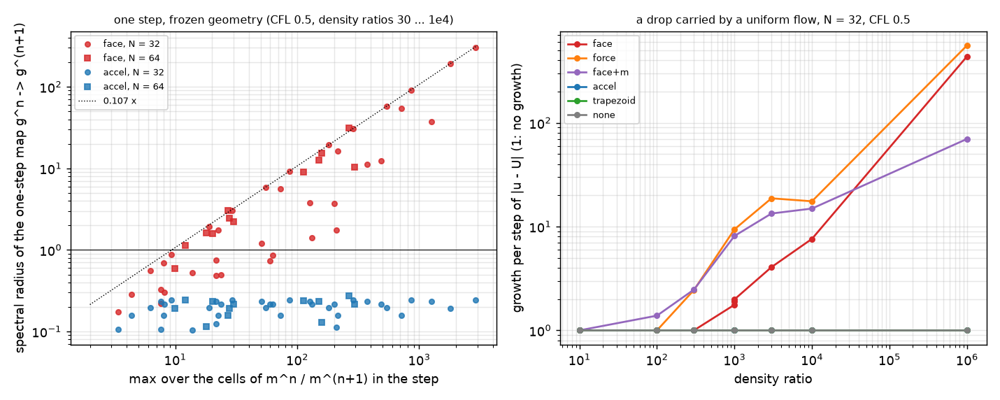

# 114 R0-P1：高密度比での面の値の源の項の帰還の不安定。機構は「出ていく質量が持ち去る半ステップの力積を、新しい（軽くなった）質量で割る」こと。局所の式は丸めの水準で一致し、1 ステップの増幅率はセルの質量比 mⁿ/mⁿ⁺¹ に比例する。同じ時間中心化を加速度の形で入れると安定だが運動量を保存しない。力積を引き戻さない形は安定で保存するが、圧力が 2Δt で振動する

新しい研究方針（ノート111）の R0-P1。Issue #141、B の指示 #145（P0「高密度比での圧力の源の項の帰還の不安定の原因の特定」）。ライブラリ（`basilisk_cupy/`）は変えていない（介入は全て試験の側のフック）。

**依存**：ゴーストセルの修正（PR #154、C の判定の前）の上のブランチである。機構は局所的で、ゴーストセルとは独立（監修の再現、#141）。ノート112・113（PR #143・#152）の「面の値の源の項」が対象。

```
python -m cases.r0p1_source_feedback                                    # 全ての表（docs/figures/r0p1_source_feedback.json、CPU 18 並列で約 3 分）
python -c "from cases.r0p1_source_feedback import plot; plot()"         # 図
pytest tests/test_r0p1_source_feedback.py                               # 6 件、約 10 秒（6 並列）
```

## 結論の要約
- **機構**：面の値の源の項は、面を通る質量に速度 `u + (Δt/2)ĝ` を持たせる。セルに残る運動量は、出ていった質量の分の半ステップの力積 `(Δt/2)m_out ĝ` だけ減るが、その後の速度は**新しい質量** m' で割って作る。重い相が抜けたセルでは `m_out/m'` が密度比の程度になり、速度の跳びが密度比に比例して大きくなる。この跳びを次の射影が圧力に変え、次のステップの g に戻る（陽的な帰還）。
- **局所の式は厳密に一致した**（1 回の掃過）。一様な g では `u⋆ − U = (Δt/2) g (1 − mⁿ/mⁿ⁺¹)`（差 4e-15〜7e-12、密度比 10〜1e5）。任意の（乱数の）g では `u⋆_i − U = (Δt/2)[m_in ĝ_in − m_out ĝ_out]/m'_i`（差 2e-16〜4e-13）。跳びの 99.8% 以上（密度比 1000）は、質量が半分以下に減ったセルにある。
- **1 ステップの増幅率（g → 次の g の線形写像のスペクトル半径、幾何を固定）は、そのステップの最大の質量比 `max mⁿ/mⁿ⁺¹` に比例する**：同じステップで密度比を 100 → 1e4 と変えると、半径 / 質量比は 0.104〜0.107 で一定（別のステップでは 0.076〜0.086）。半径が 1 を超えるのは質量比が約 10〜100 から。
- **監修の 3 つの観察（#141）を説明する**：(1) ゴーストセルと独立（機構がセルに局所的）。(2) 閾値が密度比 100 と 1000 の間（6 ステップの半径の幾何平均が、密度比 100 で 0.83、300 で 1.88）。(3) 格子に依存（N = 32 → 64 で幾何平均 4.9 → 10.6、実測の成長率 1.9 → 3.2）。CFL への依存も合う（CFL 0.25 で幾何平均 1.24・実測 1.22、0.125 で 0.26・安定）。ただし幾何平均は、CFL 0.5 では実測の成長率の 2.5〜5 倍で、定量の予測にはなっていない（3 節）。
- **源の項の平均の取り方の問題ではない**。同じ半ステップの加速度の入れ方を 5 通り比べた。

| 入れ方 | 密度比 1000 の成長率（1 ステップ） | 安定な範囲 | 総運動量（渦の中の液滴） | 単相の精度 |
| --- | --- | --- | --- | --- |
| 面の値の源の項（ライブラリ） | 1.9（N = 64 で 3.2） | 密度比 ≤ 300 | 保存（3e-13） | 2 次 |
| 同 + 一様な g の式の分をセルから戻す | 8.1 | ≤ 10 | 変化 1.0e-3 | 同じ |
| 力の形（輸送の前に `(Δt/2)ρⁿg` を足し、後で同じ力積を引く） | 9.4 | ≤ 100 | 保存（3e-13） | 2 次 |
| **加速度の形**（前に `(Δt/2)g` を足し、後で `(Δt/2)g` を引く） | **増幅なし**（密度比 1e6 まで） | 走査した全て（円い液滴。監修：気泡・小さい液滴・2 つの液滴・斜めの帯、2000 ステップ） | **変化 1.5e-3（格子を細かくしても減らない）** | 2 次 |
| 引き戻さない形（前に `(Δt/2)G` を足すだけ。射影が残りの半分を与える） | **増幅なし**（1e6 まで） | 同上 | **保存（2e-13）** | 2 次（最良） |

- 安定性の判定ができていない条件：**密度比 1e6 の薄い膜**（幅約 1.3 セル）。監修の測定では、源の項なしの形も含めて圧力の求解が収束せず（残差 1e-6）、どの形でも判定できない（密度比 1000〜1e4 の薄い膜は 3 つの形とも 1e-4 以下）。
- **安定な 2 つの形には、それぞれ欠点がある**。加速度の形は、必須の要件「圧力を含む総運動量の保存（1e-9）」を満たさない。引き戻さない形は保存するが、**圧力（g）が 2Δt の周期で振動する**（定常の Taylor–Green で、連続するステップの g の差が 56〜86%。格子を細かくすると増える）。速度の誤差には現れていない。
- **したがって、「面の値の源の項をそのまま二相に入れる」ことはできない**（確定）。「安定で、保存し、圧力も振動しない最小の修正」は、この範囲では見つかっていない。対策の選定（引き戻さない形の振動の制御、または保存型の中点法・RK2）は B の判断を求める。

## 定式化と理論的根拠
### A. 設定
- 周期の [0, 1]²、表面張力・粘性なし。液滴（半径 0.15、重い相 ρ₁ = 1、周りは ρ₂ = 1/密度比）を一様流 U = (1, 0.37) が運ぶ（ノート77 の P0-1）。厳密解は u = U、g = 0 のままで、どの方式でも丸め誤差だけが種になる。
- 現行の方式（`conserving.h` の移植 + `conserving_source`）の 1 ステップ：(i) 相ごとの運動量を VOF の質量の流束で運ぶ。面の値に `(Δt/2)ρ_k ĝ`（ĝ は面の両側のセルの gⁿ の平均）を足す。(ii) `u⋆ = (q₁ + q₂)/ρⁿ⁺¹`。(iii) 射影して `uⁿ⁺¹ = u⋆ + Δt gⁿ⁺¹`。

### B. 局所の式（導出。1 回の掃過について厳密）
セル i の質量を m（掃過の前）、m'（後）、入る質量を m_in、出る質量を m_out とする（`m' = m − m_out + m_in`）。運ぶ速度が一様な U のとき、濃度の勾配の項は 0 で、面の値は `U + (Δt/2)ĝ_f` である。

```
m' u⋆ = m U − m_out (U + (Δt/2) ĝ_out) + m_in (U + (Δt/2) ĝ_in)
u⋆ − U = (Δt/2) [m_in ĝ_in − m_out ĝ_out] / m'                         (F)
一様な g では：u⋆ − U = (Δt/2) g (m_in − m_out)/m' = (Δt/2) g (1 − m/m')   (K)
```

- **(F) の係数 `m_out/m'` は有界でない**。重い相が 1 回の掃過で抜けたセル（体積分率 c → 0）では `m/m' ≈ 1 + c(ρ₁/ρ₂ − 1)`。
- 解釈：出ていく質量は、半ステップの加速を受けた速度で出ていく。その分の力積は、セルには与えられていない（力積は射影の段で、新しい質量に対して `Δt ρⁿ⁺¹ gⁿ⁺¹` として与えられる）。密度が滑らかなら `1 − m/m' = O(Δt)` で、(K) は 2 次の整合な項 `−(Δt²/2)(u·∇ρ) g/ρ` になる。密度が跳ぶと O(1)〜O(密度比) になる。
- **同じ時間中心化の、別の入れ方**（C 節の介入）：
  - 加速度の形（輸送の前に `u ← u + (Δt/2)g`、後で `u ← u − (Δt/2)g`）：`m'u⋆ = (m − m_out)(U + (Δt/2)g_i) + m_in(U + (Δt/2)g_j) − m'(Δt/2)g_i`（上流の値で運ぶとして）から

    ```
    u⋆ − U ≈ (Δt/2) (m_in/m') (g_j − g_i)                                  (A)
    ```

    係数は `m_in/m' ≤ 1`。出ていく質量は式に現れない。一様な g では 0。
  - 力の形（前に `M ← M + (Δt/2)ρⁿg`、後で `M ← M − (Δt/2)ρⁿg`）：一様な g では (K) と同じ式になる（引く力積を古い質量で作るため）。
  - 一様な g の分 (K) をセルから戻す形：`(Δt/2)[m_in(ĝ_in − g_i) − m_out(ĝ_out − g_i)]/m'` が残り、`m_out/m'` の係数は消えない。
- **保存との関係**：足す力積と引く力積の総和が等しければ、総運動量は変わらない。面の値の源の項と力の形はそうなっている（流束の形、または同じ `ρⁿg`）。加速度の形は、足すのが `ρⁿg`、引くのが `ρⁿ⁺¹g` で、1 ステップに `(Δt/2)Σ g(ρⁿ − ρⁿ⁺¹)` だけ総運動量を変える。**保存する引き方は、軽くなったセルに重い相の大きさの力積を掛けることになり、不安定の原因そのものである**（仮定つきの主張：線形で局所的な引き方に限る）。
  - 引き戻さない形：`u ← u + (Δt/2)Gⁿ` を足して運び、何も引かない。射影は残りの半分だけを与える（`Δt g̃ = (Δt/2)Gⁿ⁺¹`、つまり `Gⁿ⁺¹ = 2g̃`）。圧力の力積は `(Δt/2)(Gⁿ + Gⁿ⁺¹)` の台形則になる。足す力積は `ρⁿGⁿ`（総和は 0：面の密度が算術平均のとき、ノート111 の 4 節）で、保存する。ただし `Gⁿ⁺¹ = 2g − Gⁿ` の形の、減衰しない 2Δt の振動を持つ（圧力の Crank–Nicolson の既知の性質）。

### C. 測定（結果の前に固定したもの、後から足したもの）
- **先に固定した**：(K) の照合（1 回の掃過）、成長率の測り方（max|u − U| が 1e-9 から 1e-3 になるまでの 1 ステップあたりの倍率。200 ステップで 1e-3 に達しなければ「安定」）、密度比 10〜1e6、4 つの介入（面・面 + 戻す・力・加速度）。
- **結果を見てから足した**：(F) の乱数の g での照合、1 ステップの写像のスペクトル半径（B の指示「まず 1 ステップの増幅率を小さい格子で」、PR #152 のコメント）、引き戻さない形、渦の中の液滴の運動量の収支、圧力の振動の測定。
- **事前の予想が外れたもの**（そのまま記録する）：(i) 源の項を上流のセルの値にする、質量加重の平均にする、の 2 つは安定化しなかった（2 節の表。上流の値は悪化、質量加重は密度比 1000 で同程度、密度比 300 では現行が安定な所で不安定になる）。(ii) 「一様な g の式 (K) の分を戻せば安定になる」と予想したが、かえって悪化した（8.1）。(F) の `m_out/m'` が残るためで、B 節の式はこの結果の後に書き直した。
- 1 ステップの写像：厳密な状態（u = U、g = 0）の周りでは、そのステップの幾何（f、運ぶ面の速度）は g によらないので、g → 次の g は線形である。同じステップを保存した状態から繰り返すべき乗法（60 回）で、スペクトル半径を求めた。ステップ 4、8、12、16、20、24 の 6 つ。

## 1. 局所の式の照合（N = 32、CFL 0.5、1 ステップ）
### 一様な g（式 (K)）
| 密度比 | 流れ | max mⁿ/mⁿ⁺¹ | max\|u⋆ − U\| | (K) との差 | 質量が半分以下になったセルにある割合（二乗和） |
| --- | --- | --- | --- | --- | --- |
| 10 | (1, 0)・(0, 1) | 3.63 | 1.44e-2 | 2e-16・8e-16 | 85% |
| 1000 | (1, 0)・(0, 1) | 126 | 0.686 | 4e-15・7e-14 | 99.96% |
| 1e5 | (1, 0)・(0, 1) | 12600 | 68.7 | 4e-13・7e-12 | 100% |
| 1000 | (1, 0.37)（2 回の掃過） | 126 | 0.686 | 0.656 | 99.8% |

- 1 回の掃過では丸めの水準で一致する。半ステップの速度の変化 `(Δt/2)|g|` = 5.5e-3 に対し、跳びは密度比 1000 で 0.686（125 倍）。
- 2 回の掃過では (K) そのままは成り立たない（2 回目の掃過は、1 回目で変わった相ごとの濃度を運ぶ）。最大のセルでは一致するが、別のセルで 0.656 の差が出る。跳びの大きさと場所は変わらない。

### 乱数の g（\|g\| ≤ 1、流れ (1, 0)、式 (F) と (A)）
| 密度比 | 面の値の源の項：max\|u⋆ − U\| / (Δt/2) | (F) との差 | max m_out/m' | 加速度の形：max / (Δt/2) | max m_in/m' |
| --- | --- | --- | --- | --- | --- |
| 1 | 0.48 | 2e-16 | 0.5 | 0.99 | 0.5 |
| 10 | 0.99 | 5e-16 | 2.9 | 1.6 | 0.85 |
| 1000 | 112 | 4e-15 | 126 | 2.8 | 0.998 |
| 1e5 | 11200 | 4e-13 | 12600 | 2.8 | 1.0 |

- (F) は丸めの水準で一致。跳びは密度比に比例する。
- 加速度の形は、密度比によらず半ステップの 2.8 倍以下。(A) は上流の値だけの近似で、勾配の項があるので一致はしない（差は跳びと同じ大きさ）。確かめたのは、**有界で密度比によらない**ことである。

## 2. 成長率（一様流の中の液滴、N = 32、CFL 0.5、U = (1, 0.37)、200 ステップ）
| 密度比 | 面の値の源の項 | + (K) を戻す | 力の形 | 加速度の形 | 引き戻さない形 | 源の項なし |
| --- | --- | --- | --- | --- | --- | --- |
| 10 | 安定 | 安定 | 安定 | 安定 | 安定 | 安定 |
| 100 | 安定 | **1.39** | 安定（max 1.6e-5 まで育つ） | 安定 | 安定 | 安定 |
| 300 | 安定（max 4.6e-4 まで育つ） | 2.47 | 2.45 | 安定 | 安定 | 安定 |
| 1000 | **1.90** | 8.13 | 9.42 | 安定（1e-11） | 安定（7e-10） | 安定（4e-12） |
| 3000 | 4.07 | 13.4 | 18.7 | 安定 | 安定 | 安定 |
| 1e4 | 7.62 | 14.9 | 17.5 | 安定 | 安定 | 安定 |
| 1e6 | 437 | 70 | 558 | 安定（4e-9） | 安定（7e-9） | 安定（6e-9） |

- 面の値の源の項：N = 64 で 3.17（密度比 1000）、290（1e6）。CFL 0.25 で 1.22（1000）、2.54（1e4）。CFL 0.125 で安定（1000、max 1.5e-8）、1.23（1e4）。流れの向きを (1, 0)、(0.3, 1) に変えても 1.77、1.99。
- 「安定」は、200 ステップで max\|u − U\| が 1e-3 に達しなかった、という意味である。密度比 300 の面の値の源の項（4.6e-4）と、密度比 100 の力の形（1.6e-5）は、丸めより大きく育っており、長い時間では不安定の可能性がある。
- 成長している間、最大の誤差のあるセルは、そのステップで質量が半分以下に減ったセルである（面の値の源の項・密度比 1000 以上・CFL 0.5 で 96〜100% のステップ。CFL 0.25 では 47〜71%）。
- 加速度の形・引き戻さない形は、N = 64・密度比 1e6 でも丸めの水準（1.5e-8）。

### 源の項の平均の取り方を変えた形（不成立の記録。監修の PR #155 の軽微 1。`face_average` で `vof._sweep` の源の項の 1 行だけを差し替え）
| 密度比・N | 現行（2 セルの算術平均） | 上流のセルの g | 密度で重み付けた平均 `(ρ_L g_L + ρ_R g_R)/(ρ_L + ρ_R)` |
| --- | --- | --- | --- |
| 300・32 | 安定（4.6e-4 まで育つ） | **1.69** | **1.50** |
| 1000・32 | 1.90 | 5.76 | 1.87 |
| 1e4・32 | 7.62 | 13.3 | 6.41 |
| 1000・64 | 3.17 | 8.51 | 2.45 |

- どちらも安定化しない。上流の値は全ての条件で悪化する。密度で重み付けた平均は、密度比 1000 以上では現行と同程度か少し小さい（N = 64 で 2.45 と 3.17）が、密度比 300 では現行が安定な所で不安定になる。監修の独立の測定（5.76、1.89、13.3、6.39、N = 64 の質量加重 2.47）と一致する。B 節の式 (F) のとおり、係数 `m_out/m'` は ĝ の作り方では消えない。

## 3. 1 ステップの増幅率と質量比（面の値の源の項、CFL 0.5。括弧は（スペクトル半径、max mⁿ/mⁿ⁺¹））
| 密度比・N | ステップ 4 | 8 | 12 | 16 | 20 | 24 | 幾何平均 | 実測の成長率（2 節） |
| --- | --- | --- | --- | --- | --- | --- | --- | --- |
| 30・32 | (0.18, 3) | (0.29, 4) | (0.56, 6) | (0.30, 8) | (0.22, 8) | (0.87, 9) | 0.34 | — |
| 100・32 | (0.33, 8) | (0.69, 8) | (1.93, 19) | (0.50, 24) | (0.49, 22) | (3.03, 29) | 0.83 | 安定 |
| 300・32 | (0.53, 14) | (1.76, 22) | (5.79, 55) | (0.74, 60) | (1.21, 51) | (9.13, 87) | 1.88 | 安定（育つ） |
| 1000・32 | (0.75, 22) | (5.57, 73) | (19.3, 181) | (1.42, 132) | (3.80, 126) | (30.5, 288) | 4.86 | 1.90 |
| 3000・32 | (0.86, 63) | (16.4, 216) | (57.9, 541) | (3.71, 202) | (11.2, 376) | (91.4, 864) | 12.1 | 4.07 |
| 1e4・32 | (1.77, 209) | (54.4, 717) | (193, 1803) | (12.4, 488) | (37.2, 1253) | (305, 2877) | 37.1 | 7.62 |
| 100・64 | (1.63, 18) | (3.07, 27) | (0.59, 10) | (2.24, 30) | (1.58, 20) | (1.13, 12) | 1.51 | — |
| 1000・64 | (15.5, 159) | (31.2, 264) | (2.43, 28) | (10.5, 296) | (12.6, 150) | (9.05, 112) | 10.6 | 3.17 |
| 1000・32・CFL 0.25 | (0.31, 12) | (8.87, 110) | (0.50, 23) | (2.78, 27) | (0.27, 5) | (3.36, 42) | 1.24 | 1.22 |
| 1000・32・CFL 0.125 | (0.05, 2) | (0.25, 4) | (0.67, 8) | (0.35, 12) | (0.27, 18) | (0.35, 9) | 0.26 | 安定 |

- **同じステップ（同じ幾何）では、半径は質量比に比例する**：ステップ 12 で 5.79 / 19.3 / 57.9 / 193（密度比 300 → 1e4）に対し質量比 55 / 181 / 541 / 1803、比は 0.105 / 0.107 / 0.107 / 0.107。ステップ 24 は 0.104〜0.106、ステップ 8 は 0.076〜0.086。係数（幾何で決まる）は 0.01〜0.11 の範囲にある（図の左）。
- **加速度の形は、同じ 6 ステップ・同じ密度比で 0.10〜0.27**（密度比 30〜1e4、N = 32・64。質量比によらない）。
- 幾何を固定した半径の幾何平均は、成長の有無の境（密度比 100 と 300 の間、CFL 0.125 と 0.25 の間）と、N・CFL・密度比への依存の向きを再現する。大きさは、CFL 0.5 では実測の 2.5〜5 倍である（実際の計算では、質量が抜けるセルがステップごとに移るので、同じ固有ベクトルが続けて増幅されない）。6 ステップだけの標本で、成長率の予測の式にはなっていない。



## 4. 単相の精度と、二相の収支
### 単相（定常の Taylor–Green、CFL 0.5、t = 0.5、max\|u − u₀\|、N = 32 / 64 / 128）
| 入れ方 | 誤差 | 連続するステップの g の差（最後、相対、N = 32 / 64 / 128） |
| --- | --- | --- |
| なし | 6.34e-2 / 3.38e-2 / 1.82e-2（1 次） | 5.3% / 3.2% / 1.7% |
| 面の値の源の項（+ 戻す形も同じ） | 8.40e-3 / 1.22e-3 / 1.77e-4 | 5.3% / 3.2% / 1.7% |
| 力の形・加速度の形（単相では同じ） | 7.15e-3 / 9.93e-4 / 1.36e-4 | 5.1% / 3.2% / 1.7% |
| 引き戻さない形 | 4.59e-3 / 7.68e-4 / 1.49e-4 | **56% / 74% / 86%** |

- 4 つの入れ方は、単相では同じ 2 次の精度を与える（時間中心化として同等）。
- **引き戻さない形は、g が 1 ステップごとに大きく振れる**（定常の流れで、連続するステップの g の差が 56〜86%。細かい格子ほど大きい）。速度の誤差は最小だが、圧力をそのまま使う処理（粘性の段の `correction`、表面張力との釣り合い、出力）には使えない。振動を除く方法（2 ステップの平均、初期値の作り方）は試していない。

### 渦の中の液滴（密度比 1000、Taylor–Green + 一様流 (0.5, 0.2)、t = 0.25、N = 32 / 64。厳密解なし）
| 入れ方 | max\|u\|（初期 2.25 / 2.45） | 総運動量の相対変化 | 運動エネルギー（初期 0.04368 / 0.04376） |
| --- | --- | --- | --- |
| なし | 2.25 / 2.45 | 7e-13 / 2e-14 | 0.04346 / 0.04371 |
| 面の値の源の項 | 2.26 / **45.9** | 2e-13 / 4e-13 | 0.04348 / 0.04448 |
| + (K) を戻す | 13.9 / 36.3 | 1.0e-3 / 9.6e-4 | 0.04337 / 0.04383 |
| 力の形 | 114 / 36.6 | 3e-13 / 1e-12 | 0.08923 / 0.04468 |
| **加速度の形** | 2.28 / 2.48 | **1.5e-3 / 1.6e-3** | 0.04332 / 0.04356 |
| **引き戻さない形** | 2.26 / 2.50 | 2e-13 / 4e-14 | 0.04348 / 0.04373 |

- 既定の方式（源の項なし）と面の値の源の項は、圧力を含めて総運動量を丸めまで保存する（周期、面の密度が体積分率の平均からの算術平均であるため。ノート111 の 4 節の条件）。
- **加速度の形は、総運動量を 1.5e-3 変える。N = 32 → 64 で減らない**（2 点だけ）。必須の要件（1e-9）を満たさない。
- 面の値の源の項は、N = 32 では t = 0.25 まで発散が見えないが、N = 64 で max\|u\| が 46 になる。

## まとめ
- **原因の特定（B の P0 の終わりの条件）**：機構は式 (F)・(K) で、1 回の掃過について丸めの水準で確かめた。増幅率は、1 ステップの写像の半径が質量比 `mⁿ/mⁿ⁺¹` に比例することで照合した（係数は幾何で決まり、0.01〜0.11）。監修の 3 つの観察と整合する。**成長率そのものを与える式は無い**（幾何平均は過大）。
- **源の項の平均の取り方・上流化・質量加重では直らない**。問題は、半ステップの力積を「どの質量から引くか」である。
- **安定な入れ方は 2 つ見つかったが、どちらも条件つき**である：加速度の形（運動量を保存しない）、引き戻さない形（保存するが圧力が振動する）。

## 自己点検（試験が成立しやすい条件に寄っていないか）
- **流れが 1 種類**：成長率は、一様流の中の円い液滴（半径 0.15）だけ。流れの向きは 3 通り。界面の形（薄い膜、斜めの直線）、液滴の大きさ、重い相が周りにある場合（気泡）は見ていない。安定の判定は 200 ステップまで。
- **格子は N = 32・64 だけ**。収束の規約の読みではない（次数ではなく安定性の判定のため）。細かい格子ほど不安定が強い、という向きだけを見た。
- **1 ステップの半径は 6 ステップの標本**で、べき乗法 60 回の最後の 20 回の平均。固有値が複素・縮退のときの収束は確かめていない。
- **二相の精度は測っていない**。加速度の形・引き戻さない形が、二相で時間 2 次を与えるかは未検証（厳密解のある二相の問題が要る。R0 の斜めの二層せん断流 + boost が候補）。
- 渦の中の液滴は厳密解が無く、安定性と収支だけを見た。運動量の非保存が「格子を細かくしても減らない」は 2 点である。
- 粘性・表面張力・外力・壁は無い。引き戻さない形は、粘性の段が g を使う（`correction`）ので、粘性ありではそのまま使えない。

## 検証済みと未検証
| 主張 | 状態 |
| --- | --- |
| 式 (K)・(F)（1 回の掃過） | 導出 + 数値で丸めの水準まで確認 |
| 跳びが質量の抜けたセルに局在 | 数値で確認 |
| 1 ステップの半径が質量比に比例 | 数値で確認（6 ステップ、密度比 30〜1e4、N = 32・64） |
| 成長の閾値と N・CFL・密度比への依存の向き | 数値で確認（幾何平均との照合。大きさは合わない） |
| 加速度の形・引き戻さない形の安定 | 走査した範囲（一様流の液滴、密度比 ≤ 1e6、N ≤ 64、200 ステップ。渦の中の液滴 t = 0.25）で確認。証明なし |
| 加速度の形が運動量を保存しないこと | 導出 + 数値で確認 |
| 「保存する局所的な引き方は不安定」 | 仮定つきの主張（力の形・面の形・戻す形の 3 つで確認。一般の証明なし） |
| 引き戻さない形の圧力の振動 | 数値で確認（単相・定常）。二相・粘性ありは未検証 |
| 二相での時間の次数、粘性・表面張力・壁 | 未検証 |

## B に求める判断
`conserving_source`（面の値の源の項）を二相に入れない、は確定とする。次のどれに進むか。
1. **引き戻さない形の振動を抑える最小の修正を探す**（例：初期値を射影で作る、g を 2 ステップの平均で読む）。成り立てば、安定・保存・2 次・最小の変更の全てを満たす。ただし射影の意味（圧力の時間のレベル）が変わるので、粘性の段・表面張力との整合を確かめ直す必要がある。
2. **加速度の形を採り、運動量の非保存を受け入れる**。必須の要件の変更にあたる（ユーザーの判断）。A は勧めない。
3. **ノート111 の 3 節 6 の保存型の中点法・RK2 に進む**（「安定な最小の修正が無い場合」の分岐）。
4. 二相では時間中心化を諦め、単相の領域だけに入れる（界面の近くで切り替える）。界面の近くは時間 1 次のままになる。

A の考え：1 を小さく試し（1〜2 個の測定）、だめなら 3。どれも、二相での時間の次数を測る厳密解つきの試験（斜めの二層せん断流 + boost）が先に要る。
