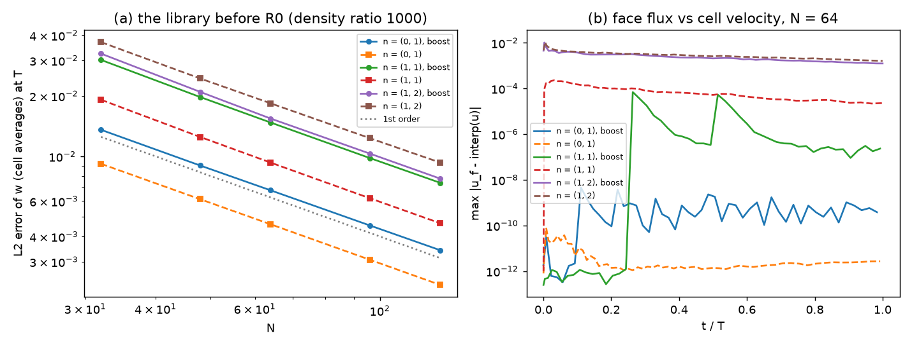

# 121 A-7（#167）：R0 の必須の試験「斜めの二層せん断流 + Galilean boost」を整備した。A 側の参照解（閉じた形の固有モード、セル平均は 2 回の原始関数で厳密）は監修 C-3 の独立の参照解と 5e-11 以下で一致。現行のライブラリ（R0 の修正の導入前）の値：全ての配置で速度の誤差は 1 次（L2 の傾き 0.99〜1.03）、保存は丸め。斜めの配置では、本来動かない界面の f の誤差とセルと面の速度の差がゆっくりしか減らない

B の指示 A-7（#145、#167）。**合否の判定には使わない導入前の値**。ライブラリは変えていない。

```
C3_REFERENCE=<audit/c3/oblique_shear_reference.py> python -m cases.r0_shear   # docs/figures/r0_shear.json（16 並列で約 15 分）
python -c "from cases.r0_shear import plot; plot()"
pytest tests/test_r0_shear.py -n 3                                             # 5 件、約 20 秒
```

## 結論の要約
- **参照解**：A 側は独立に、層ごとの三角関数と伝達行列で固有モードを閉じた形で作った（速度の減衰率は `cases.viscous_stress.stokes_rate`、Sturm の個数の検算つき）。セル平均は、`G1' = w`・`G2' = G1` の閉じた形の 2 階差分（斜めの n では `/(ab h²)`、平行では 1 階差分）で厳密。監修 C-3（Legendre のスペクトル要素、numpy だけ）と比べて、**固有値の相対差 4e-11 以下、モードの形 4e-11 以下、セル平均 4e-11 以下、体積分率 5e-13 以下**（n = (0, 1)・(1, 1)・(1, 2)）。モードの正規化は両者で違う（C-3 は節点の上の max|φ| = 1、反対称のモードの符号の取り方も違う）ので、モードごとに最小二乗の倍率を合わせて比べた。
- **初期化の注意（確認した）**：ライブラリの `start` は、最初の面の速度をセル平均の補間で作り、射影しない。n = (1, 2) では発散が 1.8e-2 になり、**最初の VOF の 1 ステップで相の質量が 1e-4〜8e-6 変わる**（N = 32〜128）。n = (1, 1) と格子に平行では、補間がたまたま発散 0。試験では、流れ関数から作る厳密な面の平均（発散 2e-16）を最初の面の速度に与えた（`exact_uf=True`、既定）。速度の誤差はほぼ変わらない（1% 以内）。
- **現行のライブラリの値**（密度比 1000、粘度比 55、CFL 0.5、t = T、N = 32〜128）：

| n | boost | L2（N = 32 → 128） | 傾き | 帯 / 内部の L2（N = 128） | f の L1（N = 128） | 相の質量 / 総運動量 | 面とセルの速度の差（N = 128） |
| --- | --- | --- | --- | --- | --- | --- | --- |
| (0, 1) | あり | 1.36e-2 → 3.42e-3 | 0.99 | 3.8e-3 / 3.4e-3 | 3e-10 | 6e-14 / 3e-14 | 5e-10 |
| (0, 1) | なし | 9.19e-3 → 2.30e-3 | 1.00 | 3.8e-3 / 2.2e-3 | 1e-12 | 7e-14 / 7e-14 | 8e-12 |
| (1, 1) | あり | 3.01e-2 → 7.39e-3 | 1.01 | 1.0e-2 / 7.0e-3 | 2.2e-7 | 2e-12 / 1e-12 | 7e-8 |
| (1, 1) | なし | 1.91e-2 → 4.66e-3 | 1.02 | 7.0e-3 / 4.3e-3 | **8.0e-6** | 6e-14 / 1e-14 | **4e-6** |
| (1, 2) | あり | 3.24e-2 → 7.75e-3 | 1.03 | 1.1e-2 / 6.8e-3 | **1.1e-5** | 3e-12 / 2e-12 | **7e-4** |
| (1, 2) | なし | 3.69e-2 → 9.31e-3 | 0.99 | 1.3e-2 / 8.1e-3 | **1.1e-5** | 3e-13 / 4e-14 | **8e-4** |

- **速度の誤差は全て 1 次**。粘性の後退 Euler（ノート113 の E3）と保存形の輸送の時間 1 次（E1・E2）で、固定の CFL では O(Δt) = O(h) が支配すると見ている（E1〜E3 を入れた構成は A-3 で測る）。界面の帯の誤差は内部の 1.1〜1.8 倍。
- **斜めの界面では、本来動かない界面が動く**：boost なしの n = (1, 1)・(1, 2) は流れが界面に平行で、界面は厳密には静止しているが、f の L1 が 8e-6〜1.1e-5（N = 128）残り、n = (1, 2) では N = 96 → 128 で減らない。セルの速度と面の流束の差も n = (1, 2) で 7e-4〜8e-4 と大きく、細分化でゆっくりしか減らない（N = 32 → 128 で 2e-3 → 7e-4）。方向分割の VOF と、接線の速度の跳び（粘度比 55 の界面）の組み合わせと見ている（**未確認**）。R0-P2 で保留した「セルの速度と面の流束の差」の判定材料になる（図 (b)：差は時間とともに減り、累積はしていない）。
- 面に揃った界面 + boost（n = (0, 1)、boost あり）は、この粘性ありの配置では育たなかった（#162 の非粘性の自由流と違い、粘性が乱れを減衰させる）。A-3 の条件 6（D2 の限定の適用が実際に切る流れでの精度）に使う。



## 定式化と理論的根拠
### A. 問題（ノート111 の 6 節、C-3 と同じ規約）
`z = a(x − U_x t) + b(y − U_y t)`、`t̂ = (−b, a)/|n|`、`u = U + t̂ w(z, t)`、圧力は一定。`ρ w_t = |n|²(μ w_z)_z`、界面で w と μ w_z が連続。相 1（ρ = 1、μ = 1e-2）は `α ≤ z < β`（α = 1/4、β = 3/4）、相 2（ρ = 1e-3、μ = 1e-2/55）。`t̂·n = 0` なので `(u·∇)u = U·∇u`（並進だけ）で、圧力の勾配は 0。

### B. 固有モード（閉じた形。導出）
層の中で `w = e^{−λt}W(z)`、`W'' = −k²W`、`k² = λρ/(|n|²μ)`。状態 `(W, m W')`（m = |n|²μ）は長さ L の層を `[[cos kL, sin kL/(mk)], [−mk sin kL, cos kL]]` で渡る。周期性は `(Φ_L Φ_H − I)v = 0`（`tr = 2`、det = 1）。λ は `tr Φ_L Φ_H = 2` の根（`stokes_rate`）、v はその零ベクトル。`max|W| = 1`（細かい標本の上）で正規化。初期値は C-3 の推奨どおり 2 つのモードの重ね合わせ（振幅 1 と 0.3）。

### C. 厳密なセル平均（導出）
`g(z)` の原始関数 `G1`、その原始関数 `G2` を 1 周期の上で閉じた形で作り、周期の外へは `G1(k + s) = kI + G1(s)`、`G2(k + s) = I k(k − 1)/2 + kJ + kIs + G2(s)`（I、J は 1 周期の積分）で延ばす。セル `[x₀, x₀ + h] × [y₀, y₀ + h]` での平均は
`[G2(z₀ + ah + bh) − G2(z₀ + ah) − G2(z₀ + bh) + G2(z₀)]/(ab h²)`（a, b ≠ 0）、`[G1(z₀ + ch) − G1(z₀)]/(ch)`（一方が 0）。体積分率は g を指示関数にして同じ式。面の速度の平均は、流れ関数 `ψ = U_x y − U_y x − G1(z)/|n|` の頂点の差（発散は丸めで 0）。

### D. 測る量（B の #167 の指定）
接線の速度の誤差（セル平均、L1・L2・L∞、全体・界面の帯〔界面までの法線の距離が 2.5 セル以内〕・純相の内部）、f の L1、相の質量、総運動量（clamp した密度。boost なしでは総運動量がほぼ 0 なので、全質量 × 最大の速さで正規化）、`h|∇·u_f|`、`max|u_f − interp(u)|` の時間の推移。時刻は T/4・T/2・T（T：boost で界面が 1 周期動く時間、boost なしでは 1/λ₁）。

## 自己点検
- 参照解の照合は C-3 の独立の実装と（3 つの n、モードの形・セル平均・体積分率）。A 側の参照解は A のコードだけで作った（C-3 のコードは照合にだけ使う）。
- 導入前の値は合否に使わない（#167）。初期の面の速度を厳密に与えたのは試験の側の選択で、ライブラリの `start` の値も記録した（n = (1, 2) だけ。他の n では両者は一致する見込み：補間が発散 0）。
- 傾きは 5 格子（規約の 10 格子には足りない：導入前の値の記録のため）。

## 検証済みと未検証
- 確認した：参照解（C-3 と一致）、ライブラリの `start` の未射影の面の速度による質量の変化、全配置の 1 次の誤差、保存。
- 未検証：斜めの界面が動く原因（方向分割と接線の跳び）、セルと面の速度の差の原因、boost ありで界面が格子を 1 周期より長く横切る場合、密度比 1e6。

## B に求める判断
1. ライブラリの `start` の未射影の面の速度（最初の VOF で質量が 1e-4 まで変わる）を、R0 の基準ソルバーの構成で直すか（例：`start` で射影する、または初期の面の速度を与える入口を作る）、試験の側の初期化の規約として記録するか。A の提案：基準ソルバーの構成の表（A-3 の段 2）に「初期の面の速度は発散 0 で与える」を入れ、ライブラリの変更は A-3 の段 3 の PR で小さく行う。
2. 斜めの界面が動く件（f の L1 1e-5 が減らない）は、A-4 の判定の前に原因を調べるか。
