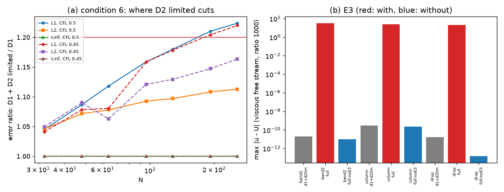

# 122 A-3 段 1（#166）と A-8（#173）：R0-P の修正を全て同時に入れた構成の検証。E3（Crank–Nicolson、ノート113）は二相で成り立たない（粘性ありの自由流が発散、総運動量が 0.3〜0.6 変わる）。E1（運ぶ面の速度の外挿）は毛管波の減衰率を悪化させる（条件 9 は不成立、訂正）。E3 を外した構成は条件 2〜5・8 を満たすが、条件 6（D2 の限定の適用が実際に切る流れの精度）は L1 で N ≥ 192 から 1.2 倍を超える（1.21〜1.22）。局所の収支の検証器（流束の配列だけを入力）は、現行のライブラリと統合した構成で L1〜L5 が丸め。#156 と D1 は検出でき、D2 は流束の不整合ではないので検出できない

B の指示 A-3 段 1（#166、**A-1 の C の判定の前なので暫定**）と A-8（#173）。ライブラリは変えていない（全てフック）。**依存**：PR #164（ノート119、D1 + D2 限定のフック）と PR #176（ノート121、二層せん断流）の上のブランチ。

```
python -m cases.r0_combined                                  # 条件 1〜6 の本体（docs/figures/r0_combined.json、14 並列で約 25 分。壁のある静水圧が長い）
python -c "from cases.r0_combined import c6; c6()"           # 条件 6 の追加（docs/figures/r0_combined_c6.json、約 5 分）
python -m cases.r0_combined_tension                          # 条件 9（docs/figures/r0_combined_tension.json、12 並列で約 10 分）
python -m cases.r0_local_budget                              # 条件 8 / A-8（docs/figures/r0_local_budget.json、約 1 分）
python -c "from cases.r0_combined import plot; plot()"
pytest tests/test_r0_combined.py tests/test_r0_local_budget.py -n 4      # 7 件、約 30 秒
```

## 結論の要約
| # | 条件（#166、結果の前に固定） | 全て（E1〜E3 + 帯 + D1 + D2 限定） | **E3 を外した構成** |
| --- | --- | --- | --- |
| 1 | 単相の時間精度 `O(h² + hΔt + Δt²)` | **ノート113 の修正済みの構成とビット一致**（tg・asym・mix × N = 32・64・96）→ ノート113 の合格を引き継ぐ | E3 が無いので、粘性ありの単相は時間 1 次（係数 O(1)、ノート113）：**不成立** |
| 2 | 自由流・安定（密度比 1e3、1e6 は記録） | 非粘性 30 条件は 1e-9 の水準。**粘性ありの 3 条件は 22〜32 に発散**（実効の CFL 0.62〜0.90） | **全て合格**（粘性あり 1.5e-13〜2.4e-10、非粘性は左と同じ） |
| 3 | 総運動量と相の質量 1e-9（渦、密度比 1000） | 非粘性は合格（8e-13）。**粘性ありは 0.28 / 0.55**（N = 32 / 64） | **合格**（4.7e-13 / 6.1e-13） |
| 4 | 静水圧（ノート115 の 21 配置 × smooth・mean、ノート120 の 3 配置を除く） | **42 / 42 合格**（2.5e-10 以下） | （非粘性なので同じ） |
| 5 | はみ出し・`ρ_lin` の下限 | はみ出しは元の方式と同じ水準（3e-7 以下）。**粘性ありの渦 N = 64 で下限に 8 回達した** | はみ出し同じ水準、**下限に達しない** |
| 6 | D2 の限定の適用が実際に切る流れの精度（元の方式〔D1 だけ〕の 1.2 倍以内） | 粘性ありのせん断流で **N ≥ 64 は発散** | 粘性ありのせん断流は切らない（0.99〜1.005 倍）。**切る流れ（非粘性の格子に平行なせん断流）では L1 の比が 1.045 → 1.224（N = 32 → 256）、N ≥ 192 で 1.2 を超える**。L2 は 1.16 以下、L∞ は 1.000 |
| 7 | 監修の C-5 の配置 | 一覧がまだ無い | 同左 |
| 8 | 局所の収支（A-8 の L1〜L5） | 全ての配置で丸め（1e-16） | 同左 |
| 9 | 表面張力・密度比 1000（発散しない、寄生流・振動数・減衰率が悪化しない） | 発散しない。寄生流は元の方式以下、周期は同じ。**減衰率が悪化：不成立**（訂正、下）。厳密な線形の参照 0.7147 に対して、元の方式 +3.4% / +2.0%、修正後 +20.6% / +8.2%（N = 32 / 64）。**原因は E1** | 同左（+20.3% / +7.7%） |

- **不成立の原因は 3 つで、それぞれ特定した**：(i) E3（二相の陽的な粘性の半分。条件 1・2・3・5・6）、(ii) D2 の限定の適用の精度の代償（条件 6 の L1、細かい格子）、(iii) E1（運ぶ面の速度の外挿。条件 9 の毛管波の減衰率。訂正で追加、監修の指摘）。E1 は時間刻みの跳びでも誤差を跳ばす（監修 C-5）。
- **訂正（監修の PR #177 の指摘 1・2）**：初版は条件 9 の減衰率を「参照が無いので判定できない」とし、線形の見積り `2k²Σμ/Σρ ≈ 0.80` と比べて「N = 64 では修正後の方が近い」と書いたが、誤り。監修が作った**厳密な線形の参照**（`audit/pr177/capwave_exact.py`：同じ配置の二層・有限の深さ・滑りの壁の線形化 Navier–Stokes を Laplace 変換で解く。capwave.c の物性で Prosperetti の表と 2e-5 で一致。この PR では `docs/figures/capwave_exact_audit.json` に写して物差しに使う）は、同じ読み方で周期 0.40257、減衰率 0.7147。線形の見積りは 12% 高かった。**修正後は減衰率の誤差が約 4〜6 倍に悪化し（+3.4% → +20.6%、+2.0% → +8.2%）、条件 9 は不成立**。原因は E2 ではなく **E1**（A も再現：4 節）。



(a) 条件 6：D2 の限定の適用が切る流れでの誤差の比（D1 だけとの比）。(b) 粘性ありの一様流：E3 あり（赤）は発散、E3 なし（青）は 1e-10 の水準。

## 定式化と理論的根拠
### A. 構成とフック
`cases/r0_combined.combined()` が `TwoPhase.__init__` を包み、作られた全ての保存形の TwoPhase に E1（運ぶ面の速度の外挿）・E2（面の値の源の項に粘性の加速度を足す）・E3（Crank–Nicolson）・帯（界面とその周り w = 1 セルで源の項を 0。壁では回り込まない）を付ける。D1・D2 は `scheme(True, "limited")`。これにより、ノート113〜120 の既存の試験の関数を**そのまま**統合した構成で実行した（試験の側の差し替えを避けるため）。

### B. E3 が二相で崩れる理由（診断。2 つ目は仮定つき）
1. **保存**：ノート113 の E3 は、陽的な半分を加速度 `(1/ρⁿ)L_h uⁿ` として移流の**後**の速度に足す。運動量の変化は `Σρⁿ⁺¹(Δt/2)(1/ρⁿ)L_h uⁿ` で、`Σ L_h u = 0`（流束の形）でも `ρⁿ⁺¹ ≠ ρⁿ` のセル（界面が動いたセル）で 0 にならない。ノート114 の「加速度の形」と同じ型。**運動量として足して新しい密度で割ると保存は戻る**（4.6e-13、`e3_form="momentum"`、試験あり）。
2. **自由流の発散**：運動量の形でも残る（7.0）。θ 法の θ = 0.6 でも 1.1、θ = 1（後退 Euler）でだけ消える。陽的な粘性の項が、移流の前後で質量が密度比倍変わる界面のセルに掛かる（ノート114 の機構と同じ型）と見ている。加えて、軽い相の粘性の硬さ（ν₂Δt/h² ≈ 2.7、CN は高周波を減衰させない）が重なる。**未確認**。

### C. D2 の限定の適用が切る条件（導出）
ノート119 の利得 Γ が 1 を超えるのは、上流のセルで相の大部分が 1 回の掃過で出ていくとき（`out ≈ c`）で、`vof.h` の勾配は c ≥ CMIN = 1/2 のセルにしか無いので、**その方向の CFL 数 C が 1/2 に近いときだけ**起きる。粘性ありのせん断流（二層せん断流 + boost）では、CFL を決めるのは接線の速度（x）で、界面を動かす y の CFL は 0.12 しかないので一度も切らなかった（条件 6 の最初の測定は、この理由で判定にならなかった）。**後から足した**配置：界面を動かす向きの速さが CFL を決めるように、U = (0, 1)、接線の速度 `w = 0.5 sin 4π(y − 1/4)`（両方の界面で 0 で連続、渦層なし）、粘性なし。厳密解は並進。

### D. 局所の収支の検証器（A-8、`cases/r0_local_budget.py`）
入力は掃過ごとの配列だけ：面の CFL 数 un、相 1 の体積の流束 F（相 2 は un − F）、トレーサー k の運動量の流束 Fq_k と面の値 ff_k と相、前後のセルの値、膨張の項 Sc・Sq_k。検査：
- L1 `c₁ − c₀ − (F_lo − F_hi) − Sc = 0`、L2 同じく運動量、L3 周期の面の両端が同じ流束（壁では 0）、L4 `Fq_k = ff_k × (相 k の体積の流束)`、L5 `Sq_k = (ステップの始めの濃度) × (相 k の体積の膨張)`（vof.h は両方の掃過でステップの始めの濃度を使う）。
- 追加：D1 の印（相の体積は動くのに運動量の流束がちょうど 0 の面の数）、L6（輸送が示す質量 `ρ₁c + ρ₂(1 − c)` と、ソルバーが速度に戻すときに**実際に使った密度**の差 / ρ₂。`(q₁ + q₂) − ρ_lin(c)u` の実測。訂正：初版は修正後の構成で 0 に固定した値で、測定ではなかった〔監修 #173 の指摘 1〕）。
- **現行の実装では L1〜L3 は更新の式そのもの**なので自明に成り立つ（検証器の値は、R2 の CCD の流束を差し替えたときに出る）。非自明なのは L4・L5・L6 と D1 の印。**収支が丸めであることは、面の値の正しさや自由流を意味しない**（監修 #173 の指摘 2：面の値を流束と更新に整合させて変えても L1〜L5 は丸めのまま。D2 が見えないのと同じ理由）。#180 で CCD の流束に使うときは、自由流と面の値の検査を別に行う。

## 1. 条件 2・3・5（抜粋。全ての値は JSON）
| 配置 | 全て | E3 なし | D1 + D2 限定だけ |
| --- | --- | --- | --- |
| 一様流、液滴、粘性あり、密度比 1e3 | **22** | 1.5e-13 | 1.7e-11 |
| 一様流、帯、粘性あり | **26** | 2.4e-10 | 3.0e-10 |
| 一様流、斜めの帯（x + 2y）、粘性あり | **32** | 9.9e-12 | 2.1e-11 |
| 一様流、帯、固定の CFL 0.4999、1e3 / 1e6 | 2.7e-11 / 5.8e-10 | — | 3.9e-12 / 4.4e-10 |
| 一様流、薄い膜、1e6（記録） | 1.3e-9 | — | 1.3e-9 |
| 一様流、斜めの帯（x + 2y）、1e6（記録） | 2.1e-9 | — | 1.4e-9 |
| 渦、粘性あり、総運動量 N = 32 / 64 | **0.28 / 0.55** | 4.7e-13 / 6.1e-13 | 3.7e-13 / 9.4e-13 |
| 渦、非粘性、総運動量 N = 32 / 64 | 3.5e-13 / 8.2e-13 | — | 8.1e-13 / 6.4e-13 |

- E1 の外挿で運ぶ面の速度の実効の CFL 数は、非粘性では 0.50 を超えなかった（記録した最大）。E3 ありの粘性の計算では 0.62〜0.90（発散の結果）。
- 粘性ありの渦（E3 あり、N = 64）で `ρ_lin` の下限に 8 回達した。E3 なしでは全ての計算で 0 回。

## 2. 条件 6
### 粘性あり、格子に平行（n = (0, 1)）+ boost（ノート121 の配置）。L2（t = T）
| N | 元の方式 | D1 | D1 + D2 限定 | D1 + E（E3 あり） | 全て | E3 なし |
| --- | --- | --- | --- | --- | --- | --- |
| 32 | 1.355e-2 | 同じ | 同じ（切った面 0） | 1.658e-2 | 1.658e-2 | 1.343e-2 |
| 64 | 6.782e-3 | 同じ | 同じ（0） | **発散** | **発散** | 6.743e-3 |
| 128 | 3.418e-3 | 同じ | 同じ（0） | **発散** | **発散** | 3.435e-3 |

斜め（n = (1, 1)）も同じ傾向（E3 ありは N = 32 で L∞ 1.0、N = 64 で発散。E3 なしは元の方式の 0.99〜1.03 倍）。

### 非粘性、格子に平行、U = (0, 1)（D2 が切る）。D1 + D2 限定 / D1 の比
| N | 32 | 48 | 64 | 96 | 128 | 192 | 256 | 傾き（D1 → 限定） |
| --- | --- | --- | --- | --- | --- | --- | --- | --- |
| L1、CFL 0.5 | 1.045 | 1.087 | 1.118 | 1.159 | 1.180 | **1.210** | **1.224** | 1.95 → 1.88 |
| L2、CFL 0.5 | 1.046 | 1.072 | 1.078 | 1.093 | 1.097 | 1.108 | 1.113 | 1.45 → 1.42 |
| L∞、CFL 0.5 | 1.000 | 1.000 | 1.000 | 1.000 | 1.000 | 1.000 | 1.000 | 0.94 → 0.94 |
| L1、CFL 0.45 | 1.041 | 1.078 | 1.081 | 1.159 | 1.178 | **1.204** | **1.220** | 1.98 → 1.90 |
| L2、CFL 0.45 | 1.049 | 1.090 | 1.063 | 1.121 | 1.129 | 1.147 | 1.163 | 1.51 → 1.46 |

- 切った面は部分的なセルの面の 0.7〜3%（N = 32：288 面、N = 128：6523 面）。元の方式（D1 なし）は D1 と L2 で同じ値（この流れでは D1 は効かない）。
- **比は格子とともに増える**：限定の適用は L1 の次数を 0.07 下げる。界面の帯で 1 次の面の値になる面の割合（∝ 1/N の帯の中で一定の割合）が L1 に効くと見ている（未確認）。

## 3. 条件 8（A-8）：局所の収支（最大の残差。運動量はスケール 2.5（渦）・1（一様流）で割る）
| 配置 | 構成 | L1 | L2 | L3 | L4 | L5 | L6 | D1 の印（面） |
| --- | --- | --- | --- | --- | --- | --- | --- | --- |
| 渦の中の液滴（Taylor–Green、6 ステップ） | 元 / 全て | 7e-17 / 1e-16 | 4e-17 / 5e-17 | 7e-21 | 1e-17 | 1e-18 | 2.8e-14 / 2.8e-14 | 0 / 0 |
| 面に揃った帯（Taylor–Green） | 元 / 全て | 6e-17 / 8e-17 | 5e-17 / 6e-17 | 7e-21 | 2e-17 | 1e-18 | 5.6e-14 / 5.6e-14 | **4** / 0 |
| c = 1/2 の帯（Taylor–Green、現行の規則） | 元 / 全て | 5e-17 | 4e-17 | 0 | 3e-18 | 3e-19 | 0 | 0 |
| **c = 1/2 の帯、#160 以前の規則** | 元 / 全て | 5e-17 | 4e-17 | 0 | 3e-18 | **1.5e-6（c = 1/2 のセル）** | 0 | 0 |
| 面に揃った帯、一様流（30 ステップ） | 元 / 全て | 2e-16 | 2e-16 | 1e-19 | 9e-16 / 1e-16 | 8e-22 / 2e-30 | **6.6e-5** / 6.9e-15 | **1194** / 0 |
| 壁に接する斜めの界面（plain の重力で動く） | 元 / 全て | 6e-17 | 1e-19 | 0 | 1e-22 | 3e-23 | 1.4e-14 / 5.6e-14 | 0 |

- **検出力（B の確認の依頼）**：#156（c = 1/2 の規則）は L5 で検出（1.5e-6、現行の規則では 2e-22）。#162 の D1 は「D1 の印」と L6 で検出（元の方式で 1194 面・6.6e-5、修正後は 0 面・6.9e-15〔実測、丸め〕）。**#162 の D2 は検出できない**：流束は整合していて（L1〜L5 は丸め）、問題は残った質量が小さいことによる増幅なので、局所の収支の性質ではない。D2 は自由流の試験と式 (D2) で検出する。
- 圧力を含む収支は総和まで（#173 の範囲）。

## 4. 条件 9（表面張力、密度比 1000、`filtered=False`）：**不成立**（訂正）
| | 元の方式 | 全て | E3 なし |
| --- | --- | --- | --- |
| 静止液滴、厳密な曲率、max\|u\|（N = 32 / 64） | 2.3e-9 / 5.3e-9 | 同じ | 同じ |
| 静止液滴、数値の曲率、max\|u\| | 6.7e-3 / 1.2e-3 | 6.7e-3 / 1.15e-3 | 6.6e-3 / 1.15e-3 |
| 毛管波、周期（参照 0.40257） | 0.4074 / 0.4039 | 0.4073 / 0.4038 | 0.4075 / 0.4039 |
| 毛管波、減衰率（参照 0.7147） | 0.739 / 0.729（+3.4% / +2.0%） | **0.862 / 0.773（+20.6% / +8.2%）** | **0.860 / 0.770（+20.3% / +7.7%）** |

**どの修正が減衰率を変えるか**（B の確認の依頼、監修の `capwave_ablate.py` と同じ切り分けを A も実行。D1 + D2 限定は全てに入れた。`docs/figures/r0_combined_capwave_ablation.json`）：

| 構成 | 減衰率 N = 32 / 64 |
| --- | --- |
| 元の方式 | 0.7391 / 0.7291 |
| 帯で切る源の項だけ | 0.7392 / 0.7291 |
| E2 だけ（帯つきの源の項） | 0.7392 / 0.7291 |
| E2 + 帯（E1・E3 なし） | 0.7392 / 0.7291 |
| **E1 だけ**（源の項なし） | **0.8599 / 0.7696** |
| E1 + E2 + 帯（E3 なし） | 0.8601 / 0.7696 |

- **E1（運ぶ面の速度の外挿）だけで悪化の全てが出る**。他の修正は 4 桁まで変えない。
- 機構（監修 C-9、#169）：現行の時間の結合は、線形の振動子で見ると symplectic Euler と同じ形（数値の減衰 0）。E1 は運ぶ速度を半ステップずらすが、毛管力は f^{n+1} から作るので、`ω²Δt/4` の 1 次の数値減衰が加わる（予測 0.136 / 0.048、測定の余分 0.121 / 0.041）。毛管力のポテンシャルを `(σκ(fⁿ) + σκ(fⁿ⁺¹))/2` にすると現行の水準に戻る（監修の反証の試験）。**A は機構の式を再導出していない**（監修の結果を引用）。

### E1 × 時間刻みの跳び（監修 C-5 の 1、#169。A は再実行していない）
`dtnext` は事象の時刻を正確に踏むために、次の事象まで Δt 未満なら残りを 1 歩で進む。ほぼ重なる 2 つの事象（間隔 1e-7）があると、直前の刻みが非常に小さく、E1 の外挿の係数 `Δt/(2Δt_prev)` が 1.9e4 になり、単相の Taylor–Green + boost の誤差が 9.6e-4 → 4.5e-2（約 50 倍）に跳ぶ。E1 の無い現行は変わらない。**E1 の不成立として記録する**（出力の事象は全ての R0 の試験で使うので、必須の条件に関わる）。

## 自己点検（試験が成立しやすい条件に寄っていないか）
- 条件 1 は、E3 ありの構成がノート113 の修正済みの構成とビット一致することで判定した（同じ計算なので、ノート113 の監修 OK の結果をそのまま使える）。E3 を外すとこの判定は成り立たない。
- 条件 6 の最初の配置（粘性ありのせん断流）は D2 が一度も切らず、判定にならなかった。**切る配置は後から足した**（C 節）。B の 1.2 倍の基準は動かしていない。格子は A-1 の条件 b と同じ N = 32〜256 まで測った（N ≤ 128 だけなら合格に見える）。
- 条件 9 の減衰率の初版の参照は線形の見積り（0.80）で、厳密でなかった。そのために結論を誤った（訂正済み）。
- 統合した構成は、フックの組み合わせ（`TwoPhase.__init__` の包み）で作った。ライブラリに入れたときに同じになることは未確認（段 3 で確かめる）。

## 検証済みと未検証
- 確認した：表の全て。E3 の保存の崩れの機構（運動量の形で戻る）。局所の検証器の検出力（#156、D1）。
- 仮定つき：E3 の自由流の発散の機構、条件 6 の比が格子とともに増える理由。
- 未検証：条件 7（C-5 の一覧待ち）、E3 を界面の近くで切る形、D2 の限定の適用の閾値（Γ > 1）を変えた場合の条件 6、壁のある粘性の流れ、密度比 1e6 の粘性。

## B に求める判断
1. **E3**：二相では、ノート113 の形の Crank–Nicolson を使えない。候補（いずれも作っていない）：(a) 界面の帯の外だけ CN、帯の中は後退 Euler（ノート117 と同じ発想）。(b) 二相では後退 Euler に戻し、粘性ありの時間 1 次を `O(h² + hΔt + Δt²)` の例外として記録する（ユーザーの判断に関わる：#153 の合格の条件）。(c) θ > 1/2 や TR-BDF2（新しい方式）。
2. **D2 の限定の適用の条件 6**：L1 で N ≥ 192 から 1.2 倍を超える（L2・L∞ は合格）。(a) 不合格として別の形（閾値を上げる、幾何学的な形〔ノート119 で b が 1.57 倍〕との組み合わせ）を探す、(b) L2 と L∞ で判定する（基準の読み方の変更になるので B の判断）。
3. （解決）条件 9 の参照は監修の厳密な線形の解を使う。条件 9 は E1 のために不成立。E1 の扱い（力の時刻を合わせる試行）は #166 の現行の指示のとおり。
