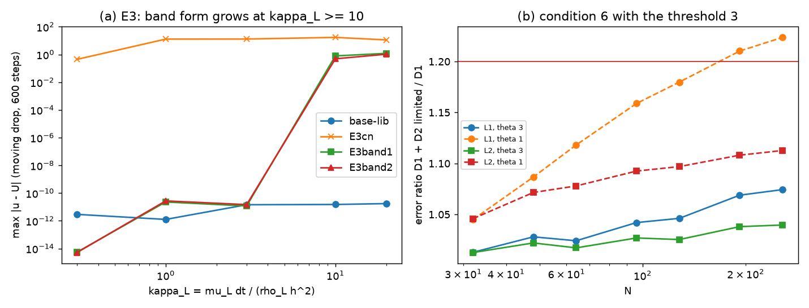

# 123 #166 の試行（上限つき）：E3 の帯の形は κ_L ≥ 10 で育つ（不成立）。E1 の力の時刻の合わせ方は重力波の余分の減衰を消すが、毛管波の減衰率は現行をわずかに上回る（厳密には不成立）。E1 の係数の扱いでは事象の重なりの誤差の跳びは直らず、その原因は面の値の圧力の源の項だった。D2 限定の閾値 θ = 3 は合格。E1・E3 なしの構成は、表面張力の 2 項目がわずかに現行を上回る

#166（段階 5、A）の作業の範囲の 2（試行）と 3 の前提（E1・E3 なしの構成の測り直し）。**合否の条件は #166 の本文に測定の前に固定されたもの**で、ここでは動かしていない。ライブラリは変えていない（全てフック：`cases/r0_combined.py` の `_setup` の選択肢、`cases/r0_trials.py`）。

```
python -m cases.r0_trials                                         # 試行（図：python -c "from cases.r0_trials import plot; plot()"）（docs/figures/r0_trials.json、20 並列で約 40 分）
python -c "from cases.r0_trials import main3; main3()"            # E1・E3 なしの構成（docs/figures/r0_trials_item3.json、約 30 分）
pytest tests/test_r0_trials.py -n 4
```

## 結論の要約
| 試行（上限） | 結果 | 不成立の条件 |
| --- | --- | --- |
| **E3**：界面の帯の面では後退 Euler、帯の外は CN（流束の形、帯の幅 1・2） | **不成立** | (b) κ_L = μ_L Δt/(ρ_L h²) を 0.3〜20 に振ると、**κ_L = 10・20 で育つ**（max\|u − U\| 0.49〜1.2。κ_L ≤ 3 は 3e-11 以下）。他の条件（単相のビット一致、粘性ありの自由流 3e-10、総運動量 2e-11、上昇気泡〔Hysing の場合 2、N = 32〕で発散なし）は合格 |
| **E1**：毛管力・重力のポテンシャルを `(φ(fⁿ) + φ(fⁿ⁺¹))/2` に（力の時刻を運ぶ速度に合わせる） | **不成立（わずか）** | (a) 毛管波の減衰率の誤差：現行 +3.4% / +2.0%、**E1 + 力の中点 +3.8% / +2.1%**（N = 32 / 64。E1 だけは +20.3% / +7.7%）。現行以下ではない。(d) 重力波：E1 だけでは余分の減衰（0.676 → 0.793）、力の中点で現行と同じ（0.6755） |
| **E1 の係数の扱い**：(i) 0.55 で頭打ち、(ii) 直前の刻みより 1.1 倍を超えて伸びたら外挿しない | **不成立** | (b) ほぼ重なる事象（間隔 1e-7）の誤差の跳び（9.6e-4 → 4.4e-2）は**どちらでも直らない**。原因は E1 ではなく**面の値の圧力の源の項**（下）。さらに、CFL の立ち上がり（`timestep` の `(previous + 0.1 dt)/1.1` は最初の数ステップで 1.1 倍を超えて伸びる）でも発動するので、事象の無い単相でノート113 とビット一致しない（差 5e-5・6e-4） |
| **D2 限定の閾値 θ = 3** | **合格** | 条件 6（D2 が切る非粘性の格子に平行なせん断流）：L1 の比 1.013〜1.074、L2 1.013〜1.040、L∞ 1.000（N = 32〜256。θ = 1 では L1 が 1.224）。面に揃った配置の自由流 4.7e-10 以下 |

- **事象の重なりの誤差の跳びの原因は、面の値の圧力の源の項**（ノート112・117）：E1 を外して源の項だけを入れても、間隔 1e-7 で 1.0e-2 → 4.7e-2 に跳ぶ（#166 の途中経過のコメント）。源の項の無い現行は跳ばない。監修 C-5 の「E1 が原因」は、E1 と源の項を一緒に入れた構成とどちらも無い現行の比較だったため。見立て（未確認）：極端に短いステップの射影で得た圧力の加速度（許容誤差の雑音 / Δt）が、次のステップの面の値に入る。**この源の項は #166 の 3 の PR の対象なので、B の判断を求める。**
- **E1・E3 なしの構成**（D1 + D2 限定 + E2 + 帯で切る源の項、#166 の 3 の条件）：自由流（密度比 1e3 で 3.6e-10、1e6 で 1.3e-9〔記録〕）・総運動量（1.2e-12 以下）・静水圧（42 / 42、2.5e-10 以下）・有界性（はみ出し 2.8e-7、`ρ_lin` の下限に達しない）・局所の収支（丸め）は合格。**表面張力の 2 項目は現行をわずかに上回る**：静止液滴（数値の曲率）の寄生流の最大が N = 32 で 6.87e-3（現行 6.75e-3、+1.8%。N = 64 は 1.2015e-3 と 1.2016e-3 で同じ）、毛管波の減衰率が 0.73923（現行 0.73911。厳密な参照 0.71466 からの誤差 +3.44% と +3.42%）。
- 打ち切りの条件（#166）に当たる：E3・E1 は上限の中で成り立たなかった。**作り込まずに B に戻す。**



(a) E3 の κ_L の走査（液滴の一様流）。(b) 条件 6 の誤差の比：θ = 3（実線）と θ = 1（破線、ノート122）。

## 定式化と理論的根拠
### A. E3 の帯の形（流束の形、構成から保存）
面 f ごとに θ_f = 1（帯〔fⁿ と fⁿ⁺¹ の界面のセルと、その周り w セル〕に接する面）、1/2（それ以外）。運動量の更新は `ρⁿ⁺¹uⁿ⁺¹ = ρⁿ⁺¹u⋆ + Δt[θ_f F(uⁿ⁺¹) + (1 − θ_f)F(uⁿ)]`（F は面の応力の流束の発散）。陰的な部分は面の粘性を `2θ_f μ` にして Δt/2 で解き（θ_f = 1/2 で μ そのもの：単相はノート113 の CN とビット一致）、陽的な部分は `(Δt/2)(L_μ − L_{μ·帯の面})uⁿ` を運動量として足して新しい密度で割る。全ての面で流束の形なので、総運動量は構成から保存する。帯の中のセルの面は全て θ_f = 1 なので、帯の中に陽的な粘性の項は残らない（構成から。数値で別に確かめてはいない）。

### B. E3 が κ_L で崩れる理由（仮定つき）
監修 C-9 の見立て（κ_L ≳ 1 で、曲がった界面が格子を横切るとき）と合う：帯の外でも、軽い相の CN は高周波を減衰させない（増幅率 → −1）。帯の外の軽い相のセルが、次のステップで帯に入る（界面が来る）と、そこで後退 Euler に切り替わる前の 1 ステップに陽的な半分の振動が残る、と見ている（**確認していない**）。幅を 2 にしても κ_L = 10 で 0.49（幅 1 で 0.78）と弱まるだけで消えない。

### C. E1 の力の中点（監修 C-9 の反証の試験を方式として 1 回だけ試した）
監修の線形の振動子の議論：E1 は運ぶ速度を半ステップずらすが力は fⁿ⁺¹ から作るので、`ω²Δt/4` の 1 次の数値減衰が加わる。力のポテンシャルを中点にすれば消える。測定：E1 + 中点の減衰率は 0.7417 / 0.7294 で、E1 だけ（0.8601 / 0.7696）の余分はほぼ消えるが、現行（0.7391 / 0.7291）より 0.0026 / 0.0003 大きい。重力（reduced）のポテンシャルも同じ中点にした。

## 1. E3（帯の形）
| 条件 | 幅 1 | 幅 2 | 参考：CN（ノート113 の形） | 参考：後退 Euler（現行） |
| --- | --- | --- | --- | --- |
| 単相とノート113 のビット一致（tg・asym・mix × N = 32・64） | 差 0 | 差 0 | — | — |
| 粘性ありの自由流、密度比 1e3（液滴・帯・斜めの帯、600 ステップ） | 2.8e-10 以下 | 3.0e-10 以下 | 22〜32（ノート122） | — |
| 同、密度比 1e6（液滴、記録） | **発散（3e10）** | **発散** | — | — |
| 総運動量（渦、粘性あり、N = 32 / 64） | 4.2e-13 / 1.4e-11 | 4.4e-13 / 1.8e-11 | 0.28 / 0.55 | — |
| κ_L = 0.3 / 1 / 3 / 10 / 20（液滴、(1, 0.37)、N = 32、CFL 0.5、600 ステップ） | 5e-15 / 2e-11 / 1e-11 / **0.78 / 1.2** | 5e-15 / 3e-11 / 1e-11 / **0.49 / 1.0** | 0.44 / 13 / 13 / 17 / 11（途中で停止） | 3e-12 / 1e-12 / 1e-11 / 2e-11 / 2e-11 |
| 上昇気泡（Hysing の場合 2、N = 32、t = 3）：上昇速度の最大 / 重心 | 0.2476 / 1.1028 | 0.2475 / 1.1043 | （ノート122・監修：発散） | 0.2482 / 1.0999 |

## 2. E1
### 毛管波の減衰率（厳密な線形の参照 0.71466、監修 `audit/pr177/capwave_exact.py`）
| 構成（D1 + D2 限定 + E2 + 帯、E3 なし） | N = 32 | N = 64 |
| --- | --- | --- |
| 現行のライブラリ | 0.7391（+3.42%） | 0.7291（+2.02%） |
| E1 なし | 0.7392（+3.44%） | 0.7291（+2.02%） |
| E1 | 0.8601（+20.3%） | 0.7696（+7.7%） |
| **E1 + 力の中点** | **0.7417（+3.8%）** | **0.7294（+2.1%）** |
| E1 + 力の中点 + 係数の頭打ち / 外挿しない | 0.7416 / 0.7415 | 0.7294 / 0.7294 |

周期は全て 0.4074 / 0.4039（参照 0.40257）。

### 重力波（表面張力なし、reduced の重力 g = 10、N = 32、同じ配置。厳密な参照なし）
| 現行 | E1 なし | E1 | E1 + 力の中点 |
| --- | --- | --- | --- |
| 0.6757 | 0.6759 | **0.7934** | 0.6755 |

### ほぼ重なる事象（監修 C-5 の配置、N = 64、誤差の最大：重なりなし → 間隔 1e-7）
| 構成 | 単相 Taylor–Green + boost | 一様流の液滴（密度比 1000） |
| --- | --- | --- |
| 現行 | 1.56e-2 → 1.57e-2 | 1.6e-12 → 9.9e-11 |
| E1（+ 源の項） | 9.6e-4 → **4.5e-2**（係数 1.9e4） | 6.2e-14 → 1.0e-10 |
| E1 頭打ち / 外挿しない（+ 源の項） | 9.6e-4 → **4.4e-2** / 9.7e-4 → **4.4e-2** | 8.7e-14 → 2.5e-10 / 3.7e-13 → 1.0e-10 |
| **源の項だけ（E1 なし）** | 1.0e-2 → **4.7e-2** | — |

- 一様流の液滴では、現行も含めて事象の間隔とともに 1e-10 まで増える（自由流の丸めの水準の変化で、跳びではない）。
- 係数の扱いは、CFL の立ち上がりでも発動し、事象の無い単相でもノート113 とビット一致しない（差 5.5e-5〔頭打ち〕・6.3e-4〔外挿しない〕）。

## 3. D2 限定の閾値 θ = 3（ノート122 の条件 6 の配置、CFL 0.5）
| N | 32 | 48 | 64 | 96 | 128 | 192 | 256 |
| --- | --- | --- | --- | --- | --- | --- | --- |
| L1 の比（θ = 3） | 1.013 | 1.028 | 1.024 | 1.042 | 1.046 | 1.069 | 1.074 |
| L2 の比 | 1.013 | 1.022 | 1.017 | 1.027 | 1.025 | 1.038 | 1.040 |
| L∞ の比 | 1.000 | 1.000 | 1.000 | 1.000 | 1.000 | 1.000 | 1.000 |
| 切った面（θ = 3 / θ = 1） | 64 / 288 | 192 / 864 | 256 / 1472 | 768 / 3619 | 1280 / 6523 | 4221 / — | 7661 / — |

面に揃った配置の自由流（帯・正方形、密度比 1e3・1e6、CFL の上限と固定の 0.4999）：4.7e-10 以下。監修 C-1 の「θ = 0.25〜10 で自由流は同じ」とも合う。

## 4. E1・E3 なしの構成（#166 の 3 の条件の測り直し）
| 条件 | 結果 |
| --- | --- |
| 自由流・安定（面に揃った形 × U 2 通り × 密度比 2 通り、固定の 0.4999、監修の形状 2000 ステップ、粘性あり 3 形状） | 密度比 1e3 で 3.6e-10 以下、1e6 で 1.3e-9 以下（記録） |
| 総運動量・相の質量（渦、粘性なし・あり、N = 32・64） | 1.2e-12 以下 |
| 静水圧（ノート115 の 21 配置 × smooth・mean） | 42 / 42、2.5e-10 以下 |
| 有界性 | はみ出し 2.8e-7 以下（現行と同じ水準）、`ρ_lin` の下限に 0 回 |
| 局所の収支（ノート122 の検証器、液滴・帯・c = 1/2 の帯） | L1〜L6 丸め、D1 の印 0 |
| 静止液滴、厳密な曲率（N = 32 / 64） | 2.318e-9 / 5.310e-9（現行と同じ） |
| **静止液滴、数値の曲率、寄生流の最大** | **6.868e-3（現行 6.746e-3、+1.8%）** / 1.2015e-3（現行 1.2016e-3） |
| **毛管波の減衰率** | **0.73923（現行 0.73911）** / 0.72912（現行 0.72910） |

## 自己点検
- 合格の条件は #166 の本文のもので、結果の後に動かしていない。E1 の「現行以下」は、差が小さく（N = 32 で 0.0026）ても不成立と書いた。
- E3 の κ_L の走査は、液滴の一様流（N = 32、600 ステップ）の 1 配置。Δt は CFL で決め、h² に比例して絞っていない。
- E1 の係数の頭打ちの値 0.55 は「立ち上がりの 1.1 倍」の想定で決めたが、立ち上がりは最初の数ステップで 1.1 倍を超えるので、想定が誤っていた（このため単相のビット一致が崩れた）。
- 上昇気泡は N = 32 だけ（監修は N = 32・64）。

## 検証済みと未検証
- 確認した：表の全て。事象の跳びが源の項によること（E1 の有無で切り分け）。
- 仮定つき：E3 の帯の形が κ_L で崩れる理由、事象の跳びの機構（短いステップの射影の雑音）。
- 未検証：帯の中に陽的な項が無いことの数値の確認、E1 の N = 128、上昇気泡の N = 64、E1・E3 なしの構成の寄生流の差（+1.8%）がどの修正によるか。

## B に求める判断
1. E3・E1 は上限の中で成り立たなかった（打ち切りの条件）。時間積分の分岐（#179、#145）の判断。
2. **面の値の圧力の源の項**（帯で切る形）は、事象の重なりで誤差を跳ばす。#166 の 3 の PR に入れるか（入れない／直前の刻みが極端に短いときの扱いを足す〔作っていない〕）。
3. E1・E3 なしの構成の表面張力の 2 項目（寄生流 +1.8%〔N = 32〕、減衰率 +0.0001）を「悪化しない」の範囲と読むか。
4. D2 限定の閾値 θ = 3 の採否。
