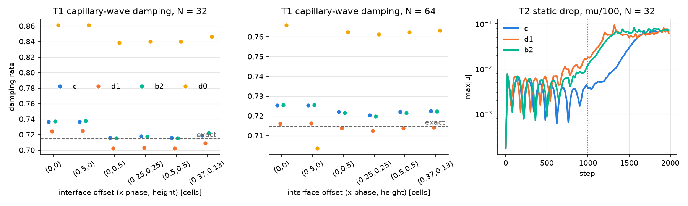

# 125 #179：時間積分の候補 d1・b2・d0 の T1（毛管波の減衰率）と T2（粘性の小さい条件での安定性）。設計（`design/179`、59d8817）の予測が 2 か所で外れたので、T3 以降に進まずに D 設計に戻す

#179（実験、A）。設計は `design/179_time_integration.md`（PR #186、59d8817）、B の承認（#179 の本文、2026-11-28）の範囲：d1 + V-BE、予備が b2、読み方は案 β。**フックで作り、ライブラリは変えていない。** 合否の条件と予測は設計に固定されたもので、結果を見てから変えていない。

```
python -m cases.r0_time179 t1        # T1（84 本、docs/figures/r0_time179_t1.json、24 並列で約 45 分）
python -m cases.r0_time179 t2        # T2（9 本、docs/figures/r0_time179_t2.json）
python -m cases.r0_time179 checks    # 結果の後の確認（docs/figures/r0_time179_checks.json）
python -m cases.r0_time179_figure    # 図（docs/figures/r0_time179.png）
```



## 結論の要約
- **予測が外れた所（設計の規則により、ここで止めて D 設計に戻す）**
  1. **T1 の d1**：現行（c）との減衰率の差は、予測の大きさ（N = 32 で 0.005 以下、N = 64 で 0.001 以下）を超えた。**−0.0111 / −0.0092**（設計の読み〔ノート122 の列の読み〕）。6 通りの位置の全てで同じ向き（d1 の方が減衰が小さい。Fourier の読みで −0.0096〜−0.0150 / −0.0079〜−0.0092）。
  2. **T2 の静止液滴（μ/100、N = 32、2000 ステップ）**：予測は「c・d1・b2 は育たない」。**3 つとも育った**（後半 1000 ステップの最大 / 前半の最大 = c 9.55、d1 5.08、b2 7.28。いずれも 1e-2 以下から約 7e-2 へ）。c も育つので、設計の「d1 が育ち c が育たなければ模型の誤り」の場合ではない。
  - b2 の差は、設計の読み（列）で N = 64 が +0.0029 で予測（0.001 以下）を超えた。Fourier の第 1 モードの読みでは全ての位置で 0.001 以下（下の表）。
  - d0 の予測（0.875 / 0.777 ± 0.02）は当たった：0.8637 / 0.7690（列の読み）。
- **合否の条件（「現行以下」、案 β：6 通りの位置の最悪値どうし）**
  - **d1 は満たす**：減衰率の相対誤差の最悪 0.0174 / 0.0030（c は 0.0308 / 0.0151）、周期 0.0089 / 0.0027（c は 0.0130 / 0.0041）。差は、許容誤差と微小な摂動による幅（2e-5 以下）より 2 桁以上大きい。
  - **b2 は減衰率で満たさない**：最悪 0.0321 / 0.0153（c より 0.0013 / 0.0002 大きい。幅は 1e-5 以下）。周期は満たす（0.0127 / 0.0039）。
  - 「発散しない」（T2）：毛管波（μ/100、N = 32・64）は 3 つとも満たす（0.96〜1.00）。静止液滴は 3 つとも満たさない（上の 2）。
- **力の利得 G の実測**（T1 で記録を求められた量、最初の 1 周期、界面から 2 セル以内の面）：x 成分 0.98 / 0.993、**y 成分 0.88 / 0.86**（N = 32 / 64）。設計の仮定 `G = cos²(kh/2)`（0.990 / 0.998）より、y 成分は 1 − G が 1 桁大きい。
- 確認（結果の後）：静止液滴の成長は、**時間刻みを半分にしても残る**（c 11.7、d1 10.1。同じ t = 4.4 まで）。μ を戻すと c は育たない（0.42）。原因は調べていない。

## 定式化と理論的根拠
### A. 作った構成（`cases/r0_time179.py`、`scheme(name)`）
全て `TwoPhase(conserving=True)` に、フックで足した。

| 名前 | 内容 |
| --- | --- |
| c-lib | ライブラリの既定 |
| **c** | 設計の 4.1 節：D1（`conserving_consistent`）、D2 限定（θ = 3）、`project_start`。**「現行」はこれ**（設計の 4.1 節の定義。測定の前に決めた）。毛管波では c-lib と 5 桁まで同じ |
| d0 | c + `conserving_predict` の運ぶ速度（保存した g を BCG の予測に渡し、Δt/2 の射影。力は `f^{n+1}`） |
| **d1** | 設計の 4.2 節：d-0a `B(uⁿ; 0)`、d-0b `+ (Δt/2) aⁿ`（`aⁿ = a_f[φⁿ, fⁿ; αⁿ]`、`φⁿ` は前のステップの力で計算して保存したもの。最初のステップは `f⁰` から）、d-0c `Π_{Δt/2}[αⁿ]`、`g_P = C(aⁿ − αⁿ∇pf)`、d-0d 実効の CFL の確認とやり直し（2 回まで）、d-1 源の項 `g_P`（帯の外、帯は界面のセルから 1 セル）、d-3 V-BE（`Δt g` の出し入れは `g_P`）、d-4 力は `(φⁿ + φ^{n+1})/2`（片方だけ定義されたセルは定義された方） |
| **b2** | 設計の 4.3 節：b-0 を作業用の写しで（`T_{Δt/2}[ufⁿ]`、源の項なし、`P(f̃)`、`V_{Δt/2}`〔現行の形：保存した g〕、`ã`、`Π_{Δt/2}[α̃](I_f ũ + (Δt/2)ã)`、`g̃`）。残すのは `uf^{n+1/2}` と `g̃` だけ。その後は d1 と同じ（源の項と出し入れは `g̃`） |

- **壁の面の法線の速度（設計に書かれていない実装の決め）**：BCG の予測（`terms/convection/bcg.prediction`）は、滑りの壁の面に `O(Δt)` の法線の速度を残す（試験の場で 1.2e-4）。Neumann の圧力の射影はこれを消せないので、多重格子が反復の上限まで回る（d0・d1 の最初の版で 1 ステップが c の 50〜60 倍）。d0・d1 では、予測の後と射影の後に、壁の面の法線の速度を補間の値（壁の境界条件から。滑り・粘着の壁で 0）にした。**ライブラリの `conserving_predict=True` も同じ**（d0-lib：N = 32 で計算時間が d0 の約 18 倍、減衰率は 5 桁まで同じ 0.86102）。
- d0・d1・b2 の予測の段には、`conserving_predict` と同じ `pf` を使う（初期値は前のステップの `pf`）。

### B. 読み方（測定の前に固定。`cases/r0_time179.py` の `OFFSETS`・`SPREAD`・`summary_t1`）
- 案 β の界面の位置（格子に対する端数のずれ、セル）：(x の位相, 平均の高さ) = (0, 0)、(0.5, 0)、(0, 0.5)、(0.25, 0.25)、(0.5, 0.5)、(0.37, 0.13)。界面は `y = dy·h + a₀ cos 2π(x − dx·h)`、a₀ = 0.01。
- 振幅：各列の高さ関数の位置の平均の、`cos 2π(x − dx·h)` への第 1 Fourier 係数。位置 (0, 0) では、ノート122 の読み（x = h/2 の列）も出した（設計の予測はこの読みで言われている）。周期は零点、減衰率は極値の対数の一次のあてはめ（ノート122 と同じ）。
- 幅：c・d1・b2 の位置 (0, 0) で、許容誤差 1e-9・1e-11 と、位相の ±1e-3 セルの摂動。
- 誤差は厳密な線形の解（監修、周期 0.40257、減衰率 0.71466）に対する相対誤差。

### C. 模型の式に実測の G を入れた値（A の算術。解釈ではない）
設計の 3.2 節（M1′）の 1 次の減衰：c は `(1 − G)ω²Δt/2`、d1 はその半分、差 d1 − c は `−(1 − G)ω²Δt/4`。ω = 2π/0.40257、Δt = 1.96e-3 / 6.64e-4（N = 32 / 64、標本の時刻に合わせた刻み）。

| | N = 32 | N = 64 |
| --- | --- | --- |
| G（y 成分、実測） | 0.882 | 0.861 |
| `−(1 − G)ω²Δt/4`（y 成分の G） | −0.0141 | −0.0056 |
| 同（x 成分の G：0.980 / 0.993） | −0.0024 | −0.0003 |
| 測定の d1 − c（列の読み / Fourier、位置 (0, 0)） | −0.0111 / −0.0122 | −0.0092 / −0.0092 |
| 測定の c − 厳密（列の読み） | +0.0244 | +0.0144 |
| 測定の d1 − 厳密（列の読み） | +0.0133 | +0.0052 |

どの成分の G をどう使うか、2 次元の射影でこの式が成り立つかは、D 設計の解釈に委ねる。

## 1. T1：毛管波の減衰率（N = 32 / 64、t ≤ 1.2、σ = 1、ρ = 1 / 1e-3、μ = 1e-2 / (1e-2/55)）
### 位置 (0, 0)、設計の読み（ノート122 の列）
| 構成 | 減衰率 N = 32 | N = 64 | 周期 N = 32 | N = 64 | 予測 | 判定 |
| --- | --- | --- | --- | --- | --- | --- |
| c（現行） | 0.7391 | 0.7291 | 0.40741 | 0.40386 | — | ノート122 の値を再現 |
| d0 | 0.8637 | 0.7690 | 0.40572 | 0.40344 | 0.875 / 0.777 ± 0.02 | **当たり** |
| d1 | 0.7280（−0.0111） | 0.7199（−0.0092） | 0.40541 | 0.40328 | 差の大きさ 0.005 / 0.001 以下 | **外れ** |
| b2 | 0.7405（+0.0014） | 0.7320（+0.0029） | 0.40730 | 0.40380 | 同上 | N = 64 が**外れ** |

### 6 通りの位置（Fourier の読み）
| 構成 | N | (0,0) | (0.5,0) | (0,0.5) | (0.25,0.25) | (0.5,0.5) | (0.37,0.13) | 減衰率の最悪の相対誤差 | 周期の最悪の相対誤差 |
| --- | --- | --- | --- | --- | --- | --- | --- | --- | --- |
| c | 32 | 0.73648 | 0.73666 | 0.71592 | 0.71818 | 0.71602 | 0.71877 | 0.0308 | 0.0130 |
| d1 | 32 | 0.72433 | 0.72463 | 0.70225 | 0.70319 | 0.70234 | 0.70919 | **0.0174** | **0.0089** |
| b2 | 32 | 0.73734 | 0.73760 | 0.71533 | 0.71749 | 0.71544 | 0.72226 | **0.0321** | 0.0127 |
| d0 | 32 | 0.86102 | 0.86113 | 0.83838 | 0.84011 | 0.84016 | 0.84614 | 0.2049 | 0.0093 |
| c | 64 | 0.72539 | 0.72546 | 0.72211 | 0.72041 | 0.72212 | 0.72252 | 0.0151 | 0.0041 |
| d1 | 64 | 0.71619 | 0.71626 | 0.71370 | 0.71249 | 0.71371 | 0.71425 | **0.0030** | **0.0027** |
| b2 | 64 | 0.72553 | 0.72561 | 0.72142 | 0.71968 | 0.72143 | 0.72221 | **0.0153** | 0.0039 |
| d0 | 64 | 0.76588 | 0.70356* | 0.76247 | 0.76120 | 0.76248 | 0.76326 | 0.0717 | 0.0030 |

- 幅（許容誤差・摂動）：減衰率 c 1.9e-6 / 3.9e-7、d1 1.6e-5 / 3.0e-6、b2 1.2e-5 / 6.5e-7、周期は 6e-7 以下（N = 32 / 64）。
- c-lib は c と 5 桁まで同じ（この配置では D1・D2 限定・`project_start` は効かない）。
- d1 の N = 32 は、位置によって厳密の上（0.724）にも下（0.702）にも出る。
- \* d0 の N = 64・(0.5, 0) の 0.70356 は、**読みの崩れ**：全標本で計算し直すと、最初の谷の直後（t = 0.232）に余分な極値（|a| = 7.72e-3）があり、あてはめに入っていた。振幅そのものは位置 (0, 0) とほぼ同じ（t = 1.008 で −4.66e-3 対 −4.66e-3）。読みは固定のままにした（d0 は合否の対象ではない）。他の計算は、保存した標本では極値が 5 つずつで同じ時刻。

### 力の利得 G（最初の 1 周期、界面から 2 セル以内の面、`⟨I_f C G_f, G_f⟩/⟨G_f, G_f⟩`）
| 構成 | N = 32（x / y） | N = 64（x / y） |
| --- | --- | --- |
| c | 0.980 / 0.882 | 0.993 / 0.861 |
| d1 | 0.979 / 0.877 | 0.992 / 0.843 |
| b2 | 0.979 / 0.865 | 0.992 / 0.843 |

位置 (0, 0)。他の位置もほぼ同じ（(0.5, 0) で c 0.981 / 0.882）。

### 実効の CFL とやり直し
d1・b2 の `uf^{n+1/2}` の実効の CFL 数は最大 0.010 / 0.007（N = 32 / 64）で、やり直しは 0 回（流れが遅い）。d1 の予測の射影の反復は最大 14 回。

## 2. T2：粘性の小さい条件（μ/100）での安定性（後半 1000 ステップの最大 / 前半の最大、1.1 以下で「発散しない」）
| 配置 | c | d1 | b2 |
| --- | --- | --- | --- |
| 毛管波 N = 32（2000 ステップ、t = 4.0） | 0.962 | 0.959 | 0.961 |
| 毛管波 N = 64（2000 ステップ、t = 1.3） | 0.989 | 0.995 | 0.989 |
| **静止液滴 N = 32**（数値の曲率、2000 ステップ、t = 4.39） | **9.55**（7.95e-3 → 7.60e-2） | **5.08**（1.88e-2 → 9.52e-2） | **7.28**（1.21e-2 → 8.80e-2） |

- 静止液滴の推移（図の右）：3 つとも 1000 ステップ付近まで 1e-3〜1e-2 で振れ、そこから 7e-2 前後まで育って止まる（d1・b2 は c より約 300 ステップ早く育つ）。発散（1e2 を超える）は無い。
- **確認（結果の後、記録）**：時間刻みを毛管の制限の半分にして同じ時刻（t = 4.40、4000 ステップ）まで：c 11.7（8.46e-3 → 9.87e-2）、d1 10.1（8.33e-3 → 8.43e-2）。μ を元の値に戻した c（2000 ステップ）：0.42（6.50e-3 → 2.73e-3）。**時間刻みを半分にしても成長は残る**。原因（曲率の誤差による寄生流の、粘性の小さい条件での成長か、他か）は調べていない。

## 3. 費用（記録。共有の計算機で 24〜33 並列、目安）
位置 (0, 0) の 1 本の壁時計：c 74 / 335 秒、d1 96 / 438 秒、b2 104 / 624 秒（N = 32 / 64、t = 1.2、612 / 1808 ステップ）。設計の 6 節の費用の記録（T3 の N = 256）は行っていない。

## 自己点検
- 予測・合否の条件・読み方は設計と #179 の本文のもの。位置の 6 通り、幅の 4 通り、「現行 = c（D1・D2 限定・`project_start`）」、Fourier の読みは、測定の前に A が置いた（このノートの B 節）。設計の予測は列の読みで言われているので、予測の判定は列の読みで行い、Fourier の値も並べた。
- 壁の面の法線の速度の扱いは、設計に無い実装の決め（A 節）。減衰率は変えない（d0 と d0-lib が 5 桁で同じ）。
- d0 の (0.5, 0) の読みの崩れは、結果を見てから見つけた。読みは変えていない。
- 静止液滴の成長の原因、T2 の「発散しない」の読み（後半 / 前半 ≤ 1.1）が、飽和する寄生流の成長に当たるかは、判断していない。

## 検証済みと未検証
- 確認した：c がノート122 の値（0.7391 / 0.7291）を再現すること、d1・b2 が全ての配置で動くこと、許容誤差と摂動の幅、静止液滴の成長が時間刻みを半分にしても残ること。
- 未検証：d1・b2 のフックの、単相の解析解での時間の次数（T3）、自由流と保存（T4）。M1′ の式がこの配置の d1 − c を表すか（C 節の数は算術だけ）。

## D 設計に求めること（#179 の本文：予測が外れたら、その時点で止めて D に回す）
1. T1 の d1 − c が予測の大きさを超えた（−0.0111 / −0.0092）。測った G（y 成分 0.88 / 0.86）との関係の解釈と、T1 の予測の扱い。
2. T2 の静止液滴で c・d1・b2 がそろって育った（時間刻みを半分にしても残る）。T2 の予測と読み方（「発散しない」の対象と読み）の扱い。
3. b2 の N = 64 の差（列の読みで +0.0029、Fourier では 0.001 以下）と、b2 が「現行以下」（減衰率）を満たさないこと。
4. T3 以降に進むか（A は止めている）。
