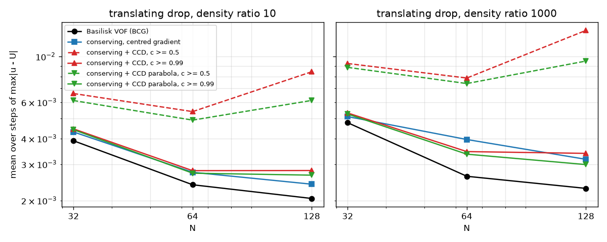

# 75 運動量保存形 + CCD の勾配：並進する液滴で精度が落ちる原因は界面のセル、そして利点は残らない

ノート72 で「いまの候補」とした、運動量保存形の VOF の濃度の勾配を相ごとの CCD に替える形（`TwoPhase(conserving_gradient="ccd")`）を、対流の効く問題で確かめた。ノート74 の放物線の項（`"ccd2"`、平均を保つ放物線の掃過の平均 `(1 − C)(1 − 2C)/12 · q″`）も入れた。

## 1. 並進する液滴（ガリレイ不変性、`cases/convection_stability.py --translate`）
周期の [0, 1]²、半径 0.15 の液滴、一様な流れ U = (1, 0)、σ = 0.01、μ = 1e-4、t = 1（1 周期）。厳密解は平行移動なので、速度の誤差 max|u − U| が運動量の移流の精度を測る。

**最後の時刻の値だけでは揺らぎが大きい**（寄生流が時間的に揺れる。同じ条件で中心差分の運動量保存形 N = 128 が t ≤ 0.9 で 1.7〜3.1e-3、t = 1.0 で 1.1e-2 になった例がある）。そこで全ステップの max|u − U| の平均で比べる：

| 構成 | 密度比 10：N = 32 / 64 / 128 | 密度比 1000：N = 32 / 64 / 128 |
| --- | --- | --- |
| Basilisk の VOF（BCG） | 3.90e-3 / 2.39e-3 / 2.05e-3 | 4.77e-3 / 2.62e-3 / 2.29e-3 |
| 運動量保存形（中心差分の勾配） | 4.30e-3 / 2.74e-3 / 2.40e-3 | 5.11e-3 / 3.96e-3 / 3.17e-3 |
| + CCD の勾配（c ≥ 0.5） | 6.61e-3 / 5.40e-3 / **8.43e-3** | 9.25e-3 / 7.86e-3 / **1.34e-2** |
| + CCD の放物線（c ≥ 0.5） | 6.11e-3 / 4.91e-3 / **6.12e-3** | 8.86e-3 / 7.39e-3 / **9.51e-3** |
| + CCD の勾配（c ≥ 0.99） | 4.46e-3 / 2.79e-3 / 2.80e-3 | 5.32e-3 / 3.46e-3 / 3.39e-3 |
| + CCD の放物線（c ≥ 0.99） | 4.42e-3 / 2.71e-3 / 2.66e-3 | 5.26e-3 / 3.36e-3 / 2.99e-3 |

- **CCD（c ≥ 0.5）は、格子を細かくすると誤差が増える**（N = 64 → 128 で 5.4e-3 → 8.4e-3、密度比 1000 で 7.9e-3 → 1.3e-2）。N = 128 で中心差分の 3.5〜4 倍。
- どの条件でも、並進では非保存形の Basilisk の VOF が最も小さい（運動量保存形は 1.1〜1.5 倍）。保存形の利点は安定性（ノート72 のせん断層）で、一様な流れの精度ではない。
- 誤差の場所（N = 128、密度比 10、0.1 ごと）：CCD（c ≥ 0.5）では t = 0.1 から重い流体の内部でも 6〜8e-3（中心差分は 1.5〜2.6e-3）。界面で生じた誤差が線全体に広がっている。

（`python -m cases.conserving_ccd_cmin`、数値は `docs/figures/conserving_ccd_cmin.json`。）

## 2. 原因：CCD の区間に入る界面のセル
相ごとの区間を c ≥ 0.5（vof.h の `CMIN`）で切ると、区間の端に、半分ほどしか満たされていない界面のセルが入る。そこの濃度 `t/c` は誤差を含みやすく、CCD は区間を一度に解くので、その誤差が区間全体の微分に広がる。中心差分の勾配なら影響はそのセルの近くだけ。

確かめるため、区間に入るセルの下限を選べるようにした：`TwoPhase(conserving_ccd_cmin=...)`（既定 None = 0.5、これまでどおり）。下限より小さいセルは vof.h の勾配のまま。0.99 にすると、上の表のとおり誤差は中心差分の運動量保存形とほぼ同じ（0.9〜1.2 倍）まで戻り、格子を細かくすると減るようになった。**原因は界面のセルで確かめられた。**

中間の下限（CCD の勾配）：

| 下限 | 並進 N = 64：密度比 10 / 1000 | N = 128：密度比 10 / 1000 | 毛管波 N = 32：β 倍率 / ω | N = 64 |
| --- | --- | --- | --- | --- |
| 0.5 | 5.40e-3 / 7.86e-3 | 8.43e-3 / 1.34e-2 | 1.31 倍 / −4.17% | **1.06 倍** / −1.41% |
| 0.75 | 3.04e-3 / 4.01e-3 | 2.99e-3 / 3.62e-3 | 1.31 倍 / −4.17% | 1.12 倍 / −1.41% |
| 0.9 | 3.06e-3 / 3.76e-3 | 3.84e-3 / 5.28e-3 | 1.43 倍 / −4.13% | 1.12 倍 / −1.41% |
| 0.99 | 2.79e-3 / 3.46e-3 | 2.80e-3 / 3.39e-3 | 1.49 倍 / −4.09% | 1.18 倍 / −1.37% |
| （中心差分の運動量保存形） | 2.74e-3 / 3.96e-3 | 2.40e-3 / 3.17e-3 | 1.62 倍 / −4.21% | 1.12 倍 / −1.41% |

（並進は全ステップの平均。下限 0.75〜0.99 の値は順に並ばない（N = 128、密度比 1000 で 0.9 が 5.28e-3 と、0.75・0.99 より大きい）。界面のセルが区間に入るかどうかで結果が揺れる。）

## 3. 他の試験
外力のない二相のせん断層（ノート72 の 2 節、運動エネルギーの最大）：

| 構成 | 密度比 10、N = 64 | N = 128 | 密度比 100、N = 64 | N = 128 |
| --- | --- | --- | --- | --- |
| 運動量保存形 | 1.0000 | 1.0000 | 1.0000 | 1.0000 |
| + CCD の勾配（c ≥ 0.5、ノート72） | 1.0002 | 1.0000 | 1.0017 | 1.0023 |
| + CCD の放物線（c ≥ 0.5） | 1.0002 | 1.0000 | 1.0004 | 1.0000 |
| + CCD の勾配（c ≥ 0.99） | 1.0000 | 1.0000 | 1.0013 | 1.0005 |
| + CCD の放物線（c ≥ 0.99） | 1.0001 | 1.0000 | 1.0006 | 1.0001 |

どれも運動エネルギーをほとんど増やさない（運動量保存形が安定性を決める、ノート72）。

毛管波・振動液滴（論文の水–空気、`cases/vof_imex_dynamics.py`）：放物線の項は CCD の勾配と同じ値（c ≥ 0.5、毛管波 N = 64：1.06 倍 / −1.41%、液滴 −1.04%）。c ≥ 0.99 では毛管波 N = 32 / 64 が 1.43〜1.49 倍 / 1.12〜1.18 倍、液滴の ω は −1.46% / −0.96〜−1.04%（c ≥ 0.5 とほぼ同じ）。

## まとめ
- ノート72 の「CCD の勾配で毛管波の減衰が 1.12 → 1.06 倍」は、**界面のセルを CCD の区間に入れたときだけ**現れ、同じ設定が並進する液滴の精度を格子を細かくするほど悪くする（N = 128 で 3.5〜4 倍）。界面のセルを外すと、並進は中心差分並みに戻るが、毛管波の改善も消える。
- **運動量保存形の勾配を CCD に替える形は、どの下限でも中心差分の運動量保存形より一様に良くはならない。不採用とし、ノート72 の「いまの候補」を取り下げる。** 選択肢（`conserving_gradient`、`conserving_ccd_cmin`）は残す。既定は変えない（勾配は中心差分）。
- いまの二相流の試験では、速度の誤差は対流の離散化ではなく、寄生流（表面張力と圧力の釣り合い）で決まっている。運動量の移流の高次化（ノート74 のコンパクトな流束を含む）は、この誤差の下では効かない。CCD の精度は、表面張力と曲率、圧力の釣り合いの側で効かせる方が有望。

## 次
- 寄生流の大きさを決める表面張力・曲率・圧力の離散化の釣り合いに戻る（`spurious.c` の照合、ノート73）。
