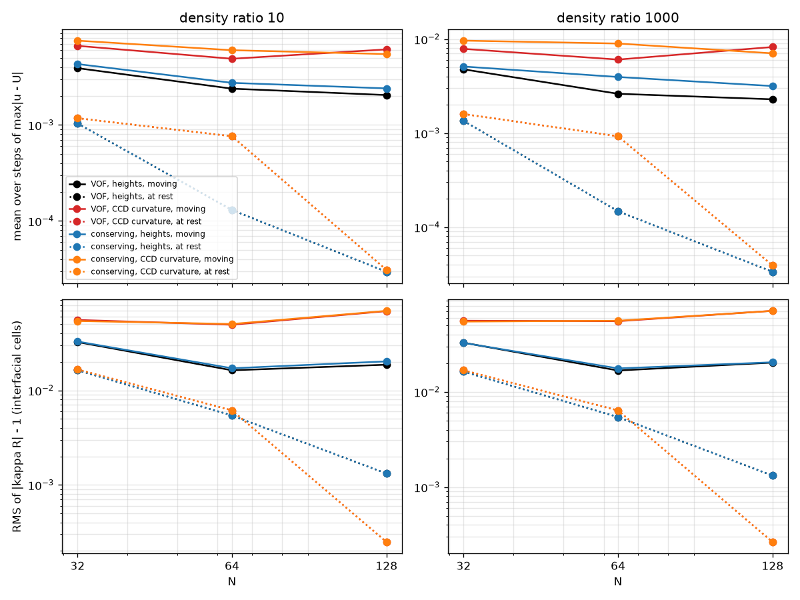

# 76 動く界面の寄生流：輸送が界面に残す格子規模の凹凸が曲率を収束させない（P4 の材料）

ノート75 の並進する液滴の速度の誤差は、運動量の移流ではなく寄生流で決まっていた。その寄生流がどこから来るかを、静止と並進を分けて測った。ユーザーの優先順位（P0〜P4）の P4（曲率・表面張力・射影）の材料で、P0〜P3（流束）の評価とは混ぜない。

## 1. 静止と並進（`python -m cases.moving_spurious`）
周期の [0, 1]²、半径 0.15 の液滴、σ = 0.01、μ = 1e-4、t = 1。`speed = 0` の静止と、一様な流れ (1, 0) に乗せた並進。速度の誤差は全ステップの max|u − U| の平均、曲率の誤差は界面のセルの |κR| − 1 の RMS（4 ステップごとの平均）。

| 密度比 10 | 速度の誤差：N = 32 / 64 / 128 | 曲率の RMS 誤差：N = 32 / 64 / 128 |
| --- | --- | --- |
| 静止、高さ関数（tension.h） | 1.0e-3 / 1.3e-4 / 3.0e-5 | 1.6% / 0.54% / 0.13% |
| 静止、CCD の列の曲率 | 1.2e-3 / 7.6e-4 / 3.1e-5 | 1.7% / 0.61% / **0.025%** |
| 並進、高さ関数 | 3.9e-3 / 2.4e-3 / 2.0e-3 | 3.2% / 1.6% / 1.9% |
| 並進、CCD の列の曲率 | 6.7e-3 / 4.9e-3 / 6.1e-3 | 5.6% / 4.9% / **6.9%** |

| 密度比 1000 | 速度の誤差：N = 32 / 64 / 128 | 曲率の RMS 誤差：N = 32 / 64 / 128 |
| --- | --- | --- |
| 静止、高さ関数 | 1.4e-3 / 1.5e-4 / 3.4e-5 | 1.6% / 0.54% / 0.13% |
| 静止、CCD の列の曲率 | 1.6e-3 / 9.3e-4 / 3.9e-5 | 1.7% / 0.64% / 0.026% |
| 並進、高さ関数 | 4.8e-3 / 2.6e-3 / 2.3e-3 | 3.3% / 1.7% / 2.0% |
| 並進、CCD の列の曲率 | 7.9e-3 / 6.1e-3 / 8.2e-3 | 5.6% / 5.5% / 7.1% |

（Basilisk の VOF の値。運動量保存形も曲率はほぼ同じで、並進の速度の誤差が 1.1〜1.5 倍。）

- **静止では曲率も速度も収束する**（高さ関数 2 次、CCD は N = 128 で高さ関数の 1/5）。
- **並進では曲率の誤差が収束しなくなり**（1.6〜2%）、速度の誤差も 2e-3 前後で止まる。CCD の曲率は並進では高さ関数の約 3 倍悪い。
- 速度の誤差は曲率の誤差に従う。

## 2. 流れを解かずに輸送だけ（`python -m cases.moving_curvature --vof`）
VOF の場を一様な速度 (1, 0) で運ぶだけ（CFL 0.5、表面張力も流れの解もなし）。曲率の RMS 誤差：

| 曲率 | N | t = 0 | 1/4 | 1/2 | 3/4 | 1 |
| --- | --- | --- | --- | --- | --- | --- |
| 高さ関数 | 32 | 2.38% | 3.30% | 4.56% | 5.02% | 5.17% |
| | 64 | 0.569% | 1.48% | 1.83% | 1.99% | 2.06% |
| | 128 | 0.139% | 2.46% | 2.52% | 2.53% | 2.53% |
| CCD の列の曲率 | 32 | 4.20% | 4.45% | 5.18% | 6.67% | 6.87% |
| | 64 | 1.46% | 2.77% | 2.93% | 3.34% | 3.42% |
| | 128 | 0.183% | 6.12% | 5.97% | 6.20% | 6.20% |

- 初期の形（`fraction(refine=8)`）は 2 次で収束するが、**1/4 周期運ぶと N = 128 で 2.5%（CCD は 6.1%）になり、格子を細かくしても減らない。**
- 方向分割の PLIC の輸送が、界面の位置に O(h²) の格子規模の凹凸を残し、2 階微分の曲率がそれを O(1) の誤差にする、と解釈できる（凹凸そのものの測定は未）。CCD の 2 階微分は格子規模の利得が 3 点差分より大きい（12/5 倍）ので、より強く拾う。
- 流れの解を含む 1 節の並進の曲率の誤差（2%）は、この輸送だけの値とほぼ同じ。**動く界面の寄生流の主因は輸送の凹凸**とみてよい。

## 3. 曲率のフィルタ（`--filter`、`ccd_curvature(filter_alpha, filter_order)`）
CCD の列の曲率で、区間の列の位置 e を微分の前に `(I + α(−D₂)^m) ẽ = e`（D₂ は同じ区間の CCD の 2 階微分、記号は約 1/(1 + α(kh)^{2m})）で濾した（ユーザーのメモの「曲率のフィルタ」）。t = 1 の曲率の RMS 誤差：

| α、m | N = 32 | 64 | 128 | 初期（N = 128） |
| --- | --- | --- | --- | --- |
| フィルタなし | 6.87% | 3.42% | 6.20% | 0.183% |
| 0.01、2 | 6.24% | 2.88% | 3.94% | 0.078% |
| 0.05、2 | 4.78% | 2.24% | 2.13% | 0.169% |
| 0.2、2 | 3.92% | 2.54% | 1.25% | 0.555% |
| 0.01、3 | 5.27% | 2.33% | 2.07% | 0.132% |
| 0.05、3 | 3.97% | 2.23% | 1.34% | 0.382% |
| （高さ関数） | 5.17% | 2.06% | 2.53% | 0.139% |

- 強いフィルタで N = 128 の誤差は 1/5 になる（1.25%、高さ関数の半分）が、**収束は戻らない**（N = 64 で 2.2〜2.5%）。kh で決めた強さのフィルタは、格子規模の雑音を一定の割合しか消さないので、曲率の誤差は O(1) のまま。強くするほど静止の精度（初期の誤差）を損なう。
- フィルタは選択肢として残す（既定 0 = なし）。流れを解く場合の速度の誤差は未測定。

## 4. CLS の側（`--cls`）
ψ を同じ一様な速度で運ぶ（SSP-RK3、質量の閉包）。ψ の曲率は各セルの等値線の曲率なので、そのセルの中心の液滴の中心からの距離 r で 1/r と比べた（0.1 < ψ < 0.9 のセル）。曲率の RMS 誤差：

| 構成 | N = 32 | 64 | 128 |
| --- | --- | --- | --- |
| 初期（厳密な形） | 0.443% | 0.0197% | 0.036% |
| 再初期化なし、t = 1/4 → 1 | 3.92% → 9.6% | 2.45% → 14.4% | 2.15% → 12.1% |
| xi-SDF の再初期化を 10 ステップごと、t = 1/4 → 1 | 72% → 136% | 109% → 199% | 267% → 277% |
| 厳密な形に再初期化を 1 回だけ（輸送なし） | 62.7% | 103% | 272% |

- **CLS でも輸送だけで曲率の誤差が時間とともに育ち、収束しない**（再初期化なしで t = 1 に 10〜14%）。
- **xi-SDF の再初期化は、1 回だけで、厳密な形の曲率を 60〜270% 狂わせる。** ψ の変化は最大 2.5%（N = 64）だが、2 階微分がそれを O(1) にする。周期でも壁でも同じ。CLS の二相流で曲率に ψ を使う設定では、再初期化が寄生流の源になる。

## まとめ
- 動く界面の寄生流は、輸送（VOF の分割の PLIC、CLS の移流と再初期化）が界面の形に残す格子規模の凹凸から来る。曲率は 2 階微分なので、その凹凸を O(1) の誤差にし、格子を細かくしても減らない。
- CCD の曲率は、静止（なめらかな形）では最も正確だが、動く界面では凹凸を強く拾って最も悪い。CCD を曲率に使う価値は、輸送が凹凸を残さない場合にしか出ない。
- 一定の強さのフィルタでは収束は戻らない。直すべきは輸送の側（凹凸を作らない輸送、または凹凸の振幅を h³ 以上に下げる）か、曲率の推定を凹凸に対して頑健にする（幅の広い当てはめ：ただし「幅の広いステンシルは使わない」原則と衝突するので要相談）。

## 次
- P4 はここで保留し、P0（表面張力のない純移流）、P1（幾何学的な VOF と運動量の流束の整合）を先に進める（ユーザーの優先順位）。
- 再開するときは、界面の凹凸の振幅とスペクトルを直接測り、輸送のどの段（分割、PLIC の再構成、`cc` の項）が作るかを分ける。CLS の xi-SDF の再初期化が曲率を壊す仕組みも調べる。
