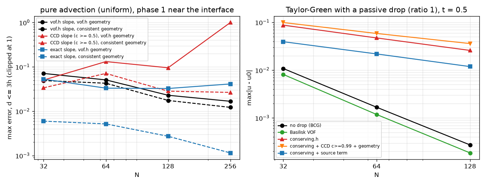

# 77 表面張力を除いた純移流（P0）と、幾何学的な VOF と流束の整合（P1）

ノート75 の後、ユーザーの優先順位（P0：寄生流を除いた純移流、P1：幾何学的な VOF と運動量の流束の整合、…、P4：曲率・表面張力）に沿って測った。P4 の材料はノート76 に分けた。

## 定式化と理論的根拠
### vof.h の濃度の面の値と、その幾何の前提
セルの中の濃度を一次 `τ(ξ) = τ_i + g ξ`（ξ はセルの中心からの距離、セル幅 1）と仮定する。

- 満たされたセルなら、1 ステップに掃過する帯 `[1/2 − C, 1/2]` の平均は `τ_i + g (1 − C)/2`。`(1 − C)/2` は帯の重心とセルの中心の差。
- 界面のセルでは、保存されている `t/c` は**相の部分の平均**なので、相の部分の重心 x_c での値。掃過されるのは帯の中の**相の部分**で、その重心は x_s。一次の τ に対して正しい面の値は次のとおり：

  ```
  τ_F = τ(x_c) + g (x_s − x_c) + g_t (y_s − y_c)
  ```

  （g_t は掃過に直交する方向の勾配、y は直交する方向の重心。）

vof.h の式は x_c = 0、x_s = (1 − C)/2、y_s = y_c を仮定しており、界面のセルでは O(h) の位置のずれ × 勾配 = O(h·g) の誤差を面の値に入れる。`VOFTracer(geometric=True)` は x_c、x_s、y_c、y_s を PLIC の線から厳密に計算する（`geometry.strip_moments`）。一次の τ に対しては、面の値が厳密になる。

### オラクルの試験の論理
- **厳密な勾配と整合した幾何**：一次の τ の面の値が厳密になり、誤差は τ の 2 次の項だけ。収束する。
- **厳密な勾配と vof.h の幾何**：幾何のずれ × 勾配の誤差が、勾配が正確なほどそのまま残る。
- **推定の勾配と vof.h の幾何**：推定の勾配（片側差分、界面の値を中心の値として扱う）の誤差が、幾何の誤差と一部打ち消しあっている可能性がある。far で、推定の勾配のほうが厳密な勾配より誤差が小さかったことは、これで説明できる。ただし、打ち消しの機構は確かめていない（解釈）。

### 運動量保存形が時間 1 次になる理由
BCG の面の値は、特性線に沿った `t^{n+1/2}` の値：

```
u_F^{n+1/2} = u_i + (h/2)(1 − C) u_x − (Δt/2)(v u_y) − (Δt/2)(∇p/ρ)_i + O(h², Δt²)
```

最後の項は、Lagrange 微分 `Du/Dt = −∇p/ρ` による、半ステップの間の速度の変化。vof.h の濃度の流束には、空間の外挿（第 2 項）はあるが、この源の項がない。面の値の誤差は `(Δt/2)|∇p/ρ| = O(Δt)` で、時間とともに積み上がって **O(Δt) の大域誤差** になる。

定常な Taylor–Green では `u·∇u = −∇p/ρ ≠ 0` なので、この項は 0 ではない。誤差が Δt（CFL 数 × h）に比例したことと一致する。`-src` で足すと 1/6 になったのも、この機構の確認になる。残りの Δt に比例する誤差の原因は未解明。

`-src` が密度比 1000 で不安定になる理由は、陽的な帰還：

```
g → ρ_k g（濃度の面の値）→ u → 圧力 → g
```

軽い相の g は ρ の比だけ大きく、1 ステップに約 1.8 倍で育った（測定）。帰還の増幅率の解析はしていない。

### c = 1/2 ちょうどのセルで濃度がずれる理由
掃過の c の更新は `c ← c + Δt[(F_lo − F_hi) + cc·div u]/h`（cc = [c > 1/2]、掃過の初めに固定）。逆相 `c₂ = 1 − c` の流束は `F₂ = u − F` なので、次が成り立つ：

```
c₂ ← c₂ + Δt[(F₂,lo − F₂,hi) + (1 − cc)·div u]/h
```

濃度が一定（t₂ = τ₂ c₂）のまま保たれるには、t₂ の膨張の項の印も `1 − cc = [c ≤ 1/2]` でなければならない。vof.h は `[c < 1/2]` を使うので、c = 1/2 ちょうどのセルでは、t₂ にだけ膨張の項がなく、次のずれが入る：

```
t₂/c₂ のずれ = τ₂ Δt div u / (h c₂) = 2 τ₂ (Δt/h) Δu
```

（Δu は掃過の方向の面の速度の差。）`complementary=True` は印を `[c ≤ 1/2]` にして、この不整合を消す。

## 1. 速度を与えた純移流（`python -m cases.pure_advection`）
周期の [0, 1]²、半径 0.15 の液滴。液滴の中に `t₁ = c φ₁`、外に `t₂ = (1 − c) φ₂`（vof.h の濃度、`φ₁ = 2 + sin 2πx cos 2πy`、`φ₂ = 1 + 0.5 cos 2πx sin 4πy`）。速度は与える（離散的に発散 0）：一様な並進 (1, 0.5) で t = 2（元に戻る、方向分割の誤差なし）と、往復する変形渦（T = 0.5）。表面張力も流れの解もない。界面のセルの初期値は c × (相の部分の φ の平均)（16 × 16 の副点）。

誤差は、各相の満たされたセルの濃度と初期のセル平均の差の最大を、界面からの物理的な距離 d の帯で：near（d ≤ 3h）、mid（3h < d ≤ 0.05）、far（d > 0.05）。（最初は「3 セルより遠い」で分けたが、格子を細かくすると帯が界面に近づき、far の誤差が N とともに増えるように見えた。物理的な距離に直した。）

一様な並進、相 1（液滴の中）：

| 勾配 | near：N = 32 / 64 / 128 / 256 | far：N = 64 / 128 / 256 |
| --- | --- | --- |
| vof.h の中心差分 | 7.1e-2 / 5.1e-2 / 2.3e-2 / 1.7e-2 | 9.1e-3 / 2.9e-3 / 3.6e-4 |
| CCD（c ≥ 0.5） | 5.0e-2 / 1.3e-1 / 9.5e-2 / **1.8** | 2.2e-2 / 1.1e-2 / 1.4e-2 |
| CCD（c ≥ 0.99） | 6.3e-2 / 5.4e-2 / 8.2e-2 / 7.4e-1 | 1.4e-2 / 6.6e-3 / 6.1e-3 |
| CCD + 放物線（c ≥ 0.5） | 5.1e-2 / 6.2e-2 / 3.5e-2 / 6.2e-2 | 5.8e-3 / 4.5e-4 / 7.6e-6 |
| CCD + 放物線（c ≥ 0.99） | 6.0e-2 / 5.2e-2 / 2.1e-2 / 1.7e-2 | 4.3e-3 / 2.1e-4 / **2.5e-6** |

- **界面の近くは、vof.h の中心差分でも約 1 次以下**（N = 256 で 1.7e-2）。
- **CCD の勾配（c ≥ 0.5）は、表面張力のない純移流で N = 256 に発散した**（相 2 の near で 4.4e+6）。c ≥ 0.99 では発散しないが near で 0.74。
- 界面から離れたところ（d > 0.05）では、CCD + 放物線が高次（N = 256 で中心差分の 1/145）。

変形渦では、どの勾配も near は 1 次程度（N = 256：中心差分 3.0e-3、CCD + 放物線 2.4〜2.7e-3）、far は CCD + 放物線が 3.9e-7〜9.7e-7（中心差分 5.0e-6）。

## 2. 幾何学的な整合（P1、`VOFTracer(geometric=True)`）
vof.h の濃度の流束の面の値 `t/c + s (1 − C)/2 g` の `(1 − C)/2` は、満たされたセルでの「掃過する帯の重心 − セルの中心」。界面のセルでは、t/c は相の部分の平均なので、正しくは「掃過する帯の**相の部分**の重心 − セルの**相の部分**の重心」で、方向分割では横方向（掃過に直交する方向）の重心のずれにも横方向の勾配が掛かる（ユーザーの式の `g · M₁`）。PLIC の線から帯の面積と一次モーメントを厳密に求め（`geometry.strip_moments`：区分線形の高さを 2 点 Gauss で、`rectangle_fraction` と丸め誤差で一致）、両方向の項を置き換える選択肢を入れた（既定は vof.h のまま、界面のない場では vof.h と完全に一致）。

勾配の推定と幾何を分けるため、勾配を厳密な値（オラクル）にした試験（`--oracle`、一様な並進、相 1、near / far）：

| 勾配 / 幾何 | N = 32 | 64 | 128 | 256 |
| --- | --- | --- | --- | --- |
| vof.h の中心差分 / vof.h | 7.1e-2 / 3.9e-2 | 5.1e-2 / 9.1e-3 | 2.3e-2 / 2.9e-3 | 1.7e-2 / 3.6e-4 |
| vof.h の中心差分 / 整合 | 4.9e-2 / 3.0e-2 | 4.3e-2 / 5.2e-3 | 1.8e-2 / 2.1e-3 | 1.2e-2 / 2.7e-4 |
| **厳密 / vof.h** | 5.3e-2 / 4.2e-2 | 3.3e-2 / 1.9e-2 | **3.3e-2 / 1.5e-2** | **4.1e-2 / 1.1e-2** |
| **厳密 / 整合** | **6.0e-3 / 4.8e-3** | **5.2e-3 / 2.4e-3** | **2.7e-3 / 9.9e-4** | **1.2e-3 / 3.2e-4** |

- **勾配を厳密にしても、幾何が vof.h のままでは界面の近くは収束せず、液滴の中（far）は逆に悪くなる**（N = 256：1.1e-2、推定の勾配では 3.6e-4）。ユーザーの指摘（全セルを前提にした BCG の予測は、厳密な微分を与えても正しくない）を実測で確かめた。
- **厳密な勾配と整合した幾何の両方で、誤差は 1/10 になり、収束する。** どちらか一方では足りない。
- ノート75 の「CCD の勾配で悪くなる」は、より正確な勾配が幾何の不整合を拡大した、と解釈できる。実際、整合した幾何では、CCD の勾配は N = 256 でも発散しない（一様な並進、相 2 の near：4.4e+6 → 2.5e-2）。
- いまの推定の勾配（vof.h の片側差分、外挿の閉包の CCD）は、界面のセルの t/c をセルの中心の値として扱う（実際は相の重心の値、O(h) のずれ）。整合した幾何の上で勾配を正しくするには、相のモーメントに適合した再構成が要る（P2）。

整合した幾何 + 実際の勾配（一様な並進、相 1 の near、N = 64 / 128 / 256）：中心差分 4.3e-2 / 1.8e-2 / 1.2e-2、CCD（c ≥ 0.5）7.1e-2 / 2.8e-2 / 2.7e-2、CCD（c ≥ 0.99）4.8e-2 / 2.2e-2 / 4.2e-2。改善は小さい。

## 3. 運動量を流れと連成して更新する（`--coupled`）
非粘性の Taylor–Green `u = (sin 2πx cos 2πy, −cos 2πx sin 2πy)`（オイラー方程式の定常解）に、受動的な液滴（密度比 1、表面張力なし）を置く。厳密解は初期の速度のまま。t = 0.5 の max|u − u0|：

| 構成 | N = 32 | 64 | 128 | 液滴から離れたところ（N = 128） |
| --- | --- | --- | --- | --- |
| 液滴なし（単相、BCG） | 1.1e-2 | 1.7e-3 | 2.7e-4 | |
| Basilisk の VOF（非保存形） | 8.1e-3 | 1.2e-3 | 1.9e-4 | 1.9e-4 |
| **運動量保存形** | 8.7e-2 | 4.7e-2 | **2.6e-2** | 1.9e-2 |
| 運動量保存形 + CCD / 整合した幾何 / 放物線 | 8.8e-2〜1.0e-1 | 4.8e-2〜6.2e-2 | 2.5e-2〜4.0e-2 | 1.9e-2〜2.1e-2 |
| 運動量保存形 + 源の項（下） | 3.9e-2 | 2.2e-2 | 1.2e-2 | 4.8e-3 |

**運動量保存形は 1 次で、N = 128 で非保存形の 140 倍。** 液滴から離れたところも大きいので、界面のせいではない。

### 3.1 界面がなくても 1 次（C 版で確認）
界面のない（全体が一つの相の）運動量保存形でも同じ：N = 32 / 64 / 128 で 6.357e-2 / 3.387e-2 / 1.820e-2。**C 版の Basilisk（`tools/basilisk/tg_conserving.c`、`conserving.h` + `two-phase.h`、f = 0）も 6.349e-2 / 3.380e-2 / 1.819e-2**（通常形は C 1.096e-2 / 1.682e-3 / 2.728e-4、本移植 1.082e-2 / 1.675e-3 / 2.733e-4）。**移植は忠実で、Basilisk の `conserving.h` 自体が、単相の Taylor–Green で 1 次。**

N = 64 / 128 で CFL 数を変えた（`--cfl`）：

| max\|u − u0\| | N = 64：CFL 0.5 / 0.25 / 0.125 | N = 128：CFL 0.5 / 0.25 / 0.125 |
| --- | --- | --- |
| 通常形（BCG） | 1.18e-3 / 7.4e-4 / 5.3e-4 | 1.86e-4 / 1.08e-4 / 7.0e-5 |
| 運動量保存形 | 3.39e-2 / 1.87e-2 / 9.8e-3 | 1.82e-2 / 9.5e-3 / 4.8e-3 |
| + 半ステップ先に予測した面の速度で運ぶ（`-pred`） | 3.40e-2 / 1.87e-2 / 9.9e-3 | 1.82e-2 / 9.5e-3 / 4.9e-3 |
| + 源の項（`-src`） | 5.8e-3 / 2.9e-3 / 1.5e-3 | 4.7e-3 / 2.4e-3 / 1.2e-3 |
| + 源の項 + 横方向の項（`-src-tr`） | 2.1e-2 / 1.1e-2 / 5.7e-3 | 1.1e-2 / 5.6e-3 / 2.8e-3 |
| + 2 回目の掃過の膨張の項を新しい濃度で（`-fresh`） | 3.5e-2 / 2.0e-2 / 1.0e-2 | 1.9e-2 / 1.0e-2 / 5.1e-3 |

- 運動量保存形の誤差は **Δt に比例**（CFL 数を半分にしても、h を半分にしても半分）。
- 仮説を 4 つ試した：
  - 運ぶ面の速度の時刻（`-pred`）は効かない。ただし定常な Taylor–Green では時刻 n の面の速度が定常解そのものなので、この試験では判定できない。
  - **vof.h の面の値には BCG の予測にある源の項 `+ Δt/2 g`（圧力勾配の加速度）がない。** 足すと誤差は 1/6 になる。それでも CFL 数に比例し、固定した CFL 数で h を半分にしてもほとんど減らない（5.8e-3 → 4.7e-3）。残る誤差の原因は未解明。
  - BCG の横方向の項（`-tr`）は、方向分割と重なって悪くなる。
  - 膨張の項の濃度の更新（`-fresh`）は効かない。
- 液滴あり（密度比 1）でも、源の項で誤差は約半分（N = 128：2.6e-2 → 1.2e-2、離れたところ 1.9e-2 → 4.8e-3）。

選択肢として入れたもの（既定はすべて無効、Basilisk のまま）：`TwoPhase(conserving_geometric, conserving_predict, conserving_source, conserving_transverse, conserving_fresh_dilation)`、`VOFTracer(geometric, source, transverse, fresh_dilation, complementary)`。

## 4. 自由流保存（P0-1、`--free-stream`）
表面張力のない液滴（N = 32、密度比 1000）を斜めの一様な流れ (1, 0.37) で 60 ステップ運ぶ。max|u − U|：

| 構成 | max\|u − U\| |
| --- | --- |
| Basilisk の VOF | 0 |
| 運動量保存形 | 9.9e-13 |
| + CCD / CCD + 放物線 / 整合した幾何 | 8.4e-13 / 1.7e-12 / 3.5e-13 |
| **+ 源の項（`-src`）** | **2.6**（CCD + 整合した幾何 + 源の項：62） |

- **いまの構成は、どれも自由流を丸め誤差で保つ。** ノート75 の並進する液滴での CCD の悪化は自由流保存の破れではなく、表面張力の経路（寄生流）を通ったもの。
- **源の項は密度比 1000 で不安定**：丸め誤差の g が 1 ステップに約 1.8 倍で育つ（10 ステップ目 1e-13 → 60 ステップ目 1.7）。密度比 1・10 では丸め誤差のまま。界面をまたぐ ρ_k g → 面の値 → 圧力 → g の陽的な帰還。3 節の源の項はこのままでは使えない。

**c = 1/2 ちょうどのセル**（ユーザーの指摘）：vof.h の膨張の項は、濃度 t₁ に c > 1/2、逆相の t₂ に c < 1/2 のセルを使うので、c = 1/2 ちょうどではどちらの相も膨張しない（c 自身は `cc = c > 1/2` = 0、つまり相 2 側）。一定の濃度（t₁ = c、t₂ = 1 − c）を発散のない一様でない速度で 1 ステップ運ぶと、平らな界面がセルの中心を通る場合、t₂/(1 − c) が **1.7e-2** ずれる（c = 1/2 ± 1e-9 なら丸め誤差）。**C 版の vof.h も同じ条件**（移植は忠実）。逆相で c ≤ 1/2 を使う選択肢 `VOFTracer(complementary=True)` で丸め誤差になる（既定は Basilisk のまま）。



（`python -m cases.pure_advection --plot`、数値は `docs/figures/pure_advection*.json`。）

## まとめ
- 表面張力を除いた純移流で、vof.h の濃度の流束は界面の近くで約 1 次以下。原因は**幾何の不整合と、界面の近くの勾配の両方**（オラクルの試験）。より正確な勾配（CCD）は、幾何が不整合なままでは誤差を拡大し、N = 256 で発散した。
- **Basilisk の運動量保存形（`conserving.h`）は、界面がなくても時間 1 次**（C 版で同じ値）。運動量の面の値に圧力の源の項がないことが大きな部分（1/6）を占めるが、残りの原因はわからない。二相流の高次化を評価する前に、運動量の輸送の時間精度という土台が欠けている。
- 演算子を一つずつ継ぎ足す修正では、土台の欠けが埋まらない。ユーザーの提案（保存則とエネルギーの構造から運動量の輸送を組み、その制約の中で CCD を使う）に研究の方針を転換する。

## 次（ユーザーの P0-1〜P0-4）
- P0-1 は 4 節で済み（試験 `tests/test_conserving.py::test_free_stream`、`test_constant_concentration_at_half`）。
- P0-2：CCD の界面の閉包と、相の平均の誤差を分けて測る。
- P0-3：質量の平方根で重み付けた陰的な輸送の、エネルギー収支の小規模な行列での検証。
- P0-4：保存・半正定値・高次の輸送演算子の構成。
