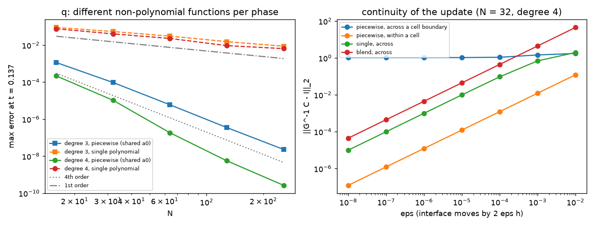

# 81 界面の速度を共有する区分多項式の再構築による Galerkin 輸送：精度・厳密性・条件数は良好、ただし界面がセル境界を越えると更新が O(1) で不連続（P0-1〜P0-6）

ノート80 の Galerkin 輸送 `G^{n+1} u^{n+1} = C u^n` は、速度の勾配が界面で折れると 1 次に落ちた。ユーザーの次の設計は、界面のセルの近くで**界面の速度 a0 を共有する一つの区分多項式**を使うもの：

```
ξ = (x − x_Γ)/h,   P_-(ξ) = a0 + Σ_{r=1..p} a_r^- ξ^r（左の相）,   P_+(ξ) = a0 + Σ_{r=1..p} a_r^+ ξ^r（右の相）
```

未知数は 2p + 1 個（a0、左の p 個、右の p 個）。条件も 2p + 1 個で、左の p 個の満ちたセルの平均、右の p 個の満ちたセルの平均、界面のセルの質量で重み付けた平均。速度は連続で、勾配は相ごとに自由。a0 は Schur 補行列で書け、分母 `Σ_s ρ_s ∫ L_s / m` は 1/(p+1) より大きい（ユーザー）。粘性の跳びの条件・リミッター・人工の散逸はまだ入れない。

実装は `cases/galerkin_transport.py`（`piecewise=True`）。界面のセルを中心とする 2p + 1 個のセルでは、この区分多項式の基底を使う。ほかのセルは、ノート80 の一つの多項式のまま。基底は Σφ_j = 1 と `∫_{K_i} ρ φ_j = m_i δ_ij` を満たすので、G・C の構造（自由流・総運動量・エネルギーの非増加）はそのまま残る。

あわせて、ユーザーが指摘した U ≠ 1 の不整合を直した。以前は、質量の写像と密度と界面の位置が別々に U を使っていた。今は、すべての関数が変位 s を受け取る（`rho_at(x, s)`、`interfaces(s)`、`matrices(n, p, s, ds)`）。単一の多項式の回帰は、ノート80 と全桁一致した（1 ステップ 2.88e-3、3.78e-4；t = 0.137 で 1.00e-2、9.15e-4）。

```
python -m cases.galerkin_transport [--piecewise]
python -m cases.galerkin_transport_figure
```

## 定式化と理論的根拠
ノート80 は構造を結論だけ書いたので、ここで導出をまとめる。証明したものと、数値で確かめただけのものを分けて書く。

### A. 記号
- セル `K_i`、質量 `m_i = ∫_{K_i} ρ`、セルの特性関数 `χ_i`。
- 内積 `⟨f, g⟩_ρ = ∫ ρ f g`。
- 再構築 `u_h = Σ_j φ_j u_j`。基底は次の 2 条件を満たす：

  (B1) `Σ_j φ_j = 1`（定数の再現）、
  (B2) `∫_{K_i} ρ φ_j = m_i δ_ij`（質量で重み付けたセル平均の再現）。

- 一様な移動 `Φ(x) = x + ds` では `ρ^{n+1}(y) = ρ^n(y − ds)`。運ばれた場を `w(y) = u_h^n(y − ds)` とする。
- G と C は次のとおり：

  ```
  G_ij = ⟨φ_i^{n+1}, φ_j^{n+1}⟩_{ρ^{n+1}},   (C u^n)_i = ∫ ρ^n(x) φ_i^{n+1}(x + ds) u_h^n(x) dx = ⟨φ_i^{n+1}, w⟩_{ρ^{n+1}}
  ```

  （変数変換 y = x + ds による。）

### B. 構造（証明）
1. **Galerkin 射影。** `G u^{n+1} = C u^n` は `⟨φ_i, u_h^{n+1} − w⟩_ρ = 0`（すべての i）と同値。つまり `u_h^{n+1}` は、運ばれた場 w の、ρ^{n+1} で重み付けた L² 直交射影 Πw。
2. **自由流。** `(G1)_i = ⟨φ_i, 1⟩ = Σ_k ∫_{K_k} ρ φ_i = m_i`（B2）。u^n = 1 なら、B1 から w = 1 なので `(C1)_i = m_i^{n+1}`。よって `G⁻¹C1 = 1`。
3. **総運動量。** B1 と B2 から `1ᵀG = m^{n+1ᵀ}`、`1ᵀC = m^{nᵀ}`（`Σ_i φ_i^{n+1} = 1` と移動の質量保存による）。よって `m^{n+1}·u^{n+1} = 1ᵀG u^{n+1} = 1ᵀC u^n = m^n·u^n`。
4. **エネルギーの非増加。** `E^{n+1} = ‖Πw‖²_ρ ≤ ‖w‖²_ρ = ∫ ρ^n (u_h^n)² = E^n`。等号は w が基底の張る空間にあるときに限る。エネルギーのノルムでの増幅率は、直交射影のノルムなので 1 以下。測定値の 1.000000000000 は、射影の値域の中の方向での等号。
5. **G ⪰ M**（M = diag m）。B2 から `∫_{K_i} ρ v_h = m_i v_i`。Cauchy–Schwarz（Jensen）から次が成り立つ：

   ```
   vᵀGv = Σ_i ∫_{K_i} ρ v_h² ≥ Σ_i (∫_{K_i} ρ v_h)² / m_i = vᵀMv
   ```

   等号は v_h が各セルで定数のとき。よって `eig(M^{-1/2} G M^{-1/2}) ≥ 1`。測定値の最小 1.000000 は、定数のベクトル（自由流）で等号になるため。
6. **G = M + Z*Z と局所運動量の補正。**
   - セルの中の揺らぎを `Zv = v_h − Σ_i v_i χ_i` とする。B2 から揺らぎの ρ 平均はセルごとに 0。交差項が消えるので `vᵀGv = vᵀMv + ‖Zv‖²_ρ`。
   - 幾何学的な remap は `u_g = M⁻¹C_g u^n`、`(C_g u)_i = ∫_{K_i} ρ^{n+1} w`（w のセル平均）。
   - w の揺らぎを f とし、`φ_i = χ_i + (Zφ)_i` と分けると `C u^n = M u_g + Z* f`。したがって次が成り立つ：

     ```
     G δu = Z*(f − Z u_g),   δu = u^{n+1} − u_g
     ```

   - Z1 = 0 なので `1ᵀZ* = 0`。よって `Σ_i m_i δu_i = 1ᵀGδu = 0`：補正は総運動量を変えない。δp_i = m_i δu_i の和は、測定で ≤ 1.4e-15。
   - |δu| の大きさは、揺らぎの射影の誤差 `f − Zu_g` の大きさで決まる。単一の多項式は、界面のセルで揺らぎを表せない（勾配の折れ）。補正が界面に集中したのはこのため。

### C. 界面の速度を共有する区分多項式と Schur 補行列
- セルを幅 1 に正規化し、界面のセルを `[0, 1]`、界面を θ とする。`μ_c^r = ∫_{K_c} ξ^r`（ξ = x − θ）とする。
- 条件は次の 3 組：
  - 左の満ちたセル c = −p … −1：`a0 + Σ_r a_r^- μ_c^r = u_c`。行列 `B_- = [μ_c^r]` は p×p。
  - 右の満ちたセル c = 1 … p：`a0 + Σ_r a_r^+ μ_c^r = u_c`（`B_+`）。
  - 界面のセル（`m = ρ_- θ + ρ_+(1 − θ)`）：`(ρ_- ∫_0^θ P_- + ρ_+ ∫_θ^1 P_+) / m = u_0`。
- a0 を固定すると、左右の係数は `a^± = B_±⁻¹(u_± − a0 1)` で決まる。代入すると `P_s = a0 L_s + Q_s[u_s]` となる。
  - `L_s(ξ) = 1 − Σ_r (B_s⁻¹1)_r ξ^r`。相 s の満ちたセルで平均が 0、`L_s(0) = 1`。
  - `Q_s[u_s]` は u_s だけで決まる部分。
- 界面のセルの条件から、a0 が次のように決まる：

  ```
  a0 = (u_0 − Σ_s ρ_s ∫_{K_0∩Ω_s} Q_s[u_s] / m) / D,   D = Σ_s ρ_s ∫_{K_0∩Ω_s} L_s / m
  ```

  D ≠ 0 なら、再構築は一意で、2p + 1 個の平均の線形関数。
- **未証明の点**：D > 0 と下限 `D > 1/(p+1)` はユーザーの見積もりで、こちらでは証明していない。P0-3 の掃引で数値的に確かめただけ（最小 0.545〜0.408、下限 0.333〜0.167）。
- **原因が未確認の点**：掃引の値が密度比によらない原因は確かめていない。最大・最小を与える θ が端点（界面のセルが一相だけ）にあれば説明がつくが、未確認。
- **多項式の厳密性。** データが相ごとの次数 p 以下の多項式で、界面で連続なら、それ自身が 2p + 1 個の条件を満たす。解は一意なので、再構築はそれと一致する（P0-2、丸め誤差まで）。
- **4 次の根拠。** 局所的な厳密性と再構築の有界性（P0-3 の増幅率）から、相ごとになめらかなデータに対して再構築の誤差は `O(h^{p+1})`。G、C の構造（B）は基底の選び方によらないので、そのまま残る。kink の誤差が smooth と全桁一致するのも、この厳密性による。kink で足した部分は帯の中の 2 次なので、誤差なしに運ばれる。

### D. 演算子の連続性
- **セルの中では連続。** 区分多項式を使うセルの組は、界面のセル cz を中心とする S(cz) = {cz − p … cz + p}。界面がセルの中で動くあいだ、この組は変わらない。条件の行列の要素は θ の多項式なので、正則なら A⁻¹ は θ のなめらかな関数。よって基底、G、C は θ に滑らかに依存し、`‖T(θ + 2ε) − T(θ)‖ = O(ε)`。測定値は 12ε。
- **セル境界では跳ぶ。** 界面がセル境界を越えると cz が 1 増え、S が 1 セルずれる。
  - 抜けるセル cz − p は、区分多項式から、その中心の単一の多項式に戻る。そのステンシルは界面をまたぎうる。
  - 入るセル cz + p + 1 は、逆に区分多項式になる。
  - さらに、θ = 1 の界面のセル（右の相の部分が幅 0）と、θ = 0 の新しい界面のセルでは、条件の組そのものが異なる。

  このため、境界の両側の極限で基底が一致しない。`T(0⁺) − T(0⁻) ≠ 0`、つまり O(1) の跳びになる（測定値 1.05）。

  ただし、どちらの基底も相ごとになめらかな u を `O(h^{p+1})` で近似する。このため、滑らかな u に作用させた差は小さい（‖u¹ − u⁰‖ は 1e-8 で 2.3e-6）。不連続なのは演算子で、なめらかな u での結果ではない。
- **(1 − θ, θ) のブレンドが特異になる理由。** cz + 1 を中心とするステンシルでは、界面はその左の隣のセル cz にある。界面の左側の多項式の条件は、満ちたセル p − 1 個と、cz の中の幅 θ の部分。θ → 0 でこの部分の重みが 0 になり、左の多項式の p 個の係数を p − 1 個の条件で決めることになる。行列は特異に近づき、基底の係数は θ の負のべきで発散する。重み θ を掛けても打ち消せない。
- **中央でのブレンド（1/4〜3/4）が連続になる理由と欠点。** 両方の成分が正則な範囲だけで混ぜ、重みは θ の連続関数。そのため基底は連続。だが重みの傾き（2/セル）に、二つの成分の差（O(1)、その中に界面の近くの大きな係数）が掛かる。結果として `dT/dθ` が大きい（測定値 ≈ 4.5e3 ε）。また、区分多項式の厳密性が成り立たない成分を混ぜるので、精度も落ちる。

### E. 次の提案の根拠（連続な重みの制約付き最小二乗）
- 界面のまわりのセルの組を、界面のセルが替わっても変わらない広さに固定する。セル i の多項式（a0 を共有する区分の形）を次で決める：

  ```
  min Σ_k w_k(x_Γ) (平均_k(P) − u_k)²   条件：平均_i(P) = u_i
  ```

  `w_k(x_Γ) ≥ 0` は界面からの距離の連続関数。遠いセルは 0 に連続に落ちる。
- 期待できる性質：
  - 条件 `平均_i(P) = u_i` から、B2 は厳密に成り立つ。B1 は、定数が最小二乗の残差 0 の解であることから成り立つ。
  - 相ごとの多項式のデータは残差 0 で一意に再現されるので、厳密性も残る（重み付き正規方程式が正則な限り）。
  - 重みが x_Γ の連続関数で、正規方程式が一様に正則なら、解は x_Γ に連続に依存する。つまり P0-4 の跳びが消える。

  ステンシルの切り替えを、重みの連続な変化に置き換える考え方。
- 確かめるべき点：
  - 正規方程式の一様な正則性（重みが 0 に近いセルを除いても、条件が足りていること）。
  - 精度（P0-1）。
  - 局所性（P0-5）。

## 図


左：相ごとに別の非多項式の関数（phases）を運んだ t = 0.137 の誤差。右：界面が 2εh 動くときの更新の跳び `‖G⁻¹C − I‖₂`（N = 32、4 次）。

## P0-1 勾配が界面で折れる場合の高次精度
q は 3 種類。
- smooth：sin 2πz。
- kink：帯の中だけ 3(z − A0)(B0 − z) を足す（連続、勾配が両方の界面で折れる）。
- phases：帯の中は e^z cos 3z、外は sin 2πz。両方の界面で連続になるよう、中に一次関数を足す（相ごとに別の非多項式の関数）。

密度比 1000、CFL 0.37。最大誤差を途中の時刻 t = 0.05、0.1 と t = 0.137 で測った（N = 16、32、64、128、256）。

| q | 再構築 | t | N = 16 | 32 | 64 | 128 | 256 | 次数 |
| --- | --- | --- | --- | --- | --- | --- | --- | --- |
| kink | 区分 3 次 | 0.05 | 5.19e-4 | 6.83e-5 | 9.14e-6 | 6.51e-7 | 1.87e-8 | 2.93、2.90、3.81、5.12 |
| | | 0.1 | 1.75e-3 | 6.46e-5 | 5.08e-6 | 3.63e-7 | 4.71e-8 | 4.76、3.67、3.81、2.95 |
| | | 0.137 | 1.10e-3 | 1.04e-4 | 6.30e-6 | 5.75e-7 | 2.06e-8 | 3.40、4.05、3.45、4.80 |
| kink | **区分 4 次** | 0.05 | 2.79e-4 | 1.58e-5 | 1.85e-7 | 8.35e-9 | 2.81e-10 | 4.15、6.41、4.47、4.89 |
| | | 0.1 | 2.33e-4 | 1.13e-5 | 4.26e-7 | 9.36e-9 | 6.10e-10 | 4.36、4.74、5.51、3.94 |
| | | 0.137 | 1.94e-4 | 2.61e-5 | 4.95e-7 | 1.09e-8 | 3.40e-10 | 2.90、5.72、5.51、5.00 |
| kink | 単一 4 次 | 0.137 | 3.67e-2 | 1.80e-2 | 1.03e-2 | 4.20e-3 | 2.92e-3 | 1.03、0.81、1.29、0.53 |
| phases | 区分 3 次 | 0.05 | 6.28e-4 | 8.49e-5 | 4.18e-6 | 3.25e-7 | 2.23e-8 | 2.89、4.35、3.68、3.86 |
| | | 0.1 | 1.45e-3 | 1.03e-4 | 6.61e-6 | 3.91e-7 | 2.74e-8 | 3.81、3.97、4.08、3.84 |
| | | 0.137 | 1.14e-3 | 9.48e-5 | 5.94e-6 | 3.50e-7 | 2.30e-8 | 3.59、4.00、4.09、3.93 |
| phases | **区分 4 次** | 0.05 | 2.36e-4 | 8.49e-6 | 1.31e-7 | 5.32e-9 | 2.35e-10 | 4.79、6.02、4.62、4.50 |
| | | 0.1 | 1.78e-4 | 1.06e-5 | 2.10e-7 | 6.93e-9 | 2.28e-10 | 4.07、5.65、4.92、4.93 |
| | | 0.137 | 2.15e-4 | 1.03e-5 | 1.83e-7 | 5.61e-9 | 2.65e-10 | 4.38、5.82、5.03、4.41 |
| phases | 単一 3 次 | 0.137 | 8.98e-2 | 5.39e-2 | 3.04e-2 | 1.54e-2 | 8.72e-3 | 0.74、0.82、0.99、0.82 |
| phases | 単一 4 次 | 0.137 | 7.60e-2 | 4.03e-2 | 2.28e-2 | 9.36e-3 | 6.45e-3 | 0.92、0.82、1.29、0.54 |

- **区分多項式は、勾配の折れも相ごとに別の関数も、途中の時刻を含めて 3 次・4 次（4 次はおおむね 4.4〜5.5）。** 単一の多項式は 1 次（0.5〜1.3）のまま。
- 区分版では、kink の誤差が smooth と全桁一致する。更新は線形で、kink で足した帯の中の 2 次の関数は、区分多項式で厳密に表せるので誤差なしに運ばれる（P0-2）。誤差は sin の部分だけから来る。
- smooth でも区分版は単一より小さい（4 次、t = 0.137：区分 1.94e-4 … 3.40e-10、単一 9.15e-4 … 3.51e-9）。
- 界面がちょうどセル境界にある状態から 1 ステップ（phases）：区分 3 次で 2.84e-4、2.10e-5、1.97e-6、1.71e-7（次数 3.76、3.41、3.53）、区分 4 次で 8.63e-5、2.02e-6、9.13e-8、3.40e-9（5.42、4.47、4.75）。自由流 ≤ 4.3e-14、運動量 ≤ 2.4e-15。

構造（1 ステップ、N = 16〜128 の最大）：

| | 区分 3 次 | 区分 4 次 | 単一 4 次（参考） |
| --- | --- | --- | --- |
| 自由流 | 9.4e-15 | 6.1e-14 | 1.0e-13 |
| 総運動量 | 4.2e-16 | 1.7e-15 | 1.1e-16 |
| エネルギーで重み付けた増幅率 | 1.000000000000 | 1.000000000000 | 1.000000000000 |
| 1 ステップの E の相対変化 | −3.6e-7 〜 −6.0e-14 | −2.3e-8 〜 +8.9e-16 | −2.6e-8 〜 +8.9e-16 |
| eig(M^{-1/2} G M^{-1/2}) | [1.000000, 6.367] | [1.000000, 7.436] | [1.000000, 43.84] |

- G ⪰ M（固有値は 1 以上、ユーザーの指摘どおり）。上限は区分版で 6〜7 倍小さい。

## P0-2 多項式の厳密性
相ごとに別の乱数の多項式（次数 p、両方の界面で連続）を、各セルの 7 点で再構築と比べた最大誤差（N = 16、密度比 1000）：次数 2 で 1.0e-15、3 で 2.4e-15、4 で 2.2e-14。**丸め誤差の範囲で厳密。**

## P0-3 密度比と体積率の掃引
界面のセルの中の界面の位置 θ を 0〜1 で 501 点動かし、最大と最小を取った。

| p | 条件数の最大 | Schur の分母の最小 | 下限 1/(p+1) | 再構築の増幅率の最大 |
| --- | --- | --- | --- | --- |
| 2 | 69.59 | 0.545 | 0.333 | 3.333 |
| 3 | 893 | 0.480 | 0.25 | 5.333 |
| 4 | 1.586e4 | 0.438 | 0.2 | 8.533 |
| 5 | 3.657e5 | 0.408 | 0.167 | 13.867 |

- ユーザーの表と全桁一致。**密度比 1、1e3、1e6 で同じ値**（質量で重み付けた平均でも、Schur の分母と増幅率は密度比によらない）。分母は下限を十分に上回る。

## P0-4 界面の移動に伴う演算子の連続性（**未解決**）
界面を 2εh 動かす（N = 32、4 次、kink）。セル境界をまたぐ場合（ステンシルの中心が界面のセルとともに切り替わる）と、セルの中の場合。

| ε | 1e-2 | 1e-4 | 1e-6 | 1e-8 |
| --- | --- | --- | --- | --- |
| 区分、セル境界をまたぐ：`‖G⁻¹C − I‖₂` | 1.75 | 1.09 | 1.05 | 1.05 |
| 区分、セル境界をまたぐ：`‖u¹ − u⁰‖∞` | 2.7e-2 | 2.6e-3 | … | 2.3e-6 |
| 区分、セルの中：`‖G⁻¹C − I‖₂` | 0.121 | 1.23e-3 | 1.23e-5 | 1.23e-7 |
| 単一、セル境界をまたぐ：`‖G⁻¹C − I‖₂` | 1.97 | 9.53e-2 | 9.95e-4 | 9.95e-6 |
| ブレンド、セル境界をまたぐ：`‖G⁻¹C − I‖₂` | 45 | 0.447 | 4.47e-3 | 4.47e-5 |
| ブレンド、セルの中：`‖G⁻¹C − I‖₂` | 183 | 1.82 | 1.82e-2 | 1.82e-4 |

E の相対変化はどれも 1e-11 程度。

- **区分版は、界面がセル境界を越えるとき、更新が O(1)（≈ 1.05）で跳ぶ。ε → 0 で消えない。** 界面のセルが替わると、区分多項式を使うセルの組が 1 セルずれ、基底そのものが不連続に変わるため。
- ‖u¹ − u⁰‖ は ε とともに小さくなる。滑らかな u では、跳ぶ前後の基底がどちらも高次で同じ関数を近似するので、跳びは u に作用すると打ち消し合う。だが演算子としては不連続で、なめらかでない u では、界面がセル境界を越えるたびに O(1) の変化が入りうる。
- 単一の多項式は、ステンシルが界面の位置によらないので連続（≈ 1e3 ε）。ブレンドの係数はその 4.5 倍。
- **ブレンドの試み 1**：界面のセルを中心とするステンシルと、その隣（cz + 1）を中心とするステンシルを、θ に比例して (1 − θ, θ) で混ぜた。θ → 0 で特異になった。cz + 1 を中心とするステンシルは、界面が左の端にあると左の満ちたセルが p − 1 個しかないため。
- **ブレンドの試み 2**：θ ≤ 1/4 で cz だけ、θ ≥ 3/4 で cz + 1 だけ、その間は一次で混ぜた（どちらのステンシルも正則な範囲）。**連続にはなった**（ε に比例して 0）。だが ε に対する係数が大きく（`‖G⁻¹C − I‖₂ ≈ 4.5e3 ε`、セルの中では 1.8e4 ε。区分版のセルの中は 12 ε）、精度も落ちた（1 ステップの誤差 2.34e-3、区分版は 1.55e-5）。自由流 2.2e-11、増幅率 1.00000000001 と構造は残る。混ぜる重みの θ 微分が大きく、基底の変化がそのまま更新に入る。

## P0-5 局所運動量の整合性：幾何学的な remap と Galerkin の補正
同じ再構築で、直接の幾何学的 remap `u_g = M⁻¹ C_g uⁿ` と Galerkin の更新 `u^{n+1}` を比べた。補正の運動量を `δp_i = m_i (u^{n+1}_i − u_{g,i})` とする（G = M + Z*Z、Gδu = Z*(f − Ru_g) の分解）。|δu| を、界面から 2 セル以内（near）とそれ以外（away）に分けた。1 ステップ、smooth、N = 16 → 128。

| 再構築 | near | away | remap の誤差 | Galerkin の誤差 |
| --- | --- | --- | --- | --- |
| 単一 3 次 | 2.8e-3 → 1.1e-6 | 1.0e-4 → 2.5e-8 | 4.0e-4 → 1.4e-7 | 2.9e-3 → 1.1e-6 |
| 区分 3 次 | 3.8e-4 → 1.4e-7 | 2.7e-4 → 1.3e-7 | ≈ Galerkin | |
| 区分 4 次 | 1.1e-4 → 2.9e-9 | 2.5e-4 → 8.7e-9 | 1.2e-8（N = 128） | 1.2e-8（N = 128） |

δp の和は ≤ 1.4e-15（総運動量は保たれる）。単一 4 次は単一 3 次と同じ傾向。

- 単一の多項式では、Galerkin の補正が界面の近くに集中し（away の 30〜40 倍）、Galerkin の誤差は remap の誤差より大きい。界面の近くで、補正が精度を落としている。
- **区分版では、補正は界面の近くと遠くで同じ大きさで、Galerkin と remap の誤差はほぼ同じ。** 局所運動量の補正が、界面に偏らない。

## P0-6 多段の増幅
N = 32、40 ステップ（界面は約 15 セル動き、何度もセル境界を越える）。T = G⁻¹C。

| 再構築 | 1 ステップの ‖T‖∞ の最大 | 1 ステップの ‖T‖₂ の最大 | 積の ‖·‖∞、‖·‖₂ |
| --- | --- | --- | --- |
| 単一 3 次 | 14.60 | 7.89 | 1 ステップとほぼ同じ |
| 単一 4 次 | 10.21 | 5.53 | 同上 |
| 区分 3 次 | 3.65 | 2.32 | 同上 |
| 区分 4 次 | 5.22 | 2.91 | 同上 |

- 積のノルムは 1 ステップとほぼ同じで、ステップとともに増えない（エネルギーのノルムで増幅率が 1 以下であることと整合）。区分版は ‖T‖∞ が 3〜4 倍小さい。ただし ‖T‖∞ > 1 なので、最大値原理（オーバーシュートなし）は成り立たない。P0-4 の跳びがあっても、積は増えない。

## まとめ
- 界面の速度を共有する区分多項式で、勾配の折れや相ごとに別の関数でも 4 次（途中の時刻を含む）に戻った。多項式の厳密性（丸め誤差）、Schur の分母の下限、条件数は、密度比によらずユーザーの見積もりどおり。保存の構造（自由流・総運動量・エネルギーの非増加・G ⪰ M）も保たれる。局所運動量の補正は界面に偏らず、多段の増幅もない。
- **ただし、界面がセル境界を越えるとき、更新の演算子が O(1) で不連続。** ユーザーの「収束次数が回復しただけで成功とはしない」の条件を、まだ満たさない。ステンシルを混ぜると連続にはなるが、精度が落ち、ε に対する係数が大きい。
- このため、多次元化には進まない。

## 次（提案）
- 連続な重みによる、セルごとの制約付き重み付き最小二乗。ステンシルを切り替えるかわりに、界面のまわりの広めのセルの組を固定する。界面からの距離の連続な重みで平均の条件を課し、セル自身の平均と定数の再現は制約として厳密に保つ。界面がセル境界を越えても、重みが連続なら基底も連続になる。区分の形（a0 共有）はそのまま。
- これで P0-4 の跳びが ε に比例して消え、P0-1 の 4 次・P0-5 の局所性が保たれるかを、同じ試験で確かめる。
- そのあとで、P1（二次元）、P2（PLIC）、P3（CCD）。
