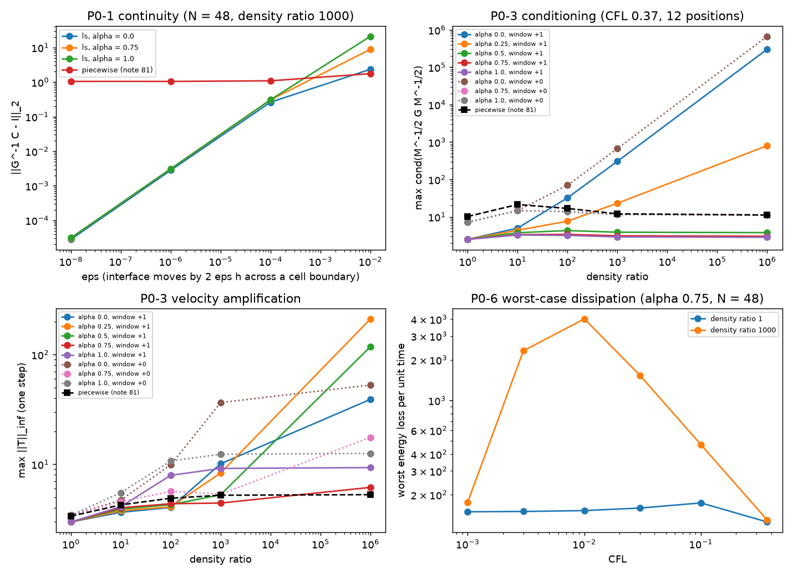

# 82 連続な重みの制約付き最小二乗の再構築：界面がセル境界を越えても演算子は連続。条件数と速度増幅は、窓を 1 セル広げた質量重み（α = 0.75）で密度比 1e6 まで抑えられる（P0-1〜P0-7）

ノート81 の区分多項式（界面の速度 a0 を共有）は、界面がセル境界を越えると更新の演算子が O(1)（≈ 1.05）で跳んだ。ユーザーの指摘：問題はステンシルの切り替え方ではなく、Galerkin 射影の近似空間そのものが不連続に変わること。合格条件は連続性だけでなく、次の 4 つを同時に満たすこと：

- セル平均の厳密な保存
- 区分多項式の高次の再現
- 界面の移動に対する演算子の連続性
- 密度比に対する良好な条件数（有限の CFL 数での速度増幅を含む）

ユーザーの提案（共通ステンシル、各セル自身の平均は厳密な制約、重み `W_jj = ω_geo,j (m_j/m_ref)^α`）を実装し、ユーザーの順序 P0-1〜P0-7 で測った（`python -m cases.galerkin_cls`、一次元、厳密な界面、4 次の区分多項式、N = 48 など）。

```
python -m cases.galerkin_cls [--jobs N]      # docs/figures/galerkin_cls.json
python -m cases.galerkin_cls_figure
```

## 図


左上：セル境界をまたぐときの演算子の跳び。右上：条件数の密度比依存。左下：1 ステップの速度増幅 ‖T‖∞。右下：最悪のエネルギー損失の単位時間あたりの値の CFL 依存。

## 定式化と理論的根拠
### A. 跳びの式（ユーザー）
再構築 R（u ↦ u_h）、ρ で重み付けた内積の随伴 R*、厳密な移動 𝒰 とすると、`G₁ = R₁*R₁`、`C = R₁*𝒰R₀` なので次が成り立つ：

```
T − I = G₁⁻¹(R₁*𝒰R₀ − R₁*R₁) = G₁⁻¹R₁*(𝒰R₀ − R₁)
```

移動距離 → 0 で 𝒰 → I でも、`R₁ − R₀ = O(1)` なら T − I = O(1)。連続性の条件は、R が界面の位置について連続であること。

### B. 実装した再構築（`Reconstruction(piecewise="ls", alpha, extra)`）
界面 zz がセル cz の中の割合 θ の位置にあるとする。

- **窓**：セル `cz − p − e … cz + p + 1 + e`（e = extra）。端の 2 セルの重みは `1 − η(θ)`（左端）と `η(θ)`（右端）、ほかは 1。`η(t) = 3t² − 2t³`。各重みに `(m_j / max m)^α` を掛ける（m_ref は解に効かない：重み全体の定数倍は最小二乗の解を変えない）。
  - θ = 1 の窓（左端の重み 0、右端の重み 1）は、次のセルの θ = 0 の窓と同じ。そのため、重みは界面の位置について連続（セル境界でも）。
- **区分多項式を使うセル（対象のセル）**：窓と同じ範囲の cz − p … cz + p + 1 で、端の 2 セルは同じ η の重み λ で、この再構築と中心の単一の多項式（ノート80）を混ぜる。対象の組の出入りもこれで連続になる。
- **各対象のセル i の適合**：未知数は区分多項式の係数 a（2p + 1 個、界面の値 a0 を共有）。

  ```
  min_a ½‖W^{1/2}(A a − u)‖²   制約：b_iᵀ a = u_i
  ```

  A の行は、窓の各セルの質量で重み付けた平均（その相の部分の積分）。b_i は対象のセルの行。解き方は、`a = b_i u_i/(b_i·b_i) + Z y`（Z は b_iᵀ の零空間の正規直交基底）、`y = (W^{1/2}AZ)⁺ W^{1/2}(u − A b_i u_i/(b_i·b_i))`。正規方程式は使わない（SVD の最小二乗）。

### C. 保たれる性質（証明）
- **B2（セル平均）**：対象のセルの平均は制約として厳密。単一の多項式もセル平均を保つ。その混合（重みの和 1）も保つ。
- **B1（定数の再現）**：u ≡ 1 なら、a = (1, 0, …, 0) が制約を満たし、残差 0。解が一意なら、それが解。混合も定数を保つ。
- **区分多項式の厳密な再現**：データが相ごとの次数 p 以下の多項式（界面で連続）なら、それ自身が残差 0 で制約を満たす。解が一意なら一致する。測定でも、すべての α・密度比・位置で ≤ 1.3e-12。
- **エネルギーの非増加・自由流・総運動量**：B1・B2 から（ノート80・81 の証明がそのまま適用される）。
- **連続性**：A の行と重みは界面の位置について連続。`W^{1/2}AZ` が列について満階数（σ_min > 0）なら、擬似逆行列は連続で、解も連続。P0-2 で全位置の σ_min を測った。

### D. 窓を 1 セル広げる理由（測定で見つけた）
e = 0 の窓は、θ = 0 と θ = 1 で端のセルの重みが 0 になり、データ 2p + 1 個・未知数 2p + 1 個の正方の系になる。正方の系では、重みは解に効かない。

- このとき、p + 1 個のセルを持つ側が a0 を決める。
- 界面の左が重い（B0）向きで、軽い側が p + 1 個を持つと、a0 は軽い相のデータで決まる。重い相の再構築が軽いセルの値に O(1) の係数で依存し、`∫ρφ_j² / m_j` が密度比の程度に大きくなる。
- 条件数は密度比 1000 で 5.76e3。α を変えても、ノート81 の区分多項式でも同じ。

窓を両側に 1 セル広げる（e = 1）と、どの θ でも両側に p + 1 個以上の満ちたセルが残り、過剰決定になる。質量の重み（α > 0）で a0 を重い相に決めさせられる。

### E. 質量で重み付けた平均のリプシッツ定数は密度比に比例する
軽いセル（密度 ρ_l）に、重い相（ρ_h）の幅 δ の薄片が入ると、平均の重い相の重みは `ρ_hδ/(ρ_l(h − δ) + ρ_hδ)`。その δ = 0 での微分は `ρ_h/(ρ_l h) = 密度比/h`。変位 h/密度比 で、軽いセルの平均は重い相の値に大きく寄る。

未知数そのものが、界面がセル境界を越えるときに、密度比に比例する速さで意味を変える。そのため、セル境界をまたぐときの `‖T − I‖/ε` は、再構築によらず密度比に比例する。測定（N = 48、ε = 1e-6）：

| 密度比 | 1 | 10 | 1000 |
| --- | --- | --- | --- |
| ls（e = 0、α = 0）：またぐ / セルの中 | 16 / 5.8 | 49 / 7.2 | 4.5e3 / 88 |
| 単一の多項式：またぐ / セルの中 | 3.8 / 3.8 | 10.7 / 5.6 | 995 / 35 |

連続性の破れではなく、リプシッツ定数が大きいということ。

### F. エネルギーの損失（ユーザーの 7 節）
Galerkin 射影なので、1 ステップの損失は射影の残差 `½‖𝒰R₀uⁿ − R₁uⁿ⁺¹‖²_ρ`。

- **滑らかなデータ**：残差は再構築の誤差の 2 乗の程度で、極めて小さい（P0-6：丸め誤差）。
- **格子規模のデータ**：再構築した場はセル境界で O(|u|) だけ跳ぶ。移動距離 ds の間に跳びが掃く体積は ds に比例し、その部分は新しい空間で表せない。損失は 1 ステップに `~E·ds/h`。単位時間あたりでは `~E·U/h`、つまり Δt によらない一定の散逸が残る。
- **界面に接する軽いセル**：E の効果で、変位 h/密度比 を超えると 1 ステップの損失が O(1) に飽和する（そのセル自身のエネルギーに対する割合）。

## P0-1 演算子の連続性（N = 48、密度比 1000、kink、e = 1）
`‖G⁻¹C − I‖₂` / kink の 1 ステップの誤差：

| | ε = 1e-2 | 1e-4 | 1e-6 | 1e-8 |
| --- | --- | --- | --- | --- |
| 区分多項式（ノート81）、またぐ | 1.75 / 1.3e-6 | 1.09 / 4.3e-7 | 1.05 / 3.3e-7 | **1.05 / 3.3e-7** |
| ls α = 0、またぐ | 2.35 / 2.0e-6 | 0.262 / 1.8e-7 | 2.8e-3 / 1.8e-9 | **2.81e-5 / 1.8e-11** |
| ls α = 0.75、またぐ | 8.91 / 5.4e-6 | 0.307 / 1.6e-7 | 3.08e-3 / 1.6e-9 | **3.08e-5 / 1.6e-11** |
| ls α = 1、またぐ | 21.1 / 1.1e-5 | 0.310 / 1.5e-7 | 3.1e-3 / 1.5e-9 | 3.1e-5 / 1.5e-11 |
| ls α = 0.75、セルの中 | 0.056 / 8.4e-8 | 5.66e-4 | 5.66e-6 | 5.66e-8 / 1.2e-13 |

- **跳びは ε に比例して消え、誤差の床（3.3e-7）もなくなる。** ユーザーの実験（等重み 3.03e-5、質量重み 4.37e-5、ε = 1e-8）と同じ。
- 有限の移動量（ε = 1e-2）では、α が大きいほど値が大きい（2.35 → 21.1）。ユーザーの質量重みの 22.3 と同じ向き。E 節のリプシッツ定数（密度比/h）が、α が大きいほど強く効く。

## P0-2 全位置での可解性
界面の位置を 1 セルにわたって 400 点動かした `min σ_min(W^{1/2}AZ)/σ_max`（e = 1）：

| α \ 密度比 | 1 | 10 | 100 | 1e3 | 1e6 |
| --- | --- | --- | --- | --- | --- |
| 0 | 7.0e-5 | 7.0e-5 | 7.0e-5 | 7.0e-5 | 7.0e-5 |
| 0.5 | 7.0e-5 | 5.3e-5 | 3.0e-5 | 1.6e-5 | 2.7e-6 |
| 0.75 | 7.0e-5 | 4.5e-5 | 1.8e-5 | 6.8e-6 | 4.8e-7 |
| 1 | 7.0e-5 | 3.8e-5 | 1.1e-5 | 3.0e-6 | 8.6e-8 |

- **全位置で正（階数は落ちない）。** α > 0 で小さくなるのは、重みの大きさの差 `(密度比)^{α/2}` が特異値の比に入るため（a0 を軽い相のデータで決めない、という意図した効果）。σ_min/σ_max は数値の安定性の目安で、再構築の大きさは条件数と ‖T‖ で別に測る（P0-3）。

## P0-3 質量重みの指数 α の探索（CFL 0.37、12 位置の最大、N = 48）
条件数 `cond(M^{-1/2}GM^{-1/2})` / ‖T‖∞ / ‖T‖₂（エネルギーで重み付けた増幅率は、すべて 1 + 3e-10 以下）：

| | 密度比 1 | 10 | 100 | 1e3 | 1e6 |
| --- | --- | --- | --- | --- | --- |
| 区分多項式（ノート81） | 10.2 / 3.36 / 2.04 | 21.4 / 4.27 / 2.57 | 16.8 / 4.90 / 2.74 | 12.0 / 5.22 / 2.91 | 11.2 / 5.29 / 2.96 |
| ls e = 0、α = 0 | 7.2 / 3.4 / 2.0 | 14.7 / 4.7 / 2.2 | 70 / 9.9 / 5.5 | 675 / 36.5 / 20 | 6.7e5 / 52.7 / 28.8 |
| ls e = 0、α = 0.75 | 7.2 / 3.4 / 2.0 | 14.7 / 4.6 / 2.4 | 13.7 / 5.7 / 2.7 | 11.5 / 5.4 / 2.9 | 11.1 / 17.6 / 11.5 |
| ls e = 1、α = 0 | 2.5 / 3.0 / 1.4 | 5.0 / 3.7 / 1.7 | 32 / 4.0 / 2.0 | 306 / 10.1 / 4.9 | 3.0e5 / 39 / 22 |
| ls e = 1、α = 0.25 | 2.5 / 3.0 / 1.4 | 4.4 / 3.8 / 1.7 | 7.7 / 4.1 / 2.1 | 23 / 8.3 / 5.1 | 801 / 211 / 145 |
| ls e = 1、α = 0.5 | 2.5 / 3.0 / 1.4 | 3.8 / 3.9 / 1.9 | 4.3 / 4.3 / 2.4 | 3.9 / 5.3 / 2.7 | 3.8 / 118 / 82 |
| **ls e = 1、α = 0.75** | **2.5 / 3.0 / 1.4** | **3.3 / 4.0 / 2.1** | **3.4 / 4.4 / 2.6** | **3.1 / 4.4 / 2.7** | **3.0 / 6.2 / 3.0** |
| ls e = 1、α = 1 | 2.5 / 3.0 / 1.4 | 3.3 / 4.1 / 2.3 | 3.2 / 7.9 / 3.1 | 2.9 / 9.2 / 3.5 | 2.8 / 9.3 / 3.6 |

1 ステップの phases の最大誤差（e = 1、α = 0.75）：1.2e-6、1.8e-6、2.1e-6、2.2e-6、2.3e-6（区分多項式は 6.4e-7〜9.9e-7。窓が広いぶん、誤差の定数は約 2 倍）。

- **α = 0（等重み）は、密度比とともに条件数が密度比に比例して悪化する**（1e6 で 3e5）。ユーザーの等重みの 875（1000 で、セル境界の近く）と同じ傾向。
- **α = 1（質量重み）は条件数が最小だが、‖T‖∞ が α = 0.75 より大きい**（密度比 1e3 で 9.2 対 4.4）。
- **α = 0.25、0.5 は、密度比 1e6 で ‖T‖∞ が 211、118 に跳ぶ**。中間の値がいつも良いわけではない（ユーザーの注意どおり）。
- **α = 0.75 と窓 e = 1 が、すべての密度比で条件数 ≤ 3.4、‖T‖∞ ≤ 6.2 を同時に満たす。** これを推奨の構成とする。

### セル境界の近くの条件数（θ の走査、密度比 1000、N = 48）
| θ | 0 | 1e-4 | 1e-2 | 0.1 | 0.5 | 0.9 | 0.99 | 0.9999 |
| --- | --- | --- | --- | --- | --- | --- | --- | --- |
| 左が重い界面 B0：区分多項式 | 5.8e3 | 3.9e3 | 41 | 6.5 | 4.9 | 5.5 | 5.8 | 5.9 |
| B0：ls e = 0、α = 0.75 | 5.8e3 | 3.9e3 | 40 | 6.1 | 2.7 | 5.0 | 10.1 | 5.8e3（θ = 0.99999） |
| **B0：ls e = 1、α = 0.75** | **4.1** | **4.2** | **4.3** | 2.0 | 1.6 | 2.0 | 3.8 | 4.1 |
| B0：ls e = 1、α = 0 | 599 | 527 | 18 | 6.5 | 6.2 | 149 | 567 | 599 |
| 右が重い界面 A0：区分多項式 | 5.9 | 5.9 | 5.8 | 5.5 | 4.9 | 6.5 | 41 | 5.5e3（θ = 0.99999） |
| **A0：ls e = 1、α = 0.75** | **2.3** | **2.3** | **2.2** | 2.1 | 1.4 | 2.1 | 3.7 | 2.3 |

（12 位置の走査は θ の小さい所を通らないので、区分多項式の値が 12 程度に見えていた。走査ではセル境界の近くで 5.8e3。）

- 区分多項式は、θ → 1 で 5.5e3 まで悪化して θ = 0 で 5.9 に跳ぶ。ノート81 の演算子の跳びを、条件数の側から見たもの。
- ユーザーの値（境界の近くで等重み 875、質量重み 5.88）と同じ水準。窓を広げると等重みでも 600 以下、α = 0.75 で 4.3 以下。

## P0-4 区分多項式の精度（密度比 1000、CFL 0.37、α = 0.75、e = 1）
最大誤差（N = 16、32、64、128、256）：

| q | t | 誤差 | 次数 |
| --- | --- | --- | --- |
| phases | 0.05 | 4.48e-4 … 6.52e-10 | 4.53、5.22、4.88、4.76 |
| phases | 0.1 | 6.72e-4 … 6.65e-10 | 4.99、5.10、5.06、4.79 |
| phases | 0.137 | 5.92e-4 … 8.33e-10 | 4.82、5.76、4.29、4.57 |
| smooth（= kink） | 0.05 | 7.54e-4 … 7.42e-10 | 4.59、5.71、4.76、4.90 |
| smooth（= kink） | 0.137 | 7.10e-4 … 9.68e-10 | 4.15、6.18、4.49、4.66 |

- **途中の時刻を含めて 4 次以上を保つ。** α = 0、1 もほぼ同じ値。kink は smooth と全桁一致する（帯の中の 2 次の関数は厳密に再現される：C 節）。
- N = 256 の値はノート81（3.4e-10、2.65e-10）の 2.5〜3 倍。窓が広いぶんの定数。

## P0-5 CFL 数への依存（密度比 1000、12 位置の最大）
条件数 / ‖T‖∞ / ‖T‖₂：

| CFL | 0.05 | 0.1 | 0.2 | 0.5 | 0.75 | 1 |
| --- | --- | --- | --- | --- | --- | --- |
| α = 0 | 389 / 6.4 / 2.5 | 223 / 6.0 / 2.4 | 289 / 7.3 / 4.2 | 597 / 8.3 / 4.5 | 597 / 7.2 / 4.2 | 597 / 1 / 1 |
| α = 0.5 | 3.8 / 7.6 / 4.0 | 6.3 / 8.0 / 4.8 | 4.1 / 6.8 / 4.1 | 7.2 / 6.7 / 3.4 | 7.2 / 14.2 / 8.5 | 7.2 / 1 / 1 |
| **α = 0.75** | **3.0 / 7.7 / 4.2** | **4.0 / 7.2 / 3.9** | **3.2 / 6.0 / 3.4** | **4.1 / 3.5 / 2.3** | **4.1 / 5.7 / 2.9** | 4.1 / 1 / 1 |
| α = 1 | 3.4 / 9.2 / 4.2 | 3.5 / 9.4 / 3.9 | 3.0 / 9.5 / 3.6 | 4.1 / 8.6 / 3.4 | 4.1 / 7.0 / 3.1 | 4.1 / 1 / 1 |

- **有限の移動量での異常な増幅は見られない**（α = 0.75 で ‖T‖∞ ≤ 7.7、‖T‖₂ ≤ 4.2、全 CFL）。CFL 1 では厳密な平行移動（T = I の置換）。
- ‖T‖∞ > 1 なので、最大値原理（オーバーシュートなし）は成り立たない。エネルギーのノルムでは増幅率 ≤ 1。

## P0-6 単位時間あたりの数値散逸
滑らかなデータ（phases、N = 64、t = 0.137）の E_h(t)/E_h(0) − 1：CFL 0.37、0.185、0.0925、0.046 で、すべて |·| ≤ 4e-13（α = 0、0.75、1）。**滑らかなデータには散逸がない**（丸め誤差）。

最悪のデータ（`1 − σ_min²(G₁^{1/2}TG₀^{−1/2})`、6 位置の最大、α = 0.75、N = 48）：

| CFL | 0.001 | 0.003 | 0.01 | 0.03 | 0.1 | 0.37 |
| --- | --- | --- | --- | --- | --- | --- |
| 密度比 1：1 ステップの損失 / 単位時間 | 3.1e-3 / 149 | 9.4e-3 / 150 | 3.2e-2 / 153 | 0.10 / 159 | 0.36 / 174 | 0.97 / 126 |
| 密度比 1000：1 ステップの損失 / 単位時間 | 3.7e-3 / 176 | 0.15 / 2.3e3 | 0.84 / 4.0e3 | 0.96 / 1.5e3 | 0.98 / 470 | 1.00 / 130 |

- **密度比 1**：最悪のモードは checkerboard（符号の反転の割合 0.96）。損失は CFL に比例し、単位時間あたり約 150 ≈ 3.1/h で、Δt によらず一定。**ユーザーの見立て（格子規模の速度分布に O(Δt) の損失、単位時間あたり一定の散逸）を確認した。** F 節の見積もり `E·U/h` と同じ形。
- **密度比 1000**：最悪のモードは界面に接するセル（セル 11、32）。CFL ≳ 1/1000 で 1 ステップの損失が O(1) に飽和する（E 節）。そのセル自身のエネルギーに対する割合で、全体のエネルギーに対しては小さいと考えられるが、全体に対する割合は測っていない。
- 毛管波の減衰への影響（格子規模の散逸が物理の散逸に比べてどれだけか）は、この一次元の試験では評価できない。二次元の毛管波で測る必要がある。

## P0-7 多ステップの累積（t = 1：界面は 1 周、すべてのセル境界を越える、CFL 0.37、phases）
| α | N | t = 0.25 | 0.5 | 0.75 | 1 | E(1)/E(0) | ‖T‖∞ の最大 / 積の最大 |
| --- | --- | --- | --- | --- | --- | --- | --- |
| 0 | 32 / 64 | 6.3e-6 / 4.8e-7 | 2.0e-5 / 5.1e-7 | 7.3e-6 / 5.5e-7 | 6.5e-6 / 5.0e-7 | 1.000000 | 10.1 / 4.8 |
| 0.75 | 32 / 64 | 6.6e-6 / 4.3e-7 | 2.0e-5 / 4.6e-7 | 7.1e-6 / 5.1e-7 | 6.6e-6 / 4.7e-7 | 1.000000 | 20.9 / 3.9 |
| 1 | 32 / 64 | 6.8e-6 / 4.3e-7 | 2.0e-5 / 4.6e-7 | 7.1e-6 / 5.1e-7 | 6.8e-6 / 4.7e-7 | 1.000000 | 47.4 / 4.0 |

- 多数の界面の通過で、誤差は増えず、積のノルムは 5 以下で、1 ステップの最大より小さい。
  - **訂正（ノート83）**：この積は初期時刻から累積したもので、途中のステップで混入した誤差の増幅を評価していない。任意の時刻から始めた積の最大 `max_{j<k}‖T_{k−1}⋯T_j‖∞` は、1 ステップの最大と同じ 19.3（α = 0.75、N = 64、87 ステップ）だった。
- 長い計算では、12 位置の走査より多くの位置を通るので、1 ステップの ‖T‖∞ の最大が大きく出る（α = 0.75 で 21、α = 1 で 47）。積が抑えられているので、安定性の問題ではない。最大値原理の破れの大きさとしては記録する。

## まとめ
| 条件 | 結果（推奨：α = 0.75、窓 e = 1） |
| --- | --- |
| セル平均の厳密な保存 | 制約として厳密（自由流 ≤ 1e-13、運動量 ≤ 1e-15） |
| 区分多項式の高次の再現 | 丸め誤差（≤ 1.3e-12）、途中の時刻を含め 4 次以上 |
| 演算子の連続性 | ε に比例して 0（1e-8 で 3.1e-5）、誤差の床も消える |
| 密度比に対する条件数 | 密度比 1〜1e6、全 θ で ≤ 4.3 |
| 有限の CFL 数での速度増幅 | ‖T‖∞ ≤ 7.7（1 ステップ、12 位置）、長い計算で最大 21、積 ≤ 5 |
| 単位時間あたりの散逸 | 滑らかなデータは 0、格子規模のデータは Δt によらず約 3/h |

- 窓を 1 セル広げることが、質量の重みを効かせる条件だった（ユーザーの「重みを滑らかにするだけでは不十分」を、別の理由で確認：正方の系では重みが効かない）。
- 残る問題：
  - 格子規模の散逸が Δt によらず残ること（毛管波の減衰への影響は二次元で測る）。
  - 1 ステップの ‖T‖∞ の最大が、まれな位置で 21 になること。
  - 界面に接する軽いセルのエネルギーの飽和した損失（E 節）。

## 次（提案）
- 二次元化（P1）の前に確かめたいこと：
  - 格子規模の散逸の大きさを、物理の粘性の散逸（毛管波の渦層）と比べる見積もり。
  - ‖T‖∞ の大きい位置の特定（どちらの界面、どの θ か）。
- その後 P1（二次元、厳密な幾何）。CCD との統合はさらに後。
