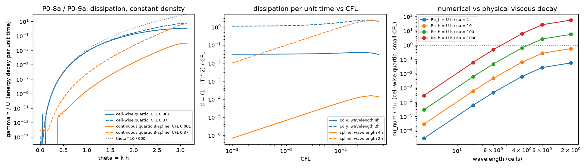

# 83 Galerkin 輸送の数値散逸：セル境界の速度の跳びが Δt によらない散逸を生む。連続な 4 次 B スプラインなら散逸は Δt とともに消える（P0-8a〜P0-8c、P0-9a）

ノート82 で、界面の移動に対する再構築の演算子の連続性は回復した（基準の構成：α = 0.75、窓 e = 1）。ユーザーの指摘：それでも、再構築した速度場そのものは通常のセル境界で不連続で、それが Δt を小さくしても消えない散逸の原因になる。将来の CCD との統合にも関係する。

ユーザーの独立の Fourier 解析を再現し、界面に局在するモードと純粋な Fourier モードを分け、任意の時刻からの増幅を測った。

```
python -m cases.galerkin_fourier          # P0-8a, P0-9a (docs/figures/galerkin_fourier.json)
python -m cases.galerkin_fourier_figure
```

P0-8b・P0-8c は `cases/galerkin_cls.py` の `localized_loss`、`transient`（`docs/figures/galerkin_p08.json`）。

## 図


左：一定密度の単位時間あたりのエネルギー減衰 γh/U（全波数）。中：波長 4 セル・2 セルの d = (1 − |T|²)/CFL。右：セルごとの 4 次多項式の数値散逸と物理の粘性の比 ν_num/ν。

## 定式化と理論的根拠
### A. Bloch の記号（一定密度、周期、一様な速度 U）
セル平均 `u_j = e^{ijθ}`（θ = kh）の再構築を φ_θ とする。φ_θ は Bloch 関数（`φ_θ(x + h) = e^{iθ}φ_θ(x)`）。

- 平行移動 S は Bloch の類を保つ。
- 異なる θ の類は ρ の内積で直交する。
- 再構築の空間の中で、θ の類は 1 次元（1 セルに未知数 1 個）。

したがって、Galerkin の 1 ステップは span(φ_θ) への射影で、次の記号になる：

```
T(C, θ) = ⟨φ_θ, S_C φ_θ⟩ / ⟨φ_θ, φ_θ⟩        （内積は 1 セルの上、C = UΔt/h）
```

|T| ≤ 1（射影）。1 ステップのエネルギー比は |T|²。単位時間あたりの減衰は次の 2 つで表す：

```
d = (1 − |T|²)/C,   γh/U = −log|T|² / C
```

（Δt = Ch/U。）実装の行列（`matrices`、密度比 1、セルごとの多項式、N = 32）は巡回行列で、その固有値はこの記号と 1.7e-14 で一致した。

### B. エネルギーの損失と、セル境界の跳び（ユーザー）
Galerkin 射影なので `Eⁿ − Eⁿ⁺¹ = ½‖(I − Π)𝒰u_hⁿ‖²_ρ`。

- 再構築した場が面 f で `[u_h]_f` だけ跳ぶと、平行移動した場は、各面の下流の幅 UΔt の帯で、上流の多項式の延長の値を持つ。帯の上での新しい空間との差は、主要項で `[u_h]_f`（幅 UΔt の箱関数）。
- 箱関数の射影の成分は、ノルムの 2 乗で O(Δt²)。そのため、残差のノルムの 2 乗は `ρ Σ_f [u_h]_f² UΔt + O(Δt²)`。

よって、次が成り立つ：

```
Eⁿ − Eⁿ⁺¹ = (Δt/2) Σ_f ρ|U|[u_h]_f² + O(Δt²),   −dE/dt = ½ Σ_f ρ|U|[u_h]_f²
```

Bloch の言葉では `γh/U = |J(θ)|²/g(θ)`、`J = φ_θ(½⁺) − φ_θ(½⁻)`、`g = ∫_cell |φ_θ|²`。

セルごとの 4 次多項式（中心 5 セル）では `|J|² = (1024/900) sin¹⁰(θ/2)`。数値の |J|² と全波数で全桁一致した。低波数では `γ ≈ |U| h⁹ k¹⁰/900`。**10 階微分型の超粘性に相当する、高波数選択的な散逸**。

### C. 連続な再構築なら散逸が Δt とともに消える理由
`[u_h]_f = 0`（C⁰ 以上）なら B の主要項が消える。残差は平行移動した場の滑らかさの不足（B スプラインでは結び目での高階微分の跳び）から来て、ノルムの 2 乗で O(Δt²)。

- 1 ステップの損失は O(Δt²)、単位時間あたり O(Δt) で、Δt → 0 で 0。
- 連続な 4 次 B スプライン `u_h = Σ a_j B₄((x − x_j)/h)` のセル平均は `(a_{i−2} + 26a_{i−1} + 66a_i + 26a_{i+1} + a_{i+2})/120 = u_i`。記号は `A(θ) = (66 + 52cos θ + 2cos 2θ)/120`。条件数は `A(0)/A(π) = 120/16 = 7.5`（ユーザーの値）。セル平均が e^{ijθ} に一致することを数値で確かめた（3e-15）。

### D. 物理の粘性との比較
単一の Fourier モードの粘性の減衰は `γ_ν = 2νk²`。数値散逸の実効動粘性は `ν_num = γ_num/(2k²)`。比は次のとおり：

```
γ_num/γ_ν = ν_num/ν = Re_h · ν_num/(Uh),   Re_h = Uh/ν
```

## P0-8a 単相の全波数・全 CFL の散逸（セルごとの 4 次多項式）
小さな C の極限（跳びの式）：

| 波長 | 16h | 8h | 6h | 4h | 3h | 2h |
| --- | --- | --- | --- | --- | --- | --- |
| θ | π/8 | π/4 | π/3 | π/2 | 2π/3 | π |
| γh/U | 8.97e-8 | 7.29e-5 | 1.02e-3 | 3.06e-2 | 0.230 | 1.088 |
| ν_num/(Uh) | 2.91e-7 | 5.91e-5 | 4.65e-4 | 6.19e-3 | 2.63e-2 | 5.51e-2 |

（ユーザーの値と一致。）d = (1 − |T|²)/C（[γh/U]）：

| 波長 \ CFL | 0.001 | 0.01 | 0.1 | 0.37 | 0.5 | 0.75 | 1 |
| --- | --- | --- | --- | --- | --- | --- | --- |
| 8h | 7.29e-5 | 7.34e-5 | 7.65e-5 | 6.70e-5 | 5.45e-5 | 2.48e-5 | 0 |
| 4h | 3.06e-2 | 3.12e-2 | 3.56e-2 [3.57e-2] | 3.57e-2 [3.60e-2] | 2.95e-2 [2.97e-2] | 1.27e-2 | 0 |
| 3h | 0.231 | 0.239 | 0.304 [0.308] | 0.345 [0.370] | 0.288 [0.312] | 0.119 | 0 |
| 2h | 1.096 | 1.164 | 1.766 [1.944] | 2.364 [5.62] | 2.000 [145] | 0.781 [1.18] | 0 |

- **CFL → 0 で、d は 0 にならず一定値に収束する**（波長 4h で 0.0306）。B の式のとおり。
- CFL 0.5 の checkerboard は 1 ステップで完全に消える（|T| ≈ 0、γ = 145 は log の発散）。CFL 1 では厳密な平行移動で散逸 0。
- 1 ステップの誤差 `|T − e^{−iCθ}|`（C = 0.37、波長 8・16・32・64 セル）：1.25e-5、1.44e-8、1.47e-11、1.45e-14。θ について約 10 次（9.75、9.94、9.99）。単相・一定密度では、Galerkin 輸送の位相と振幅の誤差は極めて高次（超収束）。

## P0-9a 連続な 4 次 B スプラインの Galerkin 輸送（一定密度、周期）
d = (1 − |T|²)/C：

| 波長 \ CFL | 0.001 | 0.01 | 0.1 | 0.37 | 0.5 | 0.75 |
| --- | --- | --- | --- | --- | --- | --- |
| 8h | 1.6e-10 | 1.5e-9 | 1.5e-8 | 3.5e-8 | 3.1e-8 | 1.0e-8 |
| 6h | 4.2e-9 | 4.2e-8 | 4.1e-7 | 9.6e-7 | 8.5e-7 | 2.8e-7 |
| **4h** | **6.73e-7** | **6.73e-6** | **6.51e-5** | **1.55e-4** | **1.36e-4** | 4.5e-5 |
| 3h | 3.9e-5 | 3.9e-4 | 3.7e-3 | 8.9e-3 | 7.8e-3 | 2.6e-3 |
| 2h | 0.00987 | 0.0987 | 0.955 | 2.276 | 2.000 | 0.667 |

- **d は CFL に比例して減り、Δt → 0 で 0 に向かう**（C 節の予測どおり）。ユーザーの値と全桁一致。
- 波長 4h、CFL 0.37 で、セルごとの多項式（0.0357）の 1/230。CFL 0.001 で 1/45,500。
- checkerboard（2h）は、CFL 0.5 で両方とも 1 ステップで消える。連続な再構築でも、すべての波数の散逸が消えるわけではない。
- 1 ステップの誤差（C = 0.37、波長 8・16・32 セル）：6.9e-9、3.9e-12、4.7e-15（約 10 次、64 セルで丸め誤差）。

## P0-8b 界面に局在するモードと純粋な Fourier モード（N = 48、α = 0.75、e = 1）
最悪の 1 ステップの損失 `1 − σ_min²`、単位時間あたりの値、[γ = −log σ_min²/Δt]、そのモードの位置：

| 再構築 | 密度比 | CFL 0.001 | 0.01 | 0.1 | 0.37 | 最悪のモードの位置（界面からのセル数）・符号の反転の割合 |
| --- | --- | --- | --- | --- | --- | --- |
| セルごとの多項式（界面なしと同じ） | 1 | 52.6 [52.6] | 55.9 [56.2] | 84.8 [93.3] | 113 [270] | 3〜13 セル（界面と無関係）、1.00 |
| ls（界面適合） | 1 | **149** [150] | 153 [155] | 174 [216] | 126 [448] | **1.5 セル**、0.91〜1.00 |
| セルごとの多項式 | 1000 | 91 [91] | 258 [266] | 115 [132] | 115 [286] | 1〜1.5 セル、1.00 |
| ls | 1000 | 176 [176] | 4.0e3 [8.7e3] | 470 [1.8e3] | 130 [1.2e3] | 0.3〜0.5 セル、0.87〜0.96 |

- **セルごとの多項式・密度比 1 の最悪は 52.6 = 1.096 × 48 で、純粋な Fourier の checkerboard（P0-8a の γh/U = 1.096）そのもの。**
- **ノート82 の約 150 は、界面適合の再構築に局在するモード**（界面から 1.5 セル、checkerboard 型）。密度比 1 でも、界面の区分多項式（勾配の折れを許す基底）が、そのまわりの格子規模の散逸を約 3 倍にする。ユーザーの見立てどおり。
- 密度比 1000 の CFL ≳ 1/1000 の飽和（4.0e3）は、界面のセルの中の 0.3〜0.5 セルの位置（ノート82 E 節の質量で重み付けた平均の効果）。

## P0-8c 任意の時刻からの増幅（N = 64、密度比 1000、t = 0.5、87 ステップ）
| α | 1 ステップの ‖T‖∞ の最大 | 初期時刻からの積 max_k ‖P_{k,0}‖∞ | **任意の時刻からの積 max_{j<k} ‖P_{k,j}‖∞** |
| --- | --- | --- | --- |
| 0 | 10.1 | 4.14 | 10.1（ステップ 75 の 1 ステップ） |
| 0.75 | 19.3 | 2.96 | 19.3（ステップ 20 の 1 ステップ） |
| 1 | 46.2 | 3.00 | 46.2（ステップ 20 の 1 ステップ） |

- **任意の時刻から始めた積の最大は、1 ステップの最大と同じ。** 複数のステップの積が、1 ステップの最大を超えることはなかった。ただし、初期時刻からの積（ノート82 の「5 以下」）は、途中で混入する誤差の増幅を過小に評価していた。途中で混入した誤差は、最大で 19.3 倍（α = 0.75）になりうる。
- **最大の行**（α = 0.75、ステップ 20）：界面のセルの行（界面からの距離 0.49 セル）。そのステップで界面はセル境界のすぐ手前（θ = 0.988）。行の係数は、セル 18〜25 で −0.70、+1.17、+2.68、−4.99、+4.15、−0.71、−2.27、+1.91（符号が交互）。α = 1 では −13.1、+10.9 など、さらに大きい。
- **最大を実現する入力 `sign(T_{i*j})`**：大きな係数のセルの中で、符号の反転の割合 0.71（α = 0.75）、0.80（α = 1）の格子規模の分布で、界面のまわり 8 セルに局在する。滑らかな相内の分布ではない（滑らかなデータの誤差は P0-4・P0-7 で 4 次）。界面がセル境界の近くにあるときの、質量で重み付けた平均の高い感度（ノート82 E 節）と、界面の区分多項式の大きな係数の組み合わせ。

## 毛管波での見積もり（D 節、セルごとの 4 次多項式、小さな CFL）
論文の毛管波（水–空気、λ = 10 mm、N = 32 で h = 0.625 mm、振幅 0.2 mm、ω = 134 s⁻¹）の速度の振幅は約 0.027 m/s。

- 水：`Re_h = Uh/ν ≈ 16.7`。波長 4h のモードで `ν_num/ν ≈ 16.7 × 6.19e-3 ≈ 0.10`、2h で 0.92。
- 空気：`Re_h ≈ 1.1` で、4h で 0.007、2h で 0.06。
- 一様な並進 U₀ を足すと、数値散逸は |U| に比例して増える（物理の粘性の減衰は変わらない）。例えば U₀ = 1 m/s なら、水の Re_h ≈ 620 で、波長 4h で ν_num/ν ≈ 3.9、8h で 0.04。

渦層（δ/h ≈ 0.2）の格子規模の成分では、数値散逸が物理の粘性と同程度かそれ以上になりうる。ユーザーの提案のとおり、静止系と並進系の毛管波の比較（ガリレイ不変性）が、移流の散逸の汚染を測る試験になる。これは単純なモードの比較で、二相の毛管波の実際の減衰率は、両相の速度場で計算する必要がある（未実施）。

## まとめ
| 連続性 | 解決すること | 状況 |
| --- | --- | --- |
| 界面の位置に対する演算子の連続性 | ステンシルの切り替えの O(1) の誤差 | ノート82 で解決 |
| 再構築した速度場の空間的な連続性 | Δt を小さくしても残る散逸 | **セルごとの多項式では未解決**（γ ≈ Uh⁹k¹⁰/900 の超粘性、Δt によらない）。連続な B スプラインで解消できることを一定密度で確認 |
| 相界面での速度の連続性 | 二相の物理的な接続 | 区分多項式（a0 共有）で満たす。ただし界面のまわりの格子規模の散逸を約 3 倍にする |

- 任意の時刻からの増幅は、1 ステップの最大（α = 0.75 で 19.3）で抑えられる。最大は、セル境界の近くの界面に局在する格子規模の入力でだけ実現する。
- 全試験の扱い（ノート82 の PR）：798 件が並列の実行で通り、8 件が GPU の CUDA グラフの作成で失敗し、単独の再実行で通った。並列の実行での失敗の原因は確定していないので、「全試験成功」とは区別して記録する。

## 次（ユーザーの順）
- P0-9b：セル平均を保つ CCD–Hermite の再構築（セル境界の値と微分を共有する連続な場）の一定密度の Fourier 解析。B スプラインとの比較。
- P0-9c：界面適合の基底（相ごとの多項式、a0 共有）との統合。変密度のセル平均の制約の可解性と条件数。
- その後 P1（二次元）。並進系の毛管波（ガリレイ不変性）は、連成の試験に入れる。
