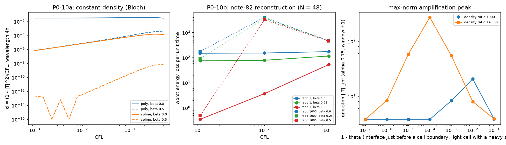

# 84 随伴補正の Galerkin 輸送：保存とエネルギーの非増加を保ったまま、小さな CFL の散逸を 2 乗のオーダーに下げる。ただし界面の軽いセルの飽和した損失と、密度比とともに増える ‖T‖∞ の山は残る（P0-10a、P0-10b）

ノート83 で、Galerkin 輸送の散逸は再構築のセル境界の跳びから来て、Δt によらないことを確かめた。ユーザーは、個別の修正ではなく「質量測度に適合した連続再構築と、時間変化する関数空間上の保存型輸送」として統一的に定式化することを提案した。その中で、最優先は P0-10a：今の再構築を変えずに、エネルギーの内積についての随伴を使った補正（BFECC と同じ代数構造）を入れること。

```
T_β = T [I + β(I − T†T)],   T† = G₀⁻¹Cᵀ（エネルギーの内積の随伴）
```

```
python -m cases.galerkin_adjoint [--jobs N]     # docs/figures/galerkin_adjoint.json
python -m cases.galerkin_adjoint_figure
```

ノート82 の基準の構成（`piecewise="ls"`、α = 0.75、窓 e = 1）に組み合わせた。ライブラリは変えていない。

## 図


- 左：一定密度（Bloch）の波長 4h の d = (1 − |T|²)/CFL。区分多項式と B スプライン、β = 0 と 0.5。
- 中：ノート82 の再構築の最悪の損失（単位時間あたり）。密度比 1 と 1000、β = 0、0.25、0.5。
- 右：界面がセル境界の手前（1 − θ）にあるときの 1 ステップの ‖T‖∞。

## 定式化と理論的根拠
### A. 随伴と、特異値の変換（ユーザー）
`⟨Tu, v⟩_{G₁} = ⟨u, T†v⟩_{G₀}` から `T† = G₀⁻¹TᵀG₁ = G₀⁻¹Cᵀ`（G₁ は対称）。

正規化 `𝒯 = G₁^{1/2}TG₀^{−1/2}` の特異値分解を `𝒯 = UΣVᵀ` とすると、次が成り立つ：

```
G₁^{1/2}T_βG₀^{−1/2} = 𝒯(I + β(I − 𝒯ᵀ𝒯)) = U Σ(I + β(I − Σ²)) Vᵀ
```

特異値は `σ ↦ σ(1 + β(1 − σ²))` と写る。β = 1/2 で `(3σ − σ³)/2`。

- この関数は [0, 1] で単調増加で、[0, 1] を [0, 1] に写す（導関数 `1 + β − 3βσ² ≥ 1 − 2β ≥ 0`、β ≤ 1/2）。**エネルギーの非増加が厳密に保たれる**。
- 損失 `e = 1 − σ²` は `e_corr = (3/4)e² + (1/4)e³`（β = 1/2）に変わる。
- 損失が O(Δt) なら O(Δt²) に、O(Δt²) なら O(Δt⁴) になる。
- σ = 0（1 ステップで完全に消えるモード）は 0 のまま。消えたものは戻らない。

### B. 自由流と総運動量が保たれること（証明）
仮定は次の 4 つ：`T1 = 1`、`m₁ᵀT = m₀ᵀ`、`G₀1 = m₀`、`C1 = m₁`。

- `T†1 = G₀⁻¹Cᵀ1 = G₀⁻¹(1ᵀC)ᵀ = G₀⁻¹m₀ = 1`。よって `T†T1 = 1`、補正の項は 0、`T_β1 = 1`。
- `m₀ᵀT† = 1ᵀG₀G₀⁻¹Cᵀ = (C1)ᵀ = m₁ᵀ`。よって `m₁ᵀTT†T = m₀ᵀT†T = m₁ᵀT = m₀ᵀ`、`m₁ᵀT_β = m₀ᵀ`。

### C. 一定密度では T† = conj(T)
平行移動で不変なので G₀ = G₁、Bloch の記号で `T† = T̄`。`T_β = T(1 + β(1 − |T|²))`。

### D. ユーザーの他の理論（このノートでは検証していない）
次の 3 つは、ユーザーの理論で、ここでは数値で確かめていない：

- 質量座標の連続な再構築とその条件数の上界 4/3。
- alias スペクトルの平均と分散による散逸と分散の統一（`1 − |T|² = C²Var_w(κ)`）。
- 移動する関数空間の半離散の方程式 `Gu̇ = −B*Ḃu`。

## P0-10a 一定密度（Bloch、波長 4h）の d = (1 − |T|²)/CFL
| CFL | 区分多項式 | 区分多項式 + 補正（β = 1/2） | B スプライン | B スプライン + 補正 |
| --- | --- | --- | --- | --- |
| 0.001 | 3.06e-2 | **7.03e-7** | 6.73e-7 | 2.2e-13 |
| 0.01 | 3.12e-2 | **7.29e-6** | 6.73e-6 | 3.1e-13 |
| 0.1 | 3.56e-2 | **9.54e-5** | 6.51e-5 | 3.2e-10 |
| 0.37 | 3.57e-2 | **3.56e-4** | 1.55e-4 | 6.7e-9 |
| 0.5 | 2.95e-2 | **3.27e-4** | 1.36e-4 | 7.0e-9 |

- **ユーザーの値と全桁一致。** 補正で、小さな CFL の散逸は CFL に比例して 0 に向かう（区分多項式でも）。CFL 0.37 で 1/100。
- checkerboard（2h）は、CFL 0.37・0.5 で補正の後も 2.0（1 ステップで消える）。

## P0-10b ノート82 の再構築（α = 0.75、e = 1）での随伴補正
### 構造（CFL 0.37、12 位置の最大、N = 48）
| β | 密度比 | 自由流 | 総運動量（m の最大で割った値） | エネルギーで重み付けた増幅率 | ‖T‖∞ | phases の 1 ステップの誤差 |
| --- | --- | --- | --- | --- | --- | --- |
| 0 | 1 / 1e3 / 1e6 | 2.6e-13 / 2.3e-13 / 1.5e-10 | 7e-13 / 6e-13 / 6e-13 | 1.000000000000 / 1.000000000000 / 1 + 3e-10 | 2.98 / 4.43 / 6.16 | 1.22e-6 / 2.22e-6 / 2.27e-6 |
| 0.5 | 1 / 1e3 / 1e6 | 2.5e-13 / 2.4e-13 / 1.3e-10 | 7e-13 / 6e-13 / 6e-13 | 1.000000000000 / 1.000000000000 / 1 + 6e-10 | 3.04 / 4.51 / 7.37 | 1.19e-6 / 2.16e-6 / 2.23e-6 |

- **自由流・総運動量・エネルギーの非増加は、補正の後も丸め誤差の範囲で保たれる**（B 節）。1 ステップの ‖T‖∞ と誤差はほぼ変わらない。

### 最悪のエネルギー損失（6 位置、N = 48、単位時間あたり）
| β | 密度比 | CFL 0.001 | 0.01 | 0.1 |
| --- | --- | --- | --- | --- |
| 0 | 1 | 149 | 153 | 174 |
| 0.25 | 1 | 74.9 | 78.4 | 116 |
| **0.5** | 1 | **0.35** | **3.7** | 52.9 |
| 0 | 1000 | 176 | 4.0e3 | 470 |
| 0.5 | 1000 | 0.49 | **3.2e3** | **457** |

- **密度比 1**：β = 1/2 で、最悪の損失は 1 ステップに CFL² に比例し（CFL 0.001 で 7.3e-6、0.01 で 7.7e-4）、単位時間あたり Δt → 0 で 0 に向かう（A 節の `e_corr ≈ (3/4)e²`）。β = 1/4 は半分になるだけ（特異値の写像が 1 次の損失を消さない）。
- **密度比 1000**：CFL ≳ 1/1000 では、補正の後も 1 ステップの損失が O(1)（0.67〜0.95）。界面に接する軽いセルで、変位 h/密度比 を超えると損失が飽和するモード（ノート82 E 節）では、σ が 0 に近く、`(3σ − σ³)/2` でもほとんど戻らない。

### 精度（P0-4 と同じ、phases、密度比 1000、N = 16 … 256）
| β | t = 0.137 の誤差 | 次数 |
| --- | --- | --- |
| 0 | 5.92e-4 … 8.33e-10 | 4.82、5.76、4.29、4.57 |
| 0.25 | 5.36e-4 … 7.79e-10 | 4.70、5.87、4.25、4.57 |
| 0.5 | 4.41e-4 … 6.60e-10 | 4.46、6.14、4.20、4.55 |

途中の時刻（0.05、0.1）も同じく 4 次以上。補正で誤差は約 0.8 倍。

### 格子規模に近いデータのエネルギー（`profile="grid"`：sin 2πz + ½ sin 32πz、N = 64 で波長 4 セル、t = 0.137 の 1 − E(t)/E(0)）
| β | 密度比 | CFL 0.37 | 0.185 | 0.0925 | 0.046 |
| --- | --- | --- | --- | --- | --- |
| 0 | 1 | 4.09e-2 | 4.35e-2 | 4.17e-2 | 3.99e-2 |
| 0.5 | 1 | 4.28e-3 | 4.20e-3 | 3.22e-3 | 2.01e-3 |
| 0 | 1000 | 4.53e-2 | 4.87e-2 | 4.72e-2 | — |
| 0.5 | 1000 | 3.67e-3 | 3.64e-3 | 3.55e-3 | — |

- **β = 0 は CFL によらず約 4%**（ノート83 の Δt によらない散逸）。
- β = 1/2 で約 1/10 になる。密度比 1 では CFL とともに減るが、小さな CFL でようやく CFL に比例し始める（0.0925 → 0.046 で 0.63 倍）。密度比 1000 では CFL によらず 0.36% が残る（界面の軽いセルの飽和した損失）。

### 長時間・任意の時刻からの増幅（N = 64、t = 0.5、87 ステップ）
| β | 密度比 | 誤差 t = 0.25 / 0.5 | E(0.5)/E(0) − 1 | 1 ステップの ‖T‖∞ の最大 | max_{j<k} ‖P_{k,j}‖∞ |
| --- | --- | --- | --- | --- | --- |
| 0 | 1e3 | 5.4e-7 / 4.5e-7 | 6e-14 | 19.3 | 19.3 |
| 0.5 | 1e3 | 4.4e-7 / 3.7e-7 | −1e-15 | 20.2 | 20.2 |
| 0 | 1e6 | 5.4e-7 / 4.5e-7 | 6e-14 | **225** | **225** |
| 0.5 | 1e6 | 4.4e-7 / 3.7e-7 | 1e-15 | **235** | **235** |

**ノート82 の訂正**：12 位置の走査で「密度比 1e6 で ‖T‖∞ ≤ 6.2」としたが、走査がまれな位置を通らなかったため。

### ‖T‖∞ の山の位置（α = 0.75、e = 1、β = 0、N = 64、界面 A0 がセル境界の手前 1 − θ）
| 1 − θ | 1e-1 | 1e-2 | 1e-3 | 1e-4 | 1e-5 | 1e-6 | 1e-7 |
| --- | --- | --- | --- | --- | --- | --- | --- |
| 密度比 1e3 | 3.83 | **20.6** | 8.27 | 3.79 | 3.79 | 3.79 | 3.79 |
| 密度比 1e6 | 3.86 | 7.97 | 54.8 | **272** | 58.3 | 8.41 | 3.80 |

- 軽いセルに、重い相の薄片（幅 (1 − θ)h）が入る位置。山は、薄片の質量 `ρ_h(1 − θ)h` が軽いセルの質量 `ρ_l h` の 10〜100 倍になる所にある（密度比 1e3 で 1 − θ ≈ 1e-2、1e6 で 1e-4）。セルの質量で重み付けた平均が、軽い相の値から重い相の値へ切り替わる所（ノート82 E 節）。
- 山の高さは密度比の約 0.37 乗（1000 倍で 13 倍）。
- 最大の行（密度比 1e6、ステップ 1、θ = 0.99982）は、界面のセルで、係数は +31.9、−65.8、+54.3、−9.2、−29.8、+25.1（符号が交互）。最大を実現する入力は、符号の反転の割合 0.8 の格子規模の分布。
- 初期時刻からの積でも 44.9（密度比 1e6、β = 0）。

## P0-10c・P0-10d 面の連続補正（一定密度の Bloch の記号）
ユーザーの質量座標の補正 `P̃_i = P_i + ℓ(s)e_{i,L} + r(s)e_{i,R}` を作った。`ℓ = 1 − 4s + 3s²`、`r = −2s + 3s²`、`e = v_f − P_i(面)`。一定密度では s = ξ + ½。

- ℓ と r はセルの上の積分が 0 なので、セル平均は変わらない。
- 面の値は両側で v_f に一致するので、場は C⁰。
- 元の多項式が厳密なら、両側の面の値は一致して補正は 0。

面の値 v_f は 2 通り試した：
- 両側の値の平均（avg）。
- 補正のエネルギー `Σ[(2/15)(e_L² + e_R²) − (1/15)e_L e_R]` の最小（opt、ユーザーの 4.1 節）。

d = (1 − |T|²)/CFL、波長 4h（[ ] は随伴補正 β = 1/2 との組み合わせ）：

| CFL | 区分多項式 | C⁰ 補正 avg | C⁰ 補正 opt | B スプライン |
| --- | --- | --- | --- | --- |
| 0.001 | 3.06e-2 [7.03e-7] | 6.92e-5 [3.8e-12] | 1.13e-4 [9.8e-12] | 6.73e-7 [2.2e-13] |
| 0.01 | 3.12e-2 [7.29e-6] | 6.90e-4 [3.57e-9] | 1.12e-3 [9.4e-9] | 6.73e-6 [3.1e-13] |
| 0.1 | 3.56e-2 [9.54e-5] | 6.50e-3 [3.17e-6] | 1.05e-2 [8.2e-6] | 6.51e-5 [3.2e-10] |
| 0.37 | 3.57e-2 [3.56e-4] | 1.46e-2 [**5.94e-5**] | 2.33e-2 [1.51e-4] | 1.55e-4 [6.7e-9] |
| 0.5 | 2.95e-2 [3.27e-4] | 1.27e-2 [6.10e-5] | 2.03e-2 [1.54e-4] | 1.36e-4 [7.0e-9] |

- **C⁰ 補正（avg）と、随伴補正との組み合わせは、ユーザーの値と一致**（CFL 0.001 の組み合わせの 3.8e-12 対 3.59e-12 は、丸め誤差の水準の差）。
- **エネルギーの最小で決めた面の値（opt）は、平均より散逸が約 1.6 倍大きい。** 補正の L² の大きさを最小にすることは、輸送の散逸を最小にすることと一致しない（ユーザーの「連続性を高めても散逸が減るとは限らない」と同じ種類の結果）。
- 1 ステップの誤差 `|T − e^{−iCθ}|`（C = 0.37、波長 8・16・32・64 セル）：
  - 区分多項式：1.25e-5 → 1.45e-14
  - avg：1.59e-6 → 2.3e-16
  - opt：3.19e-6 → 3.5e-16

  補正は精度を損なわない（θ について約 11 次）。
- 変密度（ノート82 の再構築）への組み込みは、まだしていない。

## まとめ
| 性質 | 随伴補正（β = 1/2）の後 |
| --- | --- |
| 自由流・総運動量 | 丸め誤差で保存（証明と測定） |
| エネルギーの非増加 | 厳密（特異値の写像） |
| 4 次の精度 | 保たれる（誤差は約 0.8 倍） |
| 小さな CFL の散逸（密度比 1） | 1 ステップに CFL²、単位時間あたり Δt → 0 で 0 |
| 格子規模のデータの損失（4% 程度） | 約 1/10 |
| 界面の軽いセルの飽和した損失（密度比 1000） | ほとんど戻らない（σ ≈ 0 は 0 のまま） |
| 1 ステップの ‖T‖∞ の山 | 変わらない（密度比 1e6 で 225〜272） |

- 随伴補正は、今の再構築を変えずに、セル境界の跳びによる Δt によらない散逸をほぼ取り除く。費用は、正定値の線形の解が 1 回から 3 回になる。
- 残る 2 つの問題は、どちらも、界面がセル境界のすぐ手前にあり、軽いセルに重い相の薄片が入る状態から来る。セルの質量で重み付けた平均（未知数そのもの）が、変位 h/密度比 の間に軽い相の値から重い相の値へ切り替わる。輸送の補正では直らず、未知数の定義か再構築の側の問題。

## 次（提案）
- P0-10c（質量座標の面の連続補正）・P0-10d（連続化 + 随伴補正）：一定密度の Fourier で、ユーザーの表（C⁰ 補正 6.92e-5、C⁰ + 随伴 5.94e-5 など）を再現する。その後、変密度のノート82 の再構築に組み込む。
- 軽いセルの重い薄片の問題：
  - 質量座標 s_i(x) では、薄片の幅が質量の割合で測られる（ユーザーの 2 節）。それが ‖T‖∞ の山と飽和した損失を和らげるか、を同じ θ の走査で確かめる。
  - 山が残るなら、「軽いセルの未知数を、薄片が入る前後でどう定義するか」（例：セルの合併、または相ごとの速度）の検討が要る。
