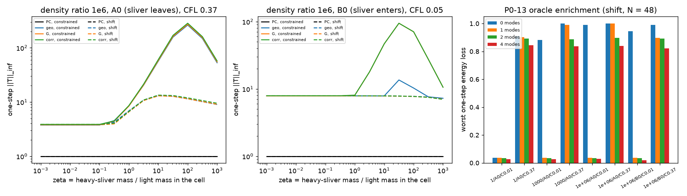

# 85 速度増幅の出どころは、混合セルの平均の制約が軽い相の多項式に押し付ける修正：制約なしの適合 + 定数のずらし（shift）で 272 → 13。失われるエネルギーは小さな CFL では界面ごとに階数 1 で、追加の基底 1 個で保持できる。質量座標の連続補正は粘性の剛性を桁違いに増やす（P0-12a〜e、P0-13）

ノート84 で、密度比 1e6 で 1 ステップの ‖T‖∞ が 272 になる山と、界面の軽いセルの飽和した損失が残った。ユーザーの指摘：

- 平均の感度（密度比に比例）と、速度の増幅（272 倍）は数学的に別の問題。平均値はいつも両相の速度の間にある。
- 増幅が再構築で起きているのか、Galerkin 射影で起きているのかを、4 つの演算子で分けるべき。
- エネルギーの安定性と Gram 行列の条件数は、最大ノルムを抑える十分条件ではない。
- 質量座標の補正は、物理空間で粘性の剛性を作りうる。
- 失われた関数そのものを調べ、追加の基底のオラクルで、1 セル 1 未知数の限界を判定すべき。
- 走査は相の質量比 ζ の対数で行う。

```
python -m cases.galerkin_amp [--jobs N]       # P0-12a/e（docs/figures/galerkin_amp.json）
python -m cases.galerkin_shift [--jobs N]     # P0-12b/d、P0-13、shift の確認（galerkin_shift.json）
python -m cases.galerkin_shift_figure
```

## 図


- 左・中：密度比 1e6 の 1 ステップの ‖T‖∞ の ζ 依存。4 つの演算子、制約付き（実線）と shift（破線）。
- 右：最悪のエネルギー損失と、追加の基底の数（オラクル）。

## 定式化と理論的根拠
### A. 平均の感度は有界（ユーザー）
混合セル（重い相の体積分率 c、密度比 r）の質量で重み付けた平均は `ū = (rc u_H + (1 − c)u_L)/(rc + 1 − c)` で、`∂ū/∂c = r(u_H − u_L)/(1 + (r − 1)c)²` と密度比に比例して敏感。それでも ū は両相の速度の間にある。そのため、増幅は平均の定義そのものからではなく、再構築か射影から来る。

### B. 4 つの演算子と分解（ユーザー）
| 演算子 | 式 | 性質 |
| --- | --- | --- |
| T_PC | `M₁⁻¹J₁*𝒰J₀` | 移動した質量の割合。成分が非負で行和 1、`‖T_PC‖∞ = 1`（密度比によらない） |
| T_geo | `M₁⁻¹J₁*𝒰R₀ = M₁⁻¹C_g` | 高次の再構築を幾何学的に積分 |
| T_G | `G₁⁻¹C` | Galerkin |
| T_corr | `T_G[I + ½(I − T†T)]` | 随伴補正（ノート84） |

`T_G − T_geo = G₁⁻¹Z₁*(𝒰R₀ − R₁T_geo)`（Z は再構築の平均 0 の成分）。T_geo で増幅していれば再構築 R₀ の問題、T_G でだけ増幅していれば射影（R₁）の問題。

### C. エネルギーは最大ノルムを抑えない（ユーザー）
`M ⪯ G ⪯ c_G M` と `TᵀG₁T ⪯ G₀` から、成分ごとに `|T_ij| ≤ √(c_G m_j⁰/m_i¹)` しか言えない。軽いセルの出力（m_i が小さい）は、重いセルの入力に対して `√(密度比)` 倍まで許される。最大ノルムの有界性は、エネルギーとは別の設計目標。

### D. 制約付きの適合が軽い相に増幅を押し付ける理由（今回の導出）
制約付き最小二乗 `min ½‖W^{1/2}(Aa − u)‖²`、`bᵀa = u_i` の解は、制約なしの解 a* から次のように修正される：

```
a = a* + λ (AᵀWA)⁻¹ b,   λ = (u_i − bᵀa*) / (bᵀ(AᵀWA)⁻¹b)
```

- 修正の向き `(AᵀWA)⁻¹b` は、データとの食い違いの意味で「安い」係数に向かう。
- α > 0 では軽いセルの重みが小さいので、軽い相の多項式の係数が安い。
- 一方、混合セルの行 b の軽い相の成分は、軽い部分の質量の割合 `m_L/m = 1/(1 + ζ)` に比例して小さい。
- そのため、平均の食い違い `u_i − bᵀa*` を軽い相の係数で埋めるには、約 `(1 + ζ)` 倍の修正が要る。

ζ ≈ 30〜100（質量は薄片が支配し、幾何学的には薄い）で、軽い部分の再構築の係数の和 Σ|φ| が 438 になった（密度比 1e6、ζ = 100。重い薄片の上は 3.4）。

ζ が大きすぎると、薄片が幾何学的にも幅を持ち、修正が重い相の係数に向かうので、山は下がる。

### E. shift：制約なしの適合と定数のずらし（今回の提案）
```
a = a* + δ e₀,   δ = u_i − bᵀa*
```

e₀ は定数の関数（a0 = 1、ほかは 0）。`bᵀe₀ = 1`（混合セルの行も定数の平均は 1）なので、セルの平均は厳密に u_i になる。保たれる性質：

- **修正は ρ で重み付けたノルムの最小**（定数は、平均を 1 だけ変える関数の中で ρ ノルムが最小）。
- |δ| ≤ |u_i| + |bᵀa*| で、密度比の因子が入らない。
- 定数は界面の両側に同じだけ加わるので、界面の値の共有（a0）を壊さない。
- 定数の再現：a* が定数を再現し、δ = 0。区分多項式の厳密な再現：a* が厳密なら δ = 0。
- 連続性：重みが連続で、制約なしの適合が満階数なら、a* は連続。

ただし、a* は重み（α）に依存するので、増幅は完全には密度比によらない（山は 7 → 13）。

### F. 平均化で失われる分散（ユーザー）
質量 m_L、m_H、速度 u_L、u_H を 1 つの平均で表すと、失われるエネルギーは厳密に次のとおり：

```
ΔE = ½ (m_L m_H/(m_L + m_H)) (u_L − u_H)²
```

軽い相の速度だけが 1 なら、相対的な損失は `m_H/(m_L + m_H)`。これは 2 つの速度の情報を 1 つの値に圧縮したことで失われる分散で、不安定ではない。

### G. 失われた関数とオラクル（ユーザー）
- 正規化した `𝒯 = G₁^{1/2}TG₀^{−1/2}` の最小特異値の右特異ベクトルから `u₀ = G₀^{−1/2}v_min`。失われた関数は `r⊥ = 𝒰R₀u₀ − R₁Tu₀`。`‖r⊥‖²_ρ = 1 − σ_min²`（測定で 3 つの計算が 15 桁一致）。
- オラクル：失われた関数 f の、セル平均を除いた部分 `ψ = f − R₁f̄`（各セルで質量平均 0）を新しい空間に足すと、f は厳密に表せる。k 個足した後の最悪の損失を測る。

### H. 質量座標の補正の粘性の剛性（ユーザー）
`∂_x δP = (ρ/m_i) ∂_s δP`。重い薄片の上では ρ/m_i が大きく、物理空間の勾配が密度比に比例して大きくなる。粘性の散逸の剛性は `K v = λ G v` の最大固有値で測る。物理の拡散の速さを両相でそろえるため、μ = ρ（動粘性一様）で比べた。

## P0-12a・P0-12e 4 つの演算子（N = 64、α = 0.75、e = 1、ζ = 10⁻³〜10³ の対数の走査の最大）
| 密度比 | 界面 | CFL | T_PC | T_geo | T_G | T_corr | 山の ζ |
| --- | --- | --- | --- | --- | --- | --- | --- |
| 1e2 | A0 / B0 | 0.37 | 1 / 1 | 8.5 / 8.9 | 8.6 / 8.9 | 9.0 / 9.3 | 3 / 316 |
| 1e3 | A0 / B0 | 0.37 | 1 / 1 | 20.2 / 8.6 | 20.7 / 11.3 | 21.6 / 11.9 | 10 / 3 |
| 1e6 | **A0**（薄片が出ていく） | 0.05 / 0.37 | 1 | **338 / 263** | 309 / 272 | 322 / 284 | 100 |
| 1e6 | **B0**（薄片が入る） | 0.05 / 0.37 | 1 | **13.6** / 95.1 | **94.5** / 126 | 94.7 / 132 | 31.6 |

- **A0 では、増幅はすでに T_geo（高次の再構築 R₀ の幾何学的な積分）にある。** Galerkin 射影はほとんど足さない。
- **B0・CFL 0.05 では、T_geo は 13.6 なのに T_G は 94.5。** ここでは Galerkin 射影（新しい時刻の再構築 R₁）が増幅させる。
- どちらも同じ D 節の機構（混合セルの制約の修正が軽い相に押し付けられる）が、古い時刻（A0）か新しい時刻（B0）の再構築で起きている。
- 区分定数の輸送はいつも 1。随伴補正は +5% 程度しか変えない。
- **ノート84 の 12 位置の一様な走査が山を見落とした理由**：山は ζ ≈ 10〜100、つまり体積分率 c ≈ 10⁻⁵〜10⁻⁴ の狭い範囲にある。ζ の対数の走査なら、密度比によらず山を捉える（ユーザーの提案）。

## shift の効果
### ζ の走査の最大（P0-12a/e、N = 64）
| 密度比 | 界面・CFL | 制約付き T_geo / T_G | **shift T_geo / T_G** | 条件数の最大（制約付き / shift） |
| --- | --- | --- | --- | --- |
| 1e2 | A0・0.37 | 8.5 / 8.6 | **7.0 / 7.0** | 2.8 / 2.9 |
| 1e3 | A0・0.37 | 20.2 / 20.7 | **10.7 / 10.8** | 2.6 / 2.6 |
| 1e6 | A0・0.05 | 338 / 309 | **14.4 / 12.3** | 1.9 / 1.9 |
| 1e6 | A0・0.37 | 263 / 272 | **13.1 / 13.0** | 1.7 / 1.7 |
| 1e6 | B0・0.05 | 13.6 / 94.5 | **7.9 / 7.9** | 2.7 / 2.7 |
| 1e6 | B0・0.37 | 95.1 / 126 | **7.2 / 9.5** | 1.5 / 1.5 |

### ほかの性質（密度比 1000 / 1e6）
| 性質 | 制約付き | shift |
| --- | --- | --- |
| 連続性：またぐ ε = 1e-8 の `‖T − I‖` / kink の誤差 | 3.08e-5 / 1.6e-11 | 2.76e-5 / 1.7e-11 |
| 4 次（phases、t = 0.137、N = 16 … 256） | 5.92e-4 … 8.33e-10（4.82、5.76、4.29、4.57） | 6.02e-4 … 8.40e-10（4.85、5.74、4.31、4.55） |
| 途中の時刻（t = 0.05、0.1）の N = 128 → 256 | 4.76、4.79 | 4.74、4.80 |
| 長時間（N = 64、t = 0.5）の 1 ステップの ‖T‖∞ / 任意の時刻からの積の最大（1e3） | 19.3 / 19.3 | **10.5 / 10.5** |
| 同（1e6） | 225 / 225 | **19.4 / 19.4** |
| 誤差 t = 0.5（1e6） | 4.48e-7 | 4.52e-7 |
| 区分多項式の厳密な再現 | 2.1e-13 | 1.1e-13 |
| 粘性の剛性 λ_max h²（μ = ρ）：密度比 1 / 1e3 / 1e6・A0 / 1e6・B0 | 9.1 / 9.6 / 9.2 / 13.1 | 9.0 / 9.3 / 9.2 / 13.3 |

- **shift は、精度・連続性・条件数・粘性の剛性を変えずに、最大ノルムの増幅を密度比 1e6 で 225 → 19.4 にする。**
- 山は密度比とともにまだ弱く増える（ζ の走査で 7.0 → 10.8 → 13.0、長時間で 10.5 → 19.4）。E 節のとおり、制約なしの適合が重み（α）に依存するため。

### 最悪のエネルギー損失（6 位置、N = 48、単位時間あたり）
| 適合 | β | 密度比 | CFL 0.001 | 0.01 | 0.37 |
| --- | --- | --- | --- | --- | --- |
| 制約付き | 0 | 1 / 1000 | 149 / 176 | 153 / 4.0e3 | 126 / 130 |
| shift | 0 | 1 / 1000 | 184 / 230 | 184 / 4.1e3 | 123 / 130 |
| 制約付き | 1/2 | 1 / 1000 | 0.35 / 0.49 | 3.7 / 3.2e3 | 121 / 130 |
| shift | 1/2 | 1 / 1000 | 0.53 / 0.83 | 5.4 / 3.4e3 | 115 / 130 |

- 散逸は shift でほぼ変わらない（小さな CFL で 1.2〜1.5 倍）。随伴補正との組み合わせも同じ振る舞い。界面の軽いセルの飽和（密度比 1000、CFL 0.01）は残る。

## P0-12b 失われた関数の場所（N = 48、最悪モード自身のエネルギーを 1 とした割合）
| 適合 | 密度比・ζ・界面 | CFL | 最悪の損失 | 最も大きいセル（相、界面からの距離）とその割合 |
| --- | --- | --- | --- | --- |
| 制約付き | 1・1・A0 | 0.01 | 0.030 | 重い相のセル（距離 2〜4）に 0.008〜0.012 ずつ分散 |
| 制約付き | 1e3・10・A0 | 0.01 | 0.585 | **界面のセルの重い相（距離 0.5）に 0.433** |
| 制約付き | 1e6・31.6・B0 | 0.01 | 0.996 | **界面のセルの軽い相（距離 0.49）に 0.484**、隣の軽いセルに 0.367 |
| shift | 1e6・100・A0 | 0.01 | 0.991 | **界面のセルの重い相（距離 0.49）に 0.968** |
| shift | 1e6・31.6・B0 | 0.01 | 0.944 | **界面のセルの重い相（距離 0.49）に 0.904** |
| 制約付き / shift | 1e3〜1e6 | 0.37 | 0.99〜1.00 | 界面の近くの軽い相のセル 3〜4 個（距離 0.3〜2.3）に分散（例 0.40、0.29、0.20） |

- **小さな CFL での飽和した損失は、界面のセル 1 個に局在する。** 密度比 1 では同じ CFL で 0.03（分散）。界面のセルの、相の間の速度の差（F 節の平均化の分散）に近いもの。
- **有限の CFL（0.37）の損失は、界面の近くの軽い相の格子規模のモード**（密度比 1 でも 0.90）。界面に固有の問題ではなく、ノート83 のセル境界の跳びの散逸。

## P0-13 追加の基底のオラクル（最悪の損失、追加する失われた関数の数 k）
| 適合 | 密度比・ζ・界面 | CFL | k = 0 | 1 | 2 | 4 |
| --- | --- | --- | --- | --- | --- | --- |
| 制約付き | 1・1・A0 | 0.01 | 0.030 | 0.030 | 0.027 | 0.022 |
| 制約付き | 1e3・10・A0 | 0.01 | 0.585 | **0.031** | 0.028 | 0.023 |
| 制約付き | 1e6・31.6・B0 | 0.01 | 0.996 | **0.030** | 0.028 | 0.017 |
| shift | 1e6・100・A0 | 0.01 | 0.991 | **0.036** | 0.035 | 0.028 |
| shift | 1e6・31.6・B0 | 0.01 | 0.944 | **0.035** | 0.035 | 0.020 |
| 制約付き | 1e6・100・A0 | 0.37 | 1.000 | 0.914 | 0.887 | 0.834 |
| shift | 1e6・31.6・B0 | 0.37 | 0.991 | 0.898 | 0.891 | 0.823 |

- **小さな CFL の飽和した損失は、追加の基底 1 個で、密度比 1 の水準（0.03）まで下がる。** 失われるのは界面ごとに 1 つの階数 1 のモードで、1 セル 1 未知数の限界（F 節）に当たる。界面のセルに速度のモーメントを 1 つ持たせる設計（ユーザーの 7・8 節）は、この損失を取り除けると見込める。
- **有限の CFL の損失は、4 個足しても 0.82〜0.83**（密度比 1 でも 0.84）。格子規模の一般のモードで、追加の基底では取れない。随伴補正か連続な再構築の範囲。
- オラクルの基底は全体の関数（局所化していない）で、実用の方式ではない。必要性の判定だけ。

## P0-12c・P0-12d 質量座標の面の連続補正（変密度、ζ の山の位置）
`P̃_i = P_i + ℓ(s)e_L + r(s)e_R`（質量座標 s_i(x)）。面の値は 2 通り：両側の平均、セルの質量で重み付けた平均。

| | 密度比 1・A0 | 1e3・A0 | 1e6・A0 | 1e6・B0 |
| --- | --- | --- | --- | --- |
| ‖T_G‖∞（制約付き、ζ = 100、CFL 0.37） | | | 補正なし 272、平均 135、質量重み 309 | |
| 条件数（同） | | | 補正なし 1.7、平均 **2.0e3**、質量重み 1.7 | |
| 粘性の剛性 λ_max h²、補正なし（shift） | 9.0 | 9.3 | 9.2 | 13.3 |
| 同、補正（平均）（shift） | 10.7 | **7.0e3** | **2.0e6** | **1.5e9** |
| 同、補正（質量重み）（shift） | 10.7 | **2.0e4** | **3.3e8** | **3.1e9** |

- **質量座標の補正は、粘性の剛性を密度比とともに桁違いに増やす**（ユーザーの予測 `~7μr/(4h)` と同じ向き、それ以上の大きさ）。運動エネルギーの条件数がよくても、重い薄片の上で物理空間の勾配が急になる。
- 増幅も直さない（面の近くしか変えない）。**変密度では不採用。**（一定密度では、ノート84 のとおり散逸を減らす。）

## まとめ
| 問題 | 原因（測定で特定） | 対策の結果 |
| --- | --- | --- |
| 速度の異常増幅（272） | 混合セルの平均の制約の修正が、軽い相の多項式に (1 + ζ) 倍で押し付けられる。古い時刻（A0）では再構築で、新しい時刻（B0）では射影で現れる | **shift で 13**（長時間で 225 → 19.4）。精度・連続性・条件数・粘性の剛性は不変 |
| 軽いセルの飽和した損失（小さな CFL） | 界面のセルの、相の間の速度の差（1 セル 1 未知数の限界） | 随伴補正・shift では戻らない。**追加の基底 1 個で 0.03 に**（オラクル） |
| 有限の CFL の散逸 | セル境界の跳び（格子規模、ノート83） | 随伴補正で小さな CFL の分は消える。追加の基底では取れない |
| 質量座標の連続補正 | 物理空間の勾配が密度比に比例 | 粘性の剛性が 1e9 倍、不採用（変密度） |

- 推奨の構成を更新：`piecewise="ls"`、α = 0.75、窓 e = 1、**fit = "shift"**、随伴補正 β = 1/2。
- 残る問題：
  - shift の山が密度比とともに弱く増えること（13〜19）。
  - 界面のセルの階数 1 の損失。

## 次（提案）
- P0-13 の続き：界面のセルに、セルの平均を変えない内部の速度モーメントを 1 つ持たせる局所的な追加の基底を設計する。オラクルと同じ損失の低下が得られるかを確かめる。課題は、その移流、生成・消滅（界面がセルを出入りするとき）のエネルギーの収支。
- shift の重みの選び方（α）と山の関係の整理。
- P1（二次元）は、上の結果を踏まえて判断する。
