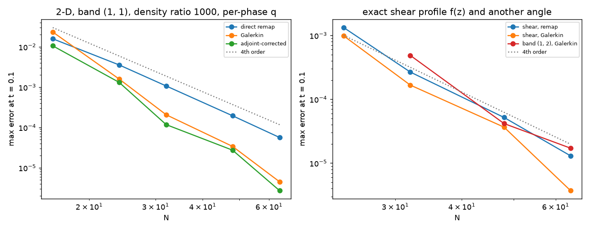

# 87 二次元の幾何学に整合した Galerkin 輸送：斜めの平らな界面の並進（P1-1a〜c、e の一部）。構造は二次元でも成り立ち、Galerkin は直接の Remap より約 1 桁正確

一次元の研究（ノート80〜86）を区切り、ユーザーの再編した計画の P1 に入った。

- 最初の試験は、周期格子の上の斜めの平らな界面を、一定の速度で並進させること。
- 比べるのは、直接の高次 Remap・Galerkin・随伴補正の 3 方式。
- 再構築は shift（ノート85）で、内部モーメントは入れない。

ユーザーの設計の要点：
- 界面の区分多項式は、接線方向に変わる界面の速度を表すため `P = P₀ + max(ξ, 0)P₁` にする。
- 過剰決定系にする（正方の系では重みが効かない）。
- 新旧のセルと相の共通の分割から G₀、G₁、C を作る。

```
python -m cases.galerkin2d               # 45° の帯、3 方式、N = 16〜48（docs/figures/galerkin2d.json）
python -m cases.galerkin2d_figure        # N = 64・せん断の形・角度 (1, 2) は galerkin2d_more.json
```

ライブラリは変えていない。

## 図


- 左：45° の帯、密度比 1000、相ごとの関数の t = 0.1 の誤差。
- 右：厳密なせん断流の形 f(z) と、角度 (1, 2)。

## 定式化と理論的根拠
### A. 周期的な斜めの帯
重い帯を `{frac(a x + b y − d) ∈ (z_A, z_B)}`（a、b は整数）とする。界面は直線 `a x + b y = z_{A,B} + d + k` で、周期の領域で閉じる（ユーザーの注意：任意の傾きの直線を周期で接続すると、領域の境界に別の界面ができる）。

一定の速度 U の並進では `d = (aU_x + bU_y)t`。帯の法線方向の周期は `1/√(a² + b²)`。

### B. 界面の区分多項式（ユーザー）
最も近い界面の直線の法線 n と接線 τ について、`ξ = n·(x − x_Γ)/h`、`η = τ·(x − x_Γ)/h` とする。基底は次のとおり：

```
P = P₀(ξ, η) + max(ξ, 0) P₁(ξ, η)
```

P₀ は全次数 4（15 個）、P₁ は全次数 3（10 個）で、計 25 係数。界面（ξ = 0）で次が成り立つ：

- `[P] = 0`、`[∂_η P] = 0`：速度は界面で連続（接線方向に変わってよい）。
- `[∂_ξ P] = P₁(0, η)`：法線方向の勾配は跳んでよい。

一次元の a0 の共有の二次元版で、界面上の速度は一つの定数ではなく η の関数。

kink の項は、セルの中心から見て界面の向こう側に置く（ξ の向きをそう選ぶ）。

### C. 適合と、単一の多項式との混合
- 区分多項式の適合は 7×7 = 49 セルの窓、単一の多項式（全次数 4、15 個）は 5×5 = 25 セル。どちらも過剰決定。
- 重みは `(m_j / max m)^0.75`。制約なしの最小二乗のあと、セル自身の質量平均を戻す定数のずらし（shift）を加える。
- 界面からの法線の距離が 3.5 セル以下では区分多項式、4.5 セル以上では単一の多項式。その間は距離の滑らかな階段の重みで混ぜる。どちらもセルの平均と定数を保つので、混合も保つ。

### D. 共通の分割とエネルギーの非増加（ユーザー）
新しいセル K_i と、移動した古いセル `K_j + UΔt`（CFL ≤ 1 で高々 4 個）の共通部分を、新しい時刻の界面の直線で相ごとに切る。その凸多角形を三角形に分け、collapsed Gauss（6 × 6 点、全次数 9 まで厳密）で積分する。

同じ積分点 q と正の重み `w_q ρ(q)` で、`B₁ = [φ_i^{n+1}(q)]`、`B₀ = [φ_j^n(q − UΔt)]` を作ると：

```
G₀ = B₀ᵀWB₀,   G₁ = B₁ᵀWB₁,   C = B₁ᵀWB₀
[[G₀, Cᵀ], [C, G₁]] = [B₀ B₁]ᵀ W [B₀ B₁] ⪰ 0   ⇒   CᵀG₁⁻¹C ⪯ G₀
```

Schur 補行列の非負性から `CᵀG₁⁻¹C ⪯ G₀` が出る。そのため、`T = G₁⁻¹C` は `‖Tu‖_{G₁} ≤ ‖u‖_{G₀}` を満たし、エネルギーは増えない。積分の精度によらず、代数的に成り立つ（測定で、ブロック行列の最小固有値は相対 ±1e-17）。

直接の Remap は `T_geo = M₁⁻¹C_g`、`(C_g)_{i·} = Σ_{q∈K_i} w_q ρ B₀(q)`。

## P1-1a・b 構造と厳密な再現
| | 45° の帯、N = 16 | N = 24 | 角度 (1, 2)、N = 32 |
| --- | --- | --- | --- |
| 自由流 `|T1 − 1|`（Galerkin / Remap） | 3.6e-11 / 1.4e-11 | 2.5e-9 / 2.5e-9 | 2.0e-11 / 2.1e-11 |
| 総運動量（質量の総和で割った値） | 3.7e-14 | 1.2e-14 | 6.3e-15 |
| `G₁1 = m₁`（相対） | 2.8e-13 | 1.5e-12 | 6.1e-13 |
| ブロック行列の最小固有値（相対） | +9.6e-18 | −1.2e-17 | +3.7e-17 |

- 相ごとの多項式 `P₀ + max(ξ, 0)P₁` の厳密な再現（界面から 2.5 セル以内のセル）：45° の帯 N = 24 で 2.9e-12、角度 (1, 2) N = 64 で 7.3e-12。
- **一部の適合で最小特異値が 0**（相対 1e-57〜1e-29）。界面から 3.5〜4.5 セルのセルでは、窓の中に界面の向こう側のデータがほとんどなく、P₁ の列がほぼ 0 になる。最小ノルムの最小二乗で、対象のセルの値（界面のこちら側）には効かない。
- ただし、N = 24 で自由流の誤差が 2.5e-9 に増えたのはこの影響と考えられる（他の N では 1e-11）。界面の位置が動くと、この階数の変化が演算子の連続性を損なう可能性がある（P1-1d で確かめる）。

## P1-1c 相ごとの滑らかな非多項式の関数（45° の帯、密度比 1000、U = (1, 0.5)、CFL 0.37）
q = sin 2πx cos 2πy + 3·(帯の中の山 (z − z_A)(z_B − z))·cos 2π(x − y)。界面で連続で、法線の勾配が折れ、接線方向にも変わる。

| N | 16 | 24 | 32 | 48 | 64 |
| --- | --- | --- | --- | --- | --- |
| 直接の Remap、t = 0.1 | 1.58e-2 | 3.56e-3 | 1.07e-3 | 1.95e-4 | 5.64e-5 |
| Galerkin | 2.33e-2 | 1.59e-3 | 2.07e-4 | 3.39e-5 | **4.49e-6** |
| 随伴補正 | 1.06e-2 | 1.32e-3 | 1.18e-4 | 2.74e-5 | **2.71e-6** |
| 次数（N = 24 → 64 の通し）：Remap / Galerkin / 随伴補正 | | | | | 4.2 / 6.0 / 6.3 |

| | Remap | Galerkin | 随伴補正 |
| --- | --- | --- | --- |
| E(0.1)/E(0) − 1（N = 48 / 64） | −3.1e-5 / −6.8e-6 | −1.9e-8 / −1.2e-9 | −6.2e-11 / −3.4e-12 |
| 1 ステップの ‖T‖∞ の最大（N ≥ 24） | 5.0〜6.0 | 6.9〜7.6 | 7.6〜8.9 |
| 条件数 cond(M^{−1/2}GM^{−1/2}) | ≤ 2.6 | ≤ 2.6 | ≤ 2.6 |
| 最大値の比 max\|u(t)\|/max\|u(0)\| | 0.99〜1.003 | 0.99〜1.003 | 0.99〜1.003 |

- **3 方式とも 4 次以上で収束**し、N = 64 で Galerkin は Remap の約 1/12、随伴補正は約 1/20 の誤差。
- 隣り合う N の間の次数は 3〜8 と揺れる（Galerkin、t = 0.05：8.3、1.3、6.1、3.1）。
  - N ごとに界面と格子の位置関係が変わり、ステップ数も少ない（t = 0.05 で 4〜9 ステップ）。
  - N = 16・24 では帯の半分が 5.7・8.5 セルで、窓に 2 つの界面が入る境目（ノート86）。
  - 位置の走査（P1-1d）で漸近の次数を確かめる必要がある。
- 二次元では、Remap のエネルギーも多くの場合減る。ただし、せん断の形の N = 24 で +1.3e-4 増えた。保証はない。

## P1-1e（の一部）厳密なせん断流の形
ユーザーの厳密解 `u = U + τ f(z)`、`z = ax + by − (aU_x + bU_y)t` は、一定の U による移流の範囲では、速度の 2 成分が `τ f(z)` を受動的に運ぶ問題になる。`f(z) = sin 2πz + 3·(帯の中の山)`（界面で連続、勾配が折れる）の成分を運んだ（t = 0.1 の誤差）：

| N | 24 | 32 | 48 | 64 |
| --- | --- | --- | --- | --- |
| Remap | 1.33e-3 | 2.67e-4 | 5.19e-5 | 1.30e-5 |
| Galerkin | 9.83e-4 | 1.67e-4 | 3.66e-5 | **3.71e-6** |
| Remap の E(t)/E(0) − 1 | **+1.3e-4** | −1.6e-5 | −1.0e-5 | −3.2e-6 |

- 速度場自身による非線形の移流と圧力の射影は、まだ入れていない（P3 で）。非圧縮の離散的な発散の評価も、射影と組み合わせてから。

## 角度 (1, 2)（Galerkin、t = 0.1）
N = 32、48、64 で 4.87e-4、4.16e-5、1.71e-5。‖T‖∞ は 6.4、条件数は 2.3。法線方向の周期は 0.447 で、N = 32 では帯の半分が 7 セル（境目）。

## まとめ
- 二次元でも、共通の分割から作った G₀、G₁、C は、エネルギーの非増加・自由流・総運動量の保存を構成上満たす。界面の区分多項式（`P₀ + max(ξ, 0)P₁`）は厳密な再現を保つ。
- 斜めの界面・密度比 1000 で、3 方式とも 4 次以上。Galerkin と随伴補正は、Remap より約 1 桁正確。Remap は二次元でも、エネルギーの増加が起こりうる。
- 未解決：
  - 適合の階数の不足（界面から 3.5〜4.5 セル）。
  - 隣り合う N の間の次数の揺れ。
  - 窓に 2 つの界面が入る場合。

## 次
- P1-1d：界面の角度と位置の走査で、演算子の連続性と ‖T‖∞ を確かめる。階数の不足の扱い（P₁ の列の除外、または λ の範囲の調整）も検討する。
- P1-2：円形界面の並進（曲率のある界面、界面の線が曲線になる）。
- P1-3：厳密な写像による変形流（非分割）。
- 多項式近似 Galerkin（ユーザーの 5 節、GPU 向け）は、二次元で条件数の上界を確かめてから試す（今の測定で cond ≤ 2.6）。
