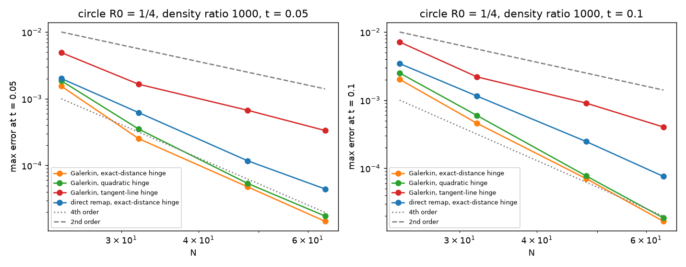

# 89 円形の界面の並進（P1-2）：ヒンジの比較。厳密な距離と二次の近似は約 5 次、接線は 2〜3 次

ユーザーの計画の P1-2。曲率のある界面で、界面の区分多項式の「折れの変数」（ヒンジ）を比べる。

- A：厳密な符号付き距離 `max(d_Γ/h, 0)`。
- B：接線 `max(ξ, 0)`。ξ はセルの足での接線に垂直な座標で、ノート88 と同じ。
- C：二次の近似 `max(ξ + (h/2R₀)η², 0)`（足での接触放物線）。
- D（PLIC）は次の段階で扱う。

再構築はノート88 の構成を使う。界面に寄せた窓（半径 5.5 セル）、角度に依存した切り替え、速度差の形、shift。

```
python -m cases.galerkin2d_circle          # docs/figures/galerkin2d_circle.json（--jobs 8 --workers 4、OMP_NUM_THREADS=1 で約 12 分）
python -m cases.galerkin2d_circle_figure
```

ライブラリは変えていない。`cases/galerkin2d.py` には、幾何を差し替えるための口を足した：

- `geom.pieces`：切断されたセルの積分点。
- `geom.frame`：足・法線・ヒンジ。
- セルごとの角度の切り替え。

PR #102 のあとの並列化（行ごとのプロセス並列、N = 64 の 1 ステップで約 12 倍、結果は逐次と一致）も、この PR に含める。

## 図


## 定式化と理論的根拠
### A. 問題
周期の単位正方形に、重い円板を置く：

- 中心 (0.5, 0.5)、半径 R₀ = 1/4、密度比 1000。
- 一定の速度 U = (1, 0.5) で並進させ、CFL は 0.37、終わりの時刻は t = 0.1。

運ぶ関数は次のとおり。界面で連続、法線の勾配が折れ、接線方向にも変わる：

```
q = sin 2πx cos 2πy + [r < R₀]·3(R₀² − r²) cos 2π(x − y)
```

### B. ヒンジの変数が満たすべきこと
各相で滑らかな q_in、q_out が、界面 Γ で連続（`q_in = q_out`）とする。d を Γ の近くで滑らかな符号付き距離（`|∇d| = 1`、`|d| < R₀` で滑らか）とすると、差 `q_out − q_in` は Γ で 0 になる。Hadamard の補題から、差は `d·g` と書け、g は滑らか：

```
q = q̃_in + max(d, 0)·g        （q̃_in は q_in の外側への滑らかな延長）
```

- q̃_in を P₀（全次数 4）で近似すると、誤差は O(h⁵)。
- g を P₁（全次数 3）で近似すると O(h⁴)。d = O(h) を掛けて O(h⁵)。

よって、**ヒンジ A（`max(d/h, 0)P₁`）は、平らな界面と同じ局所の近似の次数を保つ**（窓は界面から数セルで、`|d| ≪ R₀`）。外側の関数 `P₀ + d P₁` は多項式ではないが、近似の次数はこの分解から出る。

ヒンジ A の折れの向きは反転しない。ノート87 の平らな界面では、kink の項をセルの中心から見て向こう側に置いた。平らな界面ではヒンジの向きを変えても違いは多項式 `ξP₁` で P₀ に吸収されるが、円では違いが `d P₁` で、多項式に吸収されないため。

### C. 接線と二次のヒンジの誤差（見積もり、証明はしていない）
足 x_Γ での接線に沿った座標を ξ、η（セル単位）とする。

```
d/h = √((R₀/h + ξ)² + η²) − R₀/h = ξ + (h/2R₀) η² − (h/2R₀)² ξη² + O(h³)
```

- **B（接線）**：ヒンジのずれは、セル単位で `(h/2R₀)η² = O(h)`。窓の中では η は 5 程度なので、N = 24（h/R₀ = 1/6）では 2 セルの規模になる。
- **C（二次）**：足での接触放物線 `ξ + (h/2R₀)η²` は、ずれが `O(h²)` に減る。外側の関数 `P₀ + (ξ + cη²)P₁` は多項式のままである。

法線の勾配の跳び J を持つ関数は、物理的な単位では、P₁ の係数がセル単位で h·J の大きさになる。そのため、局所の表現の誤差はおよそ次のとおり：

- B：`J·h·O(h) = O(h²)`
- C：`O(h³)`
- A：B 節の分解で O(h⁵)

輸送の誤差の次数は、それぞれこの次数か、累積で 1 つ下がる程度と見込んだ（下の測定で、B は 2〜3、C は A と同じ約 5 で、C の O(h³) の項は N ≤ 64 では見えない）。

厳密な再現の試験（A の形の関数 P₀ + max(d/h, 0)P₁ をセル単位の無作為な係数で作る）は、係数をセル単位で固定するので、h による縮みはヒンジのずれの縮みだけを表す：

- B は N = 24 → 32 で 1.6e-2 → 1.4e-2（縮まない）。
- C は 2.2e-3 → 1.0e-3（2.6 乗）。

### D. 切断されたセルの積分
- セルの x の範囲を、円がセルの上下の辺を横切る点と、円の左右の端（x = c_x ± R₀）で分ける。
- 各小区間で、y の範囲は x の滑らかな関数（√ の形）になる。y は Gauss 6 点で積分する。
- x は、`x = a + (b − a)(1 − cos πt)/2` と置いて t で Gauss 16 点で積分する。円の左右の端で接する所では、y の範囲が √(x − a) のように振る舞うが、この置き換えで dx が sin πt を含み、被積分関数が t で滑らかになる。

測定：
- 円の面積の誤差は、中心 (0.5, 0.5) で 1e-15。
- 中心を格子からずらすと、最大で相対 1e-10。セルの辺と交わる点が円の左右の端のすぐ近くにあると、√ の分岐点が小区間のすぐ外に来て、cos の置き換えが効かないため。
- 輸送の誤差（1e-5 以上）には影響しない。P1-3 の積分（`cases/galerkin2d_shear.py`）では、近い方の接点から `y = y_t ± u²` と置き換えて、この弱点を除いた（面積の誤差 1e-16）。

その他：
- ヒンジ A の基底は d を含み多項式ではないので、y の Gauss は厳密ではない（積分の誤差は残る）。
- ただし、エネルギーの非増加は、共通の積分点と正の重みからの代数的な性質なので（ノート87 D 節）、積分の精度によらない。
- 並進では、新しいセルと移動した古いセルの共通部分は長方形になる。それを新しい時刻の円で切る。

### E. 窓の中心の不具合（この段階で直した）
ノート88 の界面に寄せた窓は、窓の中心を `x_w = c − s·n` で求めていた。n は、接線のヒンジの向きの反転を戻した外向きの法線である。

曲線のヒンジ（A、C）は法線を反転しない。そのため、界面の外側のセル（s > 0）では、窓の中心が界面から 2s 離れた所に置かれていた。

- 厳密な再現は、窓が満階数なら窓の位置によらないので、この不具合を検出できなかった（6.4e-12）。
- 窓の中心を、frame の足 x_Γ に直接置くように直した。A の厳密な再現は 1.9e-15 になった。
- 平らな界面（ノート87・88）では、両者は同じ式になり、結果は変わらない（R = 5.5 の厳密な再現 2.2e-14、直す前と同じ）。

## 1. 厳密な再現（界面から 2.5 セル以内のセル、相対誤差）
| | N = 24 | N = 32 |
| --- | --- | --- |
| A：厳密な距離 | 1.9e-15 | 1.8e-15 |
| C：二次 | 2.2e-3 | 1.0e-3 |
| B：接線 | 1.6e-2 | 1.4e-2 |

## 2. 輸送（密度比 1000、U = (1, 0.5)、CFL 0.37、最大誤差）
| N | 24 | 32 | 48 | 64 | 次数（24 → 64 の通し） |
| --- | --- | --- | --- | --- | --- |
| Galerkin・A、t = 0.1 | 2.02e-3 | 4.57e-4 | 7.06e-5 | **1.67e-5** | **4.9** |
| Galerkin・C | 2.50e-3 | 5.95e-4 | 7.74e-5 | 1.87e-5 | 5.0 |
| Galerkin・B | 7.14e-3 | 2.19e-3 | 9.06e-4 | 4.04e-4 | **2.9** |
| 直接の Remap・A | 3.44e-3 | 1.15e-3 | 2.47e-4 | 7.60e-5 | 3.9 |
| Galerkin・A、t = 0.05 | 1.54e-3 | 2.52e-4 | 4.78e-5 | 1.46e-5 | 4.8 |
| Galerkin・C | 1.86e-3 | 3.51e-4 | 5.38e-5 | 1.75e-5 | 4.8 |
| Galerkin・B | 4.92e-3 | 1.65e-3 | 6.72e-4 | 3.34e-4 | 2.7 |
| 直接の Remap・A | 2.01e-3 | 6.20e-4 | 1.17e-4 | 4.45e-5 | 3.9 |

隣り合う N の間の次数：

| | t = 0.05 | t = 0.1 |
| --- | --- | --- |
| A | 6.3、4.1、4.1 | 5.2、4.6、5.0 |
| C | 5.8、4.6、3.9 | 5.0、5.0、4.9 |
| B | 3.8、2.2、2.4 | 4.1、2.2、2.8 |
| Remap | 4.1、4.1、3.4 | 3.8、3.8、4.1 |

平らな界面（ノート87）より揺れが小さい。

| | N = 24 | 32 | 48 | 64 |
| --- | --- | --- | --- | --- |
| E(0.1)/E(0) − 1：Galerkin・A | −3.9e-6 | −4.7e-7 | −1.5e-8 | −1.2e-9 |
| 同：Remap・A | −6.2e-4 | −1.8e-4 | −2.4e-5 | −5.7e-6 |
| 1 ステップの ‖T‖∞ の最大：Galerkin（A / B / C） | 14.7 / 16.5 / 17.0 | 11.2 / 14.5 / 13.1 | 12.1 / 12.4 / 13.2 | 11.4 / 12.6 / 12.0 |
| 同：Remap | 6.9 | 6.8 | 7.2 | 9.0 |
| 条件数 cond(M^{−1/2}GM^{−1/2}) の最大 | 3.3 | 3.0 | 3.5 | 3.6 |
| 最大値の比 max\|u(t)\|/max\|u(0)\| | 1.012 | 1.006 | 1.003 | 1.0015 |
| 自由流 `\|T1 − 1\|`（最後のステップ） | 6e-12 | 6e-11 | 9e-10 | 5e-9 |

- **A と C は約 5 次で、ほぼ同じ精度**（N = 64 で C は A の 1.12 倍）。N = 64 で、Galerkin・A は Remap の 1/4.5。
- **B（接線）は 2〜3 次に落ちる**。N = 64 で A の 24 倍。C 節の見積もり（局所 O(h²)）と合う。ノート87・88 の平らな界面の「4 次」は、接線のヒンジが厳密だったから得られた。
- Remap も、ここではエネルギーが減った（ノート87 の帯では、せん断の形の N = 24 で増えた）。
- ‖T‖∞ は平らな帯（6.9〜7.6）より大きく 11〜17。条件数は 3.6 以下。
- 最大値の比は 1 をわずかに超え、N とともに 1 に近づく。離散化の誤差の大きさで、増幅ではない。
- 自由流の誤差は N とともに 6e-12 から 5e-9 に増えた。構成上は丸め誤差だけのはずである（`G₁1 = C1` は、同じ積分点と 1 の分割から出る）。
  - 確認：中心をずらした円で、セルごとの写像 W の `|W1 − e₀|` と、積分点での 1 の分割 `|Σφ_j − 1|` を測った。
    - N = 24：`max|W|` は 7.1e2、`|W1 − e₀|` は 8.6e-11、1 の分割は 8.2e-11。
    - N = 48：`max|W|` は 1.4e4、`|W1 − e₀|` は 7.2e-9、1 の分割は 4.1e-9。
  - 丸めは `max|W|` に比例する。
  - **原因**：max|W| が大きいのは、界面から遠いセル（約 21 セル）の単一の多項式の適合で、定数の係数の行だった。単一の多項式も、単項式を界面の足のまわりで作っていたため、`ξ⁴ ≈ 21⁴ ≈ 2e5` の打ち消し合いで丸めが増えていた。平らな帯（ノート87・88）では、界面からの距離が帯の半幅（5〜8 セル）以下なので目立たなかった。
  - **修正**：全次数の多項式の空間は平行移動で変わらないので、単一の多項式の原点をセルの中心に移した（`centre_single=True`、既定）。
    - 1 の分割の誤差は、N = 24 で 8.2e-11 → 9.9e-14、N = 48 で 4.1e-9 → 8.6e-14。max|W| は 1.4e4 → 9.2。
    - N = 48 の 2 ステップで、自由流は 6.3e-10 → 3.7e-14。誤差は直す前と相対 4e-11 まで一致（2.58687945702e-5 と 2.58687945712e-5）。
    - 上の表の値は、直す前の計算である（自由流の行以外は丸めの範囲で変わらない）。

## まとめ
- 曲率のある界面では、ヒンジの変数の選び方が次数を決める。
  - 厳密な距離（A）と、足での接触放物線（C）は約 5 次で、平らな界面と同じ。
  - 接線（B）は 2〜3 次に落ちる。
- C は多項式のままなので、厳密な距離が手に入らない一般の界面（PLIC、レベルセット）でも、曲率の推定があれば使える。D（PLIC）の基礎になる。
- エネルギーの非増加・自由流・保存は、曲線の界面でも構成上成り立つ。自由流の丸めが N とともに増える問題は、単一の多項式の原点を界面の足からセルの中心に移して直した（4e-9 → 1e-13）。
- この段階で、曲線のヒンジのときの窓の中心の不具合（E 節）と、単一の多項式の原点による丸め（2 節の最後）を直した。

## 次
- P1-3：厳密な写像による変形流。`u = (A sin 2πy cos(πt/T), 0)`（写像 `x + S(t) sin 2πy`、面積を保つ、t = T で戻る）で円板を変形させる。
  - 試作は `cases/galerkin2d_shear.py`。
  - 動いた古いセルの縦の面は曲線 `x = jh + ΔS sin 2πy` になる。y を外、x を内にした区分の積分で、共通の分割を作る。
- D（PLIC）：体積率から作った直線とその曲率を、C のヒンジに渡す。
