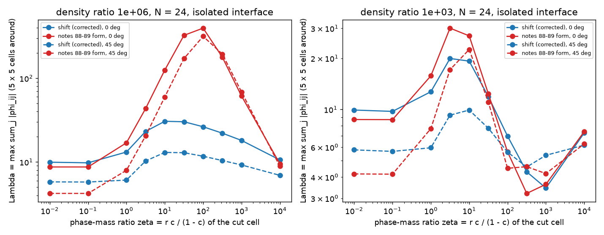

# 90 訂正：ノート88・89 の「速度差の shift」は、セル平均に拘束した最小二乗だった（ユーザーのレビュー）。重み付き平均を引く形に直し、密度比 100 万での増幅を 397 → 26 に戻した

ユーザーが PR #102 のコードを読んで、次の点を指摘した。

`_fit_split()` は、窓のすべての行から対象のセル k の行を引いて定数の列を消していた（`Ad = A − A_k`、`u − u_k1`）。これは、ノート85 で異常増幅の原因として不採用にした、**セル平均に拘束した最小二乗**と数学的に同じである。

さらに、界面に寄せた窓は diff の指定によらず必ず `_fit_split()` を通る。そのため、**ノート88 と 89 の結果（PR #102、#103）は、すべて拘束した形で計算されていた**。

```
python -m cases.galerkin2d_shiftfix            # 等価性と、ζ の走査（docs/figures/galerkin2d_shiftfix.json）
python -m cases.galerkin2d_shiftfix --rerun    # ノート88 の 3〜5 節を直した形で（galerkin2d_rank_shift.json）
python -m cases.galerkin2d_circle              # ノート89 を直した形で（旧の結果は galerkin2d_circle_constrained.json）
```

ライブラリは変えていない（`cases/galerkin2d.py` の `Reconstruction2D(lsq=...)`）。

## 図


## 定式化と理論的根拠
### A. 本来の shift（ノート85）
制約なしの重み付き最小二乗 `a* = argmin ‖W^{1/2}(Aa − u)‖`（A の第 0 列は定数）を解き、定数の係数だけを直してセル平均を戻す：

```
a_shift = a* + (u_k − A_k a*) e₀
```

平均を合わせる修正を定数だけが負うので、軽い相の高次の係数に押し付けない。

### B. ノート88・89 の形は拘束した最小二乗
対象のセルの行を引いた問題

```
min_â Σ_j w_j [(A_j − A_k)_{1:} â − (u_j − u_k)]²
```

に `a₀ = u_k − A_{k,1:} â` を代入すると、`min ‖W^{1/2}(Aa − u)‖ s.t. A_k a = u_k` と同じになる（満階数のとき）。

**定数の係数を自由に動かせないので、平均の拘束が高次の係数を歪める。** 重い相が薄片しかないセルでは、その歪みが軽い相の側に大きく出る（ノート85 の ζ 依存の増幅）。

### C. 正しい消去：重み付き平均の行を引く
`p = w/Σw` として `Ā = pᵀA`、`ū = pᵀu` とおく。

```
min_â Σ_j w_j [(A_j − Ā)_{1:} â − (u_j − ū)]²
```

は、定数の列を含む制約なしの最小二乗と同じ â を与える（定数項を持つ最小二乗は、重み付き平均で中心化した最小二乗に等しい）。

実装は次のとおり：
- データは `(I − 1pᵀ)(u − u_k1)` の形で入れる。一様な速度では `u − u_k1 = 0` が丸めによらず成り立つので、自由流の性質は残る。
- 解いた高次の係数から、定数を `u_k − A_{k,1:} â` で戻す（shift）。
- 界面成分の分割（X と Z の擬似逆行列、階数の扱い）は、そのまま使える。

### D. 増幅の指標
ユーザーの指標：`Λ_i = max_{x∈K_i} Σ_j |φ_ij(x)|`（セル平均の誤差が、再構築の値でどこまで増えうるか）。輸送の演算子の ‖T‖∞ とは別の量である。

ζ の走査はユーザーの方法による。切断されたセルの重い相の体積分率 c を、`ζ = rc/(1 − c)` から逆算して直接指定する（`c = ζ/(r + ζ)`）。

- 0°（辺に平行な薄片）：`c = δ/h`。
- 45°（頂点を切る三角形）：`c = (δ/h)²/(2|n_x n_y|) = (δ/h)²`。

密度比が大きいと、両相の質量が同程度になる界面の位置は、0° では `δ/h ~ 1/r`、45° では `δ/h ~ 1/√r` の尺度にある。一様な位置の走査では、これらを取りこぼしうる。

## 1. 等価性（N = 24、0°、密度比 1e6、区分多項式の適合 336 個）
| 比較 | 係数の差の最大（相対） |
| --- | --- |
| 直した形 と 普通の shift（定数の列を含む lstsq + 定数の修正） | 2.5e-10 |
| ノート88・89 の形 と 拘束した最小二乗（KKT 系） | 1.9e-7 |

どちらも丸め（密度比 1e6 の重みでの悪条件）の範囲で一致した。ユーザーの独立な計算（4.7e-10）と同じ結論である。

## 2. 増幅率 Λ（N = 24、孤立した界面、切断されたセルのまわり 5×5 セルの最大）
| 密度比・角度 \ ζ | 0.01 | 1 | 3.16 | 10 | 31.6 | 100 | 316 | 1000 | 1e4 |
| --- | --- | --- | --- | --- | --- | --- | --- | --- | --- |
| 1e6・0°：直した shift | 9.9 | 13.1 | 23.2 | 30.6 | 30.2 | **26.3** | 22.1 | 18.1 | 10.6 |
| 1e6・0°：ノート88 の形 | 8.7 | 16.9 | 43.4 | 125.3 | 325.4 | **396.9** | 178.7 | 61.5 | 9.5 |
| 1e6・45°：直した shift | 5.8 | 6.1 | 10.3 | 13.0 | 12.9 | 11.7 | 10.4 | 9.2 | 6.9 |
| 1e6・45°：ノート88 の形 | 4.2 | 8.0 | 20.5 | 59.8 | 171.9 | **316.6** | 194.6 | 68.7 | 8.9 |
| 1e3・0°：直した shift | 9.9 | 12.7 | 19.9 | 19.2 | 11.9 | 7.0 | 4.3 | 3.4 | 7.3 |
| 1e3・0°：ノート88 の形 | 8.7 | 15.8 | 30.1 | 27.1 | 12.3 | 5.6 | 3.2 | 3.6 | 7.4 |
| 1e3・45°：直した shift | 5.8 | 5.9 | 9.3 | 9.9 | 7.7 | 5.6 | 4.6 | 5.4 | 6.2 |
| 1e3・45°：ノート88 の形 | 4.2 | 7.7 | 17.1 | 22.5 | 11.1 | 4.5 | 4.6 | 4.2 | 6.3 |

- 密度比 1e6・0° は、ユーザーの表（直した形 13.2、30.6、30.2、26.4、22.1、18.1、ノート88 の形 17.0、125.3、325.7、397.2、178.9、61.5）と一致した。
- **頂点を切る 45° でも、ノート88 の形は 317 まで増える**（直した形は 13 以下）。
- 密度比 1000 では差は 1.5〜2.3 倍で、ノート88・89 の試験（密度比 1000）が通ったことと矛盾しない。
- ζ が小さい（重い相がほとんどない）所では、ノート88 の形の方が少し小さい（8.7 対 9.9）。ここは両者とも小さい。

## ノート88・89 の測り直し
直した形で、ノート88 の 3〜5 節とノート89 の円の計算をやり直している（`--rerun`、`galerkin2d_circle`）。結果は次の PR で、このノートに追記する。

## まとめ
- ノート88・89 の「速度差の shift」は、セル平均に拘束した最小二乗だった。重み付き平均の行を引く形に直し、普通の shift と一致させた。
- 密度比 1e6 の薄片のセルのまわりで、増幅率は 397 → 26（0°）、317 → 12（45°）。
- 密度比 1000 では差は 1.5〜2.3 倍で、ノート88・89 の結論（次数、Galerkin と Remap の比）が大きく変わるとは考えにくいが、測り直しで確かめる。
- 研究の方針の転換（ノート91）により、最小二乗 Galerkin は参照解法（Oracle）として残す。
