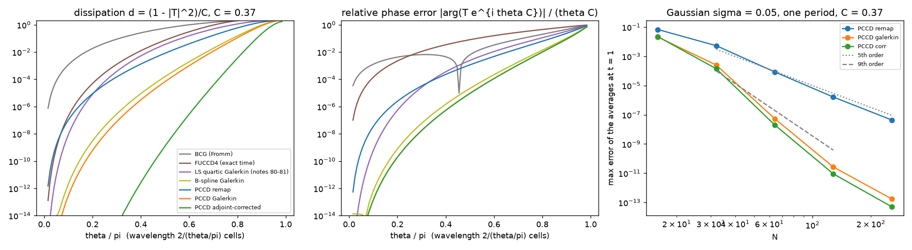

# 91 原始関数型 CCD（PCCD、仮称）の P0：一定密度・一次元周期で、5 次の C¹ 再構築、Remap は 5 次、Galerkin は 9 次以上

**訂正（ノート103、監修 #119）**：E 節の Gram の上限 1.53214 を与える波数は θ = π ではなく θ ≈ 0.793π（θ = π では 1.23657）。

ユーザーの方針の転換（PR #102 のレビュー）を受けて、研究の中心を CCD に戻した。

- **最小二乗 Galerkin（ノート80〜89）**：比較用の参照解法（Oracle）として残す。
- **保留**：円形界面・変形流・最小二乗の高速化は保留する（PR にしない枝 `hold-curved-poly-thin` に試作を残した）。

最初の段階 P0 は、ユーザーの提案した PCCD を、一定密度・一次元周期・一定速度で検証することである。

- 原始関数に CCD を当てて、面の値と勾配を求める。
- そこから C¹ の Hermite 再構築を作る。
- 同じ再構築で、3 つの輸送（Remap、Galerkin、随伴補正）を比べる。

```
python -m cases.pccd           # docs/figures/pccd.json（精度、Fourier、t = 1 までの輸送）
python -m cases.pccd_compare   # BCG・FUCCD4・ノート80〜81 との Fourier の比較（pccd_compare.json）
python -m cases.pccd_figure
```

ライブラリは変えていない（FUCCD4 の記号は、ライブラリの演算子の行列から取った）。

## 図


- 左：散逸 `d = (1 − |T|²)/C`（CFL 0.37）。
- 中：相対の位相誤差。
- 右：狭い Gauss 型の山（σ = 0.05）を 1 周期運んだ誤差。

## 定式化と理論的根拠
### A. 原始関数の CCD
セル i を `[x_i, x_{i+1}]`、セル平均を `q_i = (1/h)∫ u dx` とする。原始関数 `F(x) = ∫^x u` について、厳密に `F_{i+1} − F_i = h q_i` が成り立つ。

Chu–Fan の 6 次の CCD を、F の面の値に当てる：

```
F'_i + 7/16 (F'_{i−1} + F'_{i+1}) − h/16 (F''_{i+1} − F''_{i−1}) = 15/(16h) (F_{i+1} − F_{i−1})
F''_i − 1/8 (F''_{i−1} + F''_{i+1}) + 9/(8h) (F'_{i+1} − F'_{i−1}) = 3/h² (F_{i+1} − 2F_i + F_{i−1})
```

`v_i = F'_i = u(x_i)`、`g_i = hF''_i = h u_x(x_i)` とおき、右辺の F の差をセル平均で書くと、ユーザーの式になる：

```
v_i + 7/16 (v_{i−1} + v_{i+1}) − 1/16 (g_{i+1} − g_{i−1}) = 15/16 (q_{i−1} + q_i)
g_i − 1/8 (g_{i−1} + g_{i+1}) + 9/8 (v_{i+1} − v_{i−1}) = 3 (q_i − q_{i−1})
```

- 右辺は、面の両側の 2 セルの平均だけを使う。
- F そのものは現れないので、F を大域的に積分して持つ必要はない。
- 2×2 のブロック三重対角の系（周期ではブロック巡回）である。

**多項式の厳密さ（測定、無作為な係数）**：
- 1 本目の式は、u が 5 次の多項式まで厳密に成り立つ（残差 1e-15）。6 次では 0.13。
- 2 本目の式は 6 次まで厳密。
- そのため、面の値は O(h⁶) と見込む（測定で 6.1〜7.0 次）。

### B. 平均を保つ Hermite 再構築
セルの中で `s = (x − x_i)/h ∈ [0, 1]` とする。(v_i, g_i, v_{i+1}, g_{i+1}) の 3 次 Hermite 補間 H_i に、泡関数を足す：

```
P_i(s) = H_i(s) + 30 s²(1 − s)² (q_i − ∫₀¹ H_i),   ∫₀¹ H_i = (v_i + v_{i+1})/2 + (g_i − g_{i+1})/12
```

- 泡関数は、両端で値も傾きも 0 で、`∫₀¹ 30 s²(1 − s)² ds = 1`。
- そのため P_i は、5 条件（両端の値、両端の傾き、平均）をすべて満たす。
- 面の値と傾きを隣のセルと共有するので、再構築は **C¹ で連続**である。ノート82〜84 の面の跳びによる射影の散逸（`γ ≈ Uh⁹k¹⁰/900` の型）は、最初から起きない。
- 5 条件は 4 次の多項式を一意に決めるので、厳密なデータなら 4 次の多項式を厳密に再現する（測定 7e-16）。再構築は O(h⁵) と見込む（測定で 5.1〜5.3 次）。

### C. 3 つの輸送
一定の速度 1、`C = Δt/h`、周期とする。

- **Remap**：新しいセル i は、`s ∈ [0, C)` で古いセル i−1（`s' = s + 1 − C`）を、`s ∈ [C, 1)` で古いセル i（`s' = s − C`）を受け取る。新しい平均は、移動した再構築の積分（掃過体積のフラックスの形）。追加の連立は不要である。
- **Galerkin**：`G = ⟨φ_i, φ_j⟩`、`C = ⟨φ_i, Sφ_j⟩`、`Gq^{n+1} = Cq^n`。ノート80 以降の理論（エネルギーの非増加、自由流、総運動量）がそのまま使える。
- **随伴補正**：`T(3/2 − T†T/2)`、`T† = G⁻¹Cᵀ`。記号では `σ → (3σ − σ³)/2`。

### D. Galerkin の次数（導出の筋道。厳密な証明はしていない）
Fourier のモード `q_j = e^{ijθ}` の再構築を φ_θ とする。Galerkin の記号は Rayleigh 商：

```
T_G(θ) = ⟨φ_θ, S φ_θ⟩ / ⟨φ_θ, φ_θ⟩
```

φ_θ が真のモード e^{iθx}（に定数を掛けたもの）から O(ε) だけずれているとき（ε = O(θ⁵)、B 節）、Rayleigh 商の誤差は ε の二次になる。そのため、記号の誤差は O(θ¹⁰) と見込む。Remap の記号は φ に線形なので O(θ⁶)。

- 測定（C = 0.37、θ = 0.2 → 0.1 の傾き）：Remap 6.2、Galerkin 10.4、随伴補正 10.6。
- 決まった時刻までの大域誤差は、ステップ数 1/(Ch) を掛けて、Remap が 5 次、Galerkin が 9 次になる見込み。

### E. Gram 行列の下限は 1
平均を保つ再構築では、Cauchy–Schwarz の不等式から、各セルで `∫P² ≥ h q_i²` が成り立つ。和をとると `G ⪰ M`（M = hI）になる。

- 定数のモードで等号が成り立つ。
- 上限は、測定で 1.53214（ユーザーの値と一致）。最大を与える波数は θ ≈ 0.793π で、θ = π では 1.23657（訂正、ノート103、監修 #119、ユーザーの再計算 1.5321399、θ ≈ 0.7934π）。
- 条件数は 1.53 で、保留中の下書き（多項式近似 Galerkin、枝 `hold-curved-poly-thin` の `docs/notes/drafts/91_polynomial_galerkin.md`）の [1, b] の議論がそのまま当てはまる。

### F. 比較の方式
- **BCG**：ライブラリの bcg.h の一次元・制限関数なしの形（Fromm）。`u_f = u_i + (1 − C)/4 (u_{i+1} − u_{i−1})`。
- **FUCCD4**：σ = 1e-3。ライブラリの演算子を 64 セルの周期格子の単位ベクトルに当てて作った行列の記号 λ(θ)h。時間は厳密（空間だけの比較）と SSP-RK3。
  - FUCCD4 は点の値の方式、PCCD はセル平均の方式なので、変数の意味は異なる。比べているのは、同じ波数のモードの 1 ステップの増幅率である。
- **ノート80〜81**：区分 4 次の Galerkin（`cases.galerkin_fourier` の "poly"）と、4 次 B スプラインの Galerkin。

## 1. 精度（u = sin 2πx + 0.3 cos 6πx、最大誤差）
| N | 16 | 32 | 64 | 128 | 次数 |
| --- | --- | --- | --- | --- | --- |
| 面の値 v | 1.35e-4 | 1.50e-6 | 2.14e-8 | 3.27e-10 | 6.5、6.1、6.0 |
| 面の勾配 g = h u_x | 2.61e-4 | 1.90e-6 | 1.46e-8 | 1.13e-10 | 7.1、7.0、7.0 |
| 再構築（セル内 21 点） | 1.35e-4 | 2.04e-6 | 5.27e-8 | 1.57e-9 | 6.0、5.3、5.1 |
| 平均の保存、面での値と傾きの跳び | ≤ 1.6e-15 | | | | |

g は h u_x なので、勾配としての次数は 1 つ下（6 次）。

## 2. Fourier（ユーザーの数値を独立に再現）
θ = π/2（波長 4 セル）での散逸 `d = (1 − |T|²)/C`：

| CFL | PCCD Remap | PCCD Galerkin | PCCD 随伴補正 | 区分 4 次 Galerkin | B スプライン Galerkin |
| --- | --- | --- | --- | --- | --- |
| 0.01 | 2.88e-4 | 2.90e-6 | 4.4e-14 | 3.12e-2 | 6.73e-6 |
| 0.1 | 3.07e-3 | 2.80e-5 | 5.9e-11 | 3.56e-2 | 6.51e-5 |
| 0.37 | **8.07e-3** | **6.66e-5** | **1.23e-9** | 3.57e-2 | 1.55e-4 |
| 0.5 | 7.15e-3 | 5.85e-5 | 1.28e-9 | 2.95e-2 | 1.36e-4 |
| 0.9 | 3.41e-4 | 3.11e-6 | 6.5e-12 | 3.96e-3 | 7.24e-6 |

ユーザーの表（Remap 8.07e-3、Galerkin 6.66e-5、随伴補正 1.23e-9、区分 4 次 3.57e-2、B スプライン 1.55e-4、CFL ごとの値）と全部一致した。

- **安定性**：2001 波数 × 8 CFL（0.01〜0.99）で、3 方式とも `max|T| ≤ 1 + 4e-16`。Remap の安定性は測定の範囲での結果で、証明ではない。
- **Gram/M**：[1.000000, 1.532140]。CCD の連立の行列の条件数は 21.2（N = 16〜256 で変わらない）。

### 既存の方式との比較（θ = π/2、CFL 0.37）
| 方式 | 散逸 d | 相対の位相誤差 |
| --- | --- | --- |
| BCG（Fromm） | 5.57e-1 | +6.2e-3 |
| FUCCD4（時間は厳密） | 7.31e-2 | +8.0e-2 |
| FUCCD4（RK3） | 9.02e-2 | +7.8e-2 |
| 区分 4 次 Galerkin（ノート80〜81） | 3.57e-2 | +2.4e-3 |
| B スプライン Galerkin | 1.55e-4 | +2.1e-5 |
| **PCCD Remap** | **8.07e-3** | **+1.1e-3** |
| **PCCD Galerkin** | **6.66e-5** | **+9.2e-6** |
| PCCD 随伴補正 | 1.23e-9 | +9.2e-6 |

- PCCD Remap は、追加の連立なしで、BCG の 1/70、FUCCD4 の 1/9 の散逸、FUCCD4 の 1/70 の位相誤差。
- 図の左：長い波（θ < 0.2π）では、FUCCD4 の散逸の方が PCCD Remap より小さい。FUCCD4 の超粘性は θ⁸ に比例し、Remap は θ⁶ に比例するため。ただし、FUCCD4 の位相誤差は全波数で PCCD より大きい。
- 図の中：短い波（θ > 0.3π）では、区分 4 次の位相誤差が PCCD Remap より小さい。
- PCCD Galerkin は、全波数で B スプライン Galerkin より少し散逸が小さく、位相誤差は同程度。

## 3. 決まった時刻までの輸送（CFL 0.37、t = 1 は 1 周期、最大誤差）
滑らかな関数 sin 2πx + 0.3 cos 6πx：

| N | 16 | 32 | 64 | 128 |
| --- | --- | --- | --- | --- |
| Remap | 1.93e-3 | 2.83e-5 | 6.66e-7 | 1.92e-8 |
| Galerkin | 3.21e-6 | 1.44e-9 | 1.50e-12 | 8.6e-14（丸め） |
| 随伴補正 | 1.32e-6 | 5.47e-10 | 4.55e-13 | 3.3e-14 |

狭い Gauss 型の山（σ = 0.05、多くのモードを含む）：

| N | 32 | 64 | 128 | 256 | 次数 |
| --- | --- | --- | --- | --- | --- |
| Remap | 5.31e-3 | 8.48e-5 | 1.64e-6 | 4.39e-8 | 6.0、5.7、5.2 |
| Galerkin | 2.51e-4 | 5.33e-8 | 2.68e-11 | 1.75e-13（丸め） | 12.2、11.0 |
| 随伴補正 | 1.40e-4 | 2.00e-8 | 9.08e-12 | 5.06e-14 | 12.8、11.1 |

- t = 0.25、0.5 でも、誤差は時刻にほぼ比例し、次数は同じ（途中の時刻でも判断する、という方針どおり）。
- Remap は 5 次に近づく。Galerkin は粗い格子で 11〜12 次（9 次の見込みより高い。前漸近域と考えている）。
- 自由流は 1e-15、総質量は 1e-14。Galerkin のエネルギーは単調に減る（N = 64 で −1.4e-9）。

## まとめ（P0 の判定）
| 合格条件（ユーザー） | 結果 |
| --- | --- |
| 4 次以上の輸送精度 | Remap 5 次、Galerkin 9 次以上 |
| 単相の Fourier の安定性 | 測定の範囲で \|T\| ≤ 1（3 方式） |
| コンパクトな求解 | 2×2 ブロック三重対角（条件数 21）、明示的には 2 セル |

- PCCD は、一定密度の単相で P0 の条件を満たした。
- Galerkin の連立（条件数 1.53）に見合う利点があるかは、Remap との比較で判断する。
  - 精度：Galerkin が大きく上回る（N = 64 で Remap の 1/1600）。
  - 計算量：Remap は連立が CCD の 1 回だけ。Galerkin は G の連立が追加になる。
  - 同じ精度に必要な格子で比べるのは、P1 以降。

## 4. 計算量
CCD の応答は 1 セル離れるごとに約 0.46 倍で減衰する（`|∂v_0/∂q_j|` は 0.67、0.24、0.11、0.048 …）。そのため、基底 φ_j と G・T の要素も同じ率で減衰し、帯行列にはならない（`|G_0j|/G_00` は j = 10 で 7e-4）。

| 方式 | 1 ステップの主な計算 |
| --- | --- |
| Remap | CCD のブロック三重対角の解法 1 回 + 各セルの 2 区間の解析的な積分 |
| Galerkin（行列を作らない） | 右辺 `Cq`：CCD 1 回 + 局所の積分 + 随伴の CCD（転置のブロック三重対角）1 回。`Gx = b` を Chebyshev（κ = 1.53 で 1 反復あたり 0.106、1e-12 まで 13 反復）、各反復で CCD 2 回。合計で CCD 約 28 回 |

- Galerkin の精度の利点（N = 64 で Remap の 1/1600）が、約 28 倍の CCD の解法に見合うかは、同じ精度に必要な格子で比べる必要がある（Remap は 5 次なので、誤差を 1/1600 にするには格子を約 4.4 倍）。
- 一次元では Galerkin の方が速い見込み。多次元では、格子の倍率が次元の冪で効くので、さらに Galerkin に有利になる。ただし、これは見積もりで、実測していない。
- 有限の反復で止めると、エネルギーの非増加の証明はそのままでは使えない（ユーザーの 7.3 節）。保留中の下書き（多項式近似 Galerkin）の条件（残差の多項式 r = q² ∈ [0, 2]、q(1) = 0）を使えば、有限の反復でもエネルギー・自由流・総運動量を厳密に保てる。

## 未検証
- 可変の密度、界面での微分の跳び（P1）。
- 境界（壁）の CCD の端の条件。
- 多次元、非一様な速度（Remap の掃過体積が変わる）。
- GPU の実装（ブロック三重対角の PCR など）。

## 次（P1）
1. 密度だけ不連続で、速度は滑らかな問題：混合セルで、質量加重平均から普通の平均を復元する連立（ユーザーの 6.1 節）。
2. 既知の微分の跳びを除いた滑らかな成分に PCCD を当て、跳びを戻す（ジャンプ分離、Oracle）。
3. 純相の CCD から未知の跳びを推定する界面の端の条件。採否は、Taylor の次数ではなく、条件数・増幅率・連続性で判断する。
