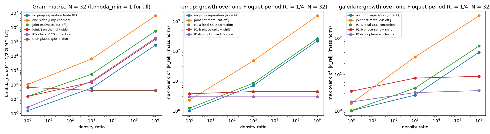

# 95 密度に頑健な二相の PCCD：Gram の悪条件の原因は軽い相から重い相への漏れ。相分離 PCCD + shift で密度比によらない条件数と Floquet の増幅（≤ 3.6）、ただし界面が面を横切るときの不連続が残る

ユーザーのレビュー（PR #104〜#106）を受けた段階。ユーザーの独立な計算で、次のことが分かった。

- 跳びの補正をしない PCCD でも、密度比 1e6 で質量正規化した Gram 行列の最大固有値が約 5.6 万になる。
- 現在の跳びの補正（切り落とし関数で領域に広げる形）では 52.7 万になる。

ユーザーの計画（P0 原因の切り分け、P1-a CCD の行への局所の補正、P1-b 相分離 PCCD、P1-c 端の条件の最適化、P2 Floquet 解析）に沿って調べた。

```
python -m cases.pccd_gram                   # P0・P1：Gram の固有値と漏れ（docs/figures/pccd_gram.json）
python -m cases.pccd_closure                # P1-c：端の条件の最適化（pccd_closure.json）
python -m cases.pccd_floquet                # P2：Floquet 解析（pccd_floquet.json）
python -m cases.pccd_twophase               # 両側同時の推定 + 切り落としの J での多ステップの Remap
python -m cases.pccd_density_robust_figure
```

ライブラリは変えていない（`cases/pccd_local.py` に P1-a と P1-b）。

## 図


- 左：Gram の最大固有値と密度比。
- 中：Remap の 1 周期（Floquet）の増幅（質量ノルム）。
- 右：Galerkin の 1 周期の増幅（質量ノルム）。

## 定式化と理論的根拠
### A. 漏れの下界（ユーザー）
再構築 `u_h = Σ_j φ_j ū_j` の Gram 行列 `G_ij = ∫ρφ_iφ_j`、`M = diag(m)` とする。軽い相の純相のセル j（`m_j = ρ_L h`）の基底が重い相に届くと、

```
λ_max(M^{−1/2}GM^{−1/2}) ≥ G_jj/m_j ≥ (r/h) ∫_{Ω_H} |φ_j|² dx
```

したがって、密度比 r によらない条件数には、漏れ `(1/h)∫_H|φ_j|²` が O(1/r) である必要がある。

CCD の陰的な結合の減衰率（1 セルあたり 0.46）は格子と密度比によらない。そのため、それだけでは密度比に対して頑健にならない。

なお、ここで抑えるのは再構築の非物理的な誤差の伝播である。物理的な圧力や粘性応力の相間の作用ではない（ユーザーの注意）。

### B. P1-a：CCD の行への局所の跳びの補正（切り落とし関数なし）
CCD の系を `Az = Bq + b_Γ`、`b_Γ = Az_J − Bq_J` とする。J = H(d)T(d)（T は 4 次の跳びの多項式、+ 側の全域に延ばす）。

- 界面をまたがない行では、J はステンシルの上で多項式（0 か T）である。CCD は u の 5 次の多項式まで厳密なので、`Az_J − Bq_J = 0` になる。
- 補正が要るのは、界面を含むセル m の両側の面 m と m+1 の行（各 2 式）だけである。
- 界面のセルの多項式は `H_m(z, q_m) + J − H_m(z_J, q_J,m)`（H は平均を保つ Hermite）。後ろの 2 項は、面の値・勾配・平均を変えない。

区分的な多項式（各相で 4 次、跳びが既知）では、全ての行が厳密に成り立つ。そのため、再構築は厳密である。

### C. P1-b：相分離 PCCD + shift（ユーザーの 5 節）
- 各相の純相のセルの列に、それぞれ PCCD を当てる。内部の面は CCD の行で、両端の面は 5 個の純相の平均からの片側の値と勾配（4 次まで厳密、係数はユーザーの式と一致）。
- 混合セルでは、両隣の純相のセルの多項式を延ばす。軽い相の側は、界面で重い相の値に合うように定数を足す（界面の速度を共有）。
- 最後に各セルで shift：`u_h = ū_i + ũ − (1/m_i)∫_{K_i}ρũ`。

軽い相のデータは、重い相の再構築に入らない。ユーザーの一般化 `R = J_c + (I − P_c)R̃` から `G = M + R̃*(I − P_c)R̃`、すなわち `M ⪯ G ⪯ (1 + c_R)M`。c_R は暫定の再構築 R̃ の大きさだけで決まり、密度比には依存しない。

### D. P1-c：陰的なコンパクトな端の条件の最適化
相の列の端の面 0（その相のセル 0〜5、次の面 1）で：

```
v₀ + p₁v₁ + p₂g₁ = Σ_{k=0}^{5} c_k q_k,      g₀ + p₃v₁ + p₄g₁ = Σ_{k=0}^{5} d_k q_k
```

u = s^p（p = 0〜4）での厳密さは、(p₁, p₂) を与えると c を 5×6 のモーメント行列の零空間の 1 方向 t₁ を除いて決める（d も同様に t₂）。自由度は 6 個である。

ユーザーの提案どおり、Taylor 展開で係数を一意に決めず、多項式の厳密さを拘束条件として、次を最小化した：

- 目的関数：λ_max(G/M) + Λ（Λ は再構築の増幅率 `max Σ_j|φ_j|`）。
- 走査：密度比 1e6、ζ = 1e-2 と 1e2。
- 罰則：相の CCD 行列の条件数が 200 を超えると罰する。
- 手法：Nelder–Mead（numpy のみ）、初期値 6 個。

### E. P2：Floquet 解析（ユーザーの 9 節）
CFL = 1/4 の並進では、4 ステップで界面と格子の相対位置が戻り、全体が 1 セル動く。

```
P_rel = S⁻¹ T₃T₂T₁T₀      （S は 1 セルのずらし）
```

1 周期の増幅を、次の 3 つで見る。

- スペクトル半径（長時間の増幅）。
- 質量ノルムの最大特異値（1 周期の過渡的な増幅）。
- G₀ ノルムの最大特異値。Galerkin では構成上 ≤ 1（ノート87 D 節）。

## 1. P0：原因の切り分け（N = 32、重い相 (0.2613, 0.7137)）
| 再構築 | λ_max：密度比 1 | 1e3 | 1e6 | r·漏れ（1e6） |
| --- | --- | --- | --- | --- |
| 補正なし（ノート92） | 1.53 | 57.2 | 55,890 | 44,900 |
| 片側の推定 | 102 | 6,146 | 6,143,000 | 3,040,000 |
| 両側同時の推定（切り落としの J） | 15.1 | 529 | 527,400 | 290,000 |
| 同、J を軽い相の側に | 15.1 | 148 | 143,900 | 57,400 |
| **P1-a 局所の CCD の補正** | 2.66 | 174 | 171,800 | 68,700 |
| **P1-b 相分離 + shift** | 64.3 | 39.7 | **39.7** | 1.2e-6 |

N = 64：補正なし 1.53 / 23.5 / 22,150、両側同時 2.93 / 404 / 401,800、軽い相の側 5.82 / 32.1 / 30,280、P1-a 2.08 / 32.1 / 30,270、P1-b 45.8 / 102 / 102。

- **ユーザーの表（補正なし・現在の補正・軽い相のみ・CCD 局所補正）を、N = 32 と 64 の全ての値で再現した。**
- 全ての場合で λ_min = 1.0000（平均を保つ再構築、ノート96 C 節）。
- **下界 `λ_max ≥ r·漏れ` は全ての場合で成り立ち**（補正なし 4.49e4 ≤ 5.59e4 など）、密度比 ≥ 1e3 では最大の固有モードの 100% が軽い相のセルの上にある。漏れが原因であることを、数値でも確かめた。
- P1-b の相分離では漏れが 1e-12 の大きさまで下がり（r·漏れ 1.2e-6）、λ_max は密度比によらない。ユーザーの試作（91.1 / 37.3 / 37.2）と同じ傾向である。混合セルの細部の扱いの違いで、値は少し違う。

## 2. P1-a と P1-b の精度（ノート93 の勾配が不連続な速度、密度比 1 と 1e6、セル内 41 点の最大誤差）
| N | 32 | 64 | 128 | 256 |
| --- | --- | --- | --- | --- |
| P1-a、既知の跳び、密度比 1e6 | 3.24e-7 | 1.02e-8 | 2.13e-10 | 1.73e-11 |
| P1-a、推定した跳び（両側同時）、1e6 | 7.49e-5 | 1.51e-6 | 4.83e-8 | 1.74e-9 |
| P1-b、相分離（陽的な端）、1e6 | 3.87e-4 | 8.00e-6 | 2.50e-7 | 9.38e-9 |
| P1-b、最適化した端、1e6 | 7.09e-4 | 1.45e-5 | 4.55e-7 | 1.78e-8 |
| （参考）切り落としの J、既知の跳び（ノート93） | 1.27e-3 | 5.10e-5 | 1.00e-6 | 2.60e-8 |

- 次数はどれも約 5（隣り合う N で 4.5〜5.6）。密度比 1 でもほぼ同じ値だった。
- P1-a に既知の跳びを与えると、切り落としの J より約 4000 倍小さい（N = 32）。χ の高階の微分による前漸近域がなくなった。
- P1-b はユーザーの値（3.95e-4、8.13e-6、2.55e-7、9.58e-9）とほぼ一致した。

## 3. P1-c：端の条件の最適化（N = 32、密度比 1e6）
増幅率 Λ と λ_max を ζ ごとに示す。

| ζ | 1e-4 | 1e-2 | 1 | 1e2 | 1e4 |
| --- | --- | --- | --- | --- | --- |
| 陽的な 5 セルの端：Λ / λ_max | 37.8 / 80.8 | 37.4 / 84.2 | 43.0 / 252 | 61.0 / 419 | 60.5 / 404 |
| 最適化した陰的な端：Λ / λ_max | 17.6 / 14.9 | 17.4 / 15.3 | 21.4 / 35.3 | 29.5 / 56.9 | 29.3 / 55.1 |

- 最適化した係数（`docs/figures/pccd_closure.json` の best）：p₁ = −4.23、p₂ = −3.18、p₃ = 4.29、p₄ = 2.12。c、d は 6 セル。
- 相の CCD 行列の条件数は 20.5 → 200（罰則の境目に張り付いた）。
- 精度は 5 次のまま、誤差は陽的な端の約 1.9 倍。
- **セルごとの増幅率**（陽的な端、ζ を固定）：相の内部 2.2、端のセル 8.5、混合セル 31〜33。残る増幅は、端の多項式を混合セルの中へ外挿する部分にある。
- 暫定目標の κ ≲ 10 には、まだ届かない。

## 4. P2：Floquet 解析（N = 32、CFL 1/4、c は界面のセルの重い相の体積分率 0.5、0.05、1e-3）
| 再構築 | Remap：スペクトル半径 | Remap：質量ノルム（1e6） | Galerkin：質量ノルム（1 / 1e3 / 1e6） |
| --- | --- | --- | --- |
| 補正なし | 1.0000 | 218 | 1.0 / 2.7 / 40.6 |
| 両側同時の推定（切り落としの J） | **1.18〜1.33（不安定）** | 1349〜1508 | 1.6 / 30.2 / 408 |
| P1-a 局所の補正 | 1.0000〜**1.0071** | 261 | 1.0 / 4.2 / 60.1 |
| P1-b 相分離 | 1.0000 | 4.4 | 3.4 / 7.9 / 8.8 |
| **P1-b + 最適化した端** | **1.0000** | **2.9** | **1.7 / 3.1 / 3.6** |

- Galerkin の G₀ ノルムの特異値は、全ての場合で 1.000（構成どおり）。質量ノルムでの過渡的な増幅は、Gram の条件数の平方根で抑えられる。
- **切り落としの J の Remap は、Floquet で不安定**（1 周期で 1.18〜1.33 倍）。両側同時の推定と切り落としの J の多ステップの Remap（`pccd_twophase.py`）では、N = 32 で誤差が t = 0.25 → 1 に 2.7e-3 → 0.12 と増えた。N ≥ 64 では約 4 次で収束した（t = 1 で 4.9e-4、3.9e-5、2.3e-6、密度比によらない）。これは、この不安定が粗い格子で現れたものと考えられる。
- P1-a の Remap は、密度比 1e6、c = 1e-3 でわずかに不安定（1.0071）。
- **P1-b（とくに最適化した端）は、Remap も Galerkin も 1 周期の増幅が 3.6 以下で、密度比によらない。**

## 5. 連続性（無作為なデータ、界面がセル N/4 の右の面を ±0.1 セル動く、N = 32）
| 再構築 | 密度比 1：間隔 0.02 / 0.01 / 0.005 | 密度比 1e3 |
| --- | --- | --- |
| 補正なし | 1e-15（変化なし） | 0.73 / 0.69 / 0.62 |
| P1-a | 0.229 / 0.117 / 0.059（連続） | 0.58 / 0.57 / 0.55 |
| P1-b + 最適化した端 | **7.56 / 7.56 / 7.56（跳び）** | 8.9 / 8.8 / 8.4 |

- 密度比 1e3 の 0.5〜0.7 は、ノート94 の両側同時の推定と同じく c ~ 1/r の尺度の急な変化と考えている（この間隔では未確認）。
- **P1-b は、界面が面を横切る所で約 8 跳ぶ。** 混合セルが純相の列に入る・出るときに、列の端（端の条件の位置）が 1 面ずれるためである（ユーザーの指摘した未解決の点）。

## まとめ
| | 密度比によらない条件数 | Floquet の安定 | 連続性 | 5 次 |
| --- | --- | --- | --- | --- |
| 切り落としの J（ノート93〜94） | ✗（52.7 万） | ✗（Remap 1.33） | ○ | ○ |
| P1-a 局所の CCD の補正 | ✗（17 万） | △（Remap 1.007） | ○ | ○（最も正確） |
| P1-b 相分離 + shift（最適化した端） | **○（57 以下）** | **○（≤ 3.6）** | **✗（跳び約 8）** | ○ |

- Gram の悪条件の主因は、CCD の陰的な結合による軽い相から重い相への漏れだった（下界と固有モードで確認）。
- 相分離でこれを断つと、条件数と Floquet の増幅が密度比によらなくなった。
- 残る課題は、相分離の (1) 端と混合セルでの増幅（Λ 18〜30、λ_max 15〜57、目標 10）と、(2) 界面が面を横切るときの不連続である。

## 次（提案、未検証）
**混合セルの滑らかな編入**：重い相の体積分率 c → 0 のとき、混合セルを軽い相の列に入れる。その際の平均は、質量加重平均から重い部分を重い相の多項式で厳密に差し引いた「軽い相の多項式の平均」を使う：

```
q_L,eff = [m ū_m − ρ_H ∫_H P_H + ρ_L ∫_H P_L] / (ρ_L h)
```

（`∫_L P_L = (m ū_m − ρ_H∫_H u)/ρ_L` に、重い部分の u を重い相の多項式で置き換え、重い部分の軽い相の多項式の積分を足したもの。）全体は連立になる。

- この「混合セルとして扱う形」と「軽い相の列に入れる形」を、軽い相の質量の割合で滑らかに混ぜる。
- 両者とも区分的な多項式に厳密なので、精度を落とさずに連続になる見込み。
- 重い相の部分の寄与は ζ に比例するので、混ぜる範囲（ζ が小さい所）では増幅しない見込み。

あわせて、端の条件の目的関数に、連続性と混合セルの増幅を入れる。
