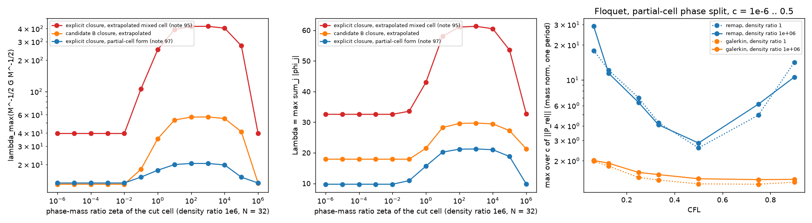

# 97 二相 PCCD の混合セルを部分セルの形に：密度比 1〜1e6・ζ の全域で λ_max ≤ 20.5・Λ ≤ 21.3、5 次（部分セル単体は面で C¹）。Floquet（7 通りの CFL）で安定、Galerkin の 1 周期の増幅 ≤ 2.0。粘性の剛性は一様に有界にできない（ユーザーの定理を数値で確認）

**条件の付記（ノート103、監修 #116・#119）**：「全域で λ_max ≤ 20.5」は、N = 32、b = 0.7137 固定（両方の相が 5 セル以上続く）の走査である。純相が 4 セル以下の列では方式が定義されない（`_solve_run` が ValueError）。軽い相の純相が 8〜5 セルでは、密度比 1e6 で λ_max が 22.5〜33.2 に増える（監修の測定）。

ユーザーのレビュー（PR #108）の計画に沿って進めた。

- **P0**：既存の最適化した端の条件の再評価、5 セルの不具合の修正、回帰試験。
- **P1**：混合セルの情報を端の条件に使う「部分セル」の形。
- **P2**：複数の CFL の Floquet 解析、決まった時刻での収束、粘性の剛性。

```
python -m cases.pccd_closure_review         # P0：6 候補と陽的な端の全条件の比較（pccd_closure_review.json）
python -m cases.pccd_floquet --general      # P2：CFL 1/16〜9/10 の Floquet（pccd_floquet_general.json）
python -m cases.pccd_partial_figure
```

ライブラリは変えていない（`cases/pccd_local.py` の `Split(mixed_mode="partial")`、`SplitBlend(mixed_mode="partial")`）。

## 図


- 左・中：λ_max と Λ の ζ による変化（密度比 1e6、N = 32）。
- 右：Floquet の 1 周期の増幅と CFL。

## 定式化と理論的根拠
### A. 端の条件の評価の量
相の列の行列 A（12 セル、両端に端の条件）について、次の 3 つを見る。

- κ(A)。
- 行ごとに最大の絶対値で正規化した κ（行の尺度によらない）。
- `‖A⁻¹B‖∞`：セル平均の誤差が、面の値と勾配にどれだけ伝わるか（ユーザーの指摘：κ だけでは入力の誤差への応答が分からない）。

### B. 部分セルの形
混合セル m（界面は s = σ）では、各相の部分は、隣の純相の端のセルの多項式 P_ext を延ばし、界面の値 u_Γ に合わせる補正を足す：

```
P_X(s) = P_X,ext(s) + (u_Γ − P_X,ext(σ)) b_X(s),   b_X = 3t² − 2t³,   t = |s − s_F| / |σ − s_F|
```

s_F は、その相の側のセルの面である。b_X は面で値も傾きも 0、界面で値 1・傾き 0。

u_Γ は、混合セルの質量加重平均の条件から一意に決まる：

```
α u_Γ = m_s ū_m − Σ_X ρ_X ∫_X (P_X,ext − P_X,ext(σ) b_X) ds,      α = Σ_X ρ_X ∫_X b_X ds > 0
```

- **厳密さ**：区分的な多項式（各相で 4 次、界面で連続）なら、両方の P_ext(σ) は真の界面の値に一致する。そのため u_Γ もそれに一致し、補正は 0 になる。
- **C¹**：セルの面で値も傾きも隣の純相のセルと一致するので、最後の shift は不要（質量の条件は厳密に満たす）。
  - **訂正（ユーザーのレビュー、PR #109）**：C¹ が構成上保証されるのは、部分セルの形の単体（`Split(mixed_mode="partial")`）だけである。`SplitBlend` の編入済みのセルには、少ない方の相の部分の定数の補正と最後の shift が残る。そのため、blend を含む最終の再構築では、任意の入力に対する C¹ は保証されない。2 節の「面での跳び 1e-8」は、滑らかな入力での測定（O(h⁵)）であり、数学的な保証ではない。
- **退化しない**：α は c → 0 でも軽い相の部分の寄与で正のまま。
- **ユーザーの提案との関係**：混合セルの平均を、事後の定数の shift ではなく、端の値 u_Γ を決める条件として使う。c → 0 で重い部分の平均は面の点の値に移り、退化しない。
- **漏れが減る理由（見積もり、証明はしていない）**：ノート95 の定数の shift は、平均の不一致（軽い相の外挿を、軽い相の質量の割合で含む）を、重い薄片を含むセル全体に一様に配っていた。λ_max = 57 の固有モードは、軽い相のデータが混合セルの重い薄片に作るエネルギーで、全体の 97% を占めた。部分セルの形では、補正は界面の近くに b の形で入り、軽い相の外挿は u_Γ を通してだけ効く。

### C. Floquet の一般の CFL
CFL = p/q では、q ステップで配置が p セル動いて元に戻る：`P_rel = S^{−p} T_{q−1} ⋯ T₀`。

- 相対座標では、厳密解の写像は恒等写像である。そのため、滑らかなモードの固有値はほぼ 1 で、2 番目の固有値の絶対値は意味を持たない（測定でも 1.000）。
- 長時間の安定性は、`max_{k≤40} ‖P_rel^k‖` で見た。
- 重い相の流入と流出は、2 つの界面（a と b）で両方を含む。

### D. 極小の薄片の原理的な制約（ユーザーの定理）
主張：セルごとに独立な平均、重い相の中での速度の連続性、密度比によらない Gram の上界 `G ⪯ C_G M`、一定の動粘度での密度比によらない粘性の剛性の上界。この 4 つを、密度比によらず同時に保証することはできない。

ユーザーの導出を確かめた。

- 格子幅 1、`ρ_H = 1`、`ρ_L = 1/r`、重い相の体積分率 `c = r^{−1/2}` とする。混合セルの質量は `m ≈ r^{−1/2}` で、大部分は重い薄片にある。
- 混合セルの平均だけを 1、他を 0 とするデータに対し：
  - Gram の上界から `∫ρu² ≤ C_G m`。
  - 粘性の剛性の上界から `∫ρ|u'|² ≤ K₀C_G m`。
- 重い相の領域（長さ O(1)、薄片を含む）で H¹ の大きさが `O(r^{−1/2})` なので、一次元のトレースの不等式から、重い薄片の速度は `|u_H| = O(r^{−1/4})`。
- 平均 1 を作るには、軽い部分が `ρ_L∫_L u ≈ m` を担う必要があり、`|u_L| ~ r^{1/2}`。軽い相のエネルギーは `ρ_L∫u_L² ~ 1 ≫ C_G m`。矛盾。

各方式が何をあきらめているか（測定は 3 節）：

- **補正なしの PCCD**：Gram の上界（∝ r）。
- **相分離の形**：粘性の剛性（重い薄片の中の急な勾配で ∝ 1/c²）と、セルの面での連続性（ノート95 の外挿の形のみ。部分セルの形は C¹）。

**設計への帰結**：粘性の演算子を、移流の再構築の微分からそのまま作ってはいけない。

### E. 実装上の注意（ユーザーの指摘）
- `SplitBlend` は、編入の候補が k 個あると最大 2^k 通りの再構築を作る。研究用の実装として明記した（多次元や多数の液滴の最終実装には使わない。端の条件そのものを連続に変える形に移る必要がある）。
- 6 セルの端の条件（最適化した候補）は、純相のセルが 5 個の列では使えない。端の条件の係数が 0 でない範囲から必要なセルの数を判定し、足りなければ例外にした。陽的な 5 セルの式（長さをそろえるための 0 を除く）は 5 セルで使える。短い式への切り替えは、切り替えの跳びを再び生むので、まだ入れていない。

## 1. P0：端の条件の候補の再評価（外挿の形、N = 32、ζ = 1e-6〜1e6）
| 候補（最適化の目的関数） | κ(A) | 行の正規化後 | ‖A⁻¹B‖∞ | λ_max：密度比 1 / 1e3 / 1e6 | Λ：同 | N = 256 の誤差 |
| --- | --- | --- | --- | --- | --- | --- |
| 陽的な 5 セル | 20.5 | 18.7 | 26.7 | 70.7 / 374 / 421 | 30.8 / 57.2 / 61.3 | 9.4e-9 |
| run1（86.414、ノート95 の採用） | 200.0 | 69.2 | **21.0** | **14.3** / 51.2 / 57.1 | 15.5 / 27.8 / 29.6 | 1.8e-8 |
| **run2（86.511、ユーザーの候補 B）** | **69.5** | **64.7** | 25.9 | 16.2 / 51.2 / 57.1 | 15.9 / 28.0 / 29.7 | 1.7e-8 |
| run0（86.552、候補 A） | 76.0 | 70.3 | 28.1 | 17.3 / 51.3 / 57.1 | 16.1 / 28.0 / 29.8 | 1.7e-8 |
| run3〜5 | 76〜100 | 70〜93 | 30〜36 | 18〜22 / 51.3 / 57.1 | 17〜19 / 28 / 30 | 1.6〜1.7e-8 |

- **密度比 ≥ 1e3 の λ_max（57.1）と Λ（約 30）は、最適化したどの候補でも同じだった。** 上限は端の条件ではなく、混合セルの扱いで決まっている。
- 候補の違いは、密度比 1 の値と行列の性質だけである。
  - run1 は応答 ‖A⁻¹B‖ が最小で、κ が最大。
  - 候補 B は κ が約 1/3 で、応答は 23% 大きい。
- 外挿の形を使うなら候補 B を推す。ただし、下の部分セルの形では、陽的な端の方が良い。

## 2. P1：部分セルの形（陽的な 5 セルの端）
| ζ（密度比 1e6） | 1e-6〜1e-2 | 1 | 1e2 | 1e4 | 1e6 |
| --- | --- | --- | --- | --- | --- |
| 外挿・陽的な端：λ_max / Λ | 40 / 33 | 252 / 43 | 419 / 61 | 404 / 60 | 40 / 33 |
| 外挿・候補 B：λ_max / Λ | 13 / 18 | 35 / 21 | 57 / 30 | 55 / 29 | 13 / 21 |
| **部分セル・陽的な端：λ_max / Λ** | **13 / 10** | **18 / 16** | **20 / 21** | **20 / 21** | **13 / 10** |
| 部分セル・候補 B：λ_max / Λ | 23 / 19 | 30 / 19 | 30 / 20 | 30 / 20 | 23 / 19 |

（密度比 1：部分セル・陽的な端で λ_max 13.8、Λ 10.9。密度比 1e3：19.3 / 20.0）

| 精度（ノート93 の速度、セル内 41 点） | N = 32 | 64 | 128 | 256 |
| --- | --- | --- | --- | --- |
| 部分セル・陽的な端、密度比 1 | 1.23e-4 | 3.26e-6 | 1.00e-7 | 2.63e-9 |
| 同、密度比 1e6 | 1.23e-4 | 3.25e-6 | 1.00e-7 | 2.57e-9 |
| （外挿・候補 B、密度比 1e6） | 7.1e-4 | 1.5e-5 | 4.6e-7 | 1.7e-8 |

- 5.0〜5.3 次で、密度比によらず、外挿の形の約 6 倍正確。
- **セルの面での跳び**（N = 64、滑らかな二相の場）：値 1.3e-8、勾配（h u_x）1.0e-8（O(h⁵) の大きさ）。
- **連続性**（無作為なデータ、界面が面を横切る）：
  - 密度比 1：間隔 1e-2 → 5e-3 で 1.15 → 0.60、1e-5 → 1e-6 で 3.7e-5 → 3.7e-6。
  - 密度比 1e3：1.94 → 0.99、0.048 → 0.0025。
  - どちらも間隔に比例して縮むので連続。ノート95 の外挿の形（4.5）より緩やか。
- **最適化した端は、部分セルの形では陽的な端より悪い**（λ_max 30.5 対 20.5）。外挿の形に合わせて最適化したため。部分セルの形では、陽的な 5 セルの式（ユーザーの係数）を採る。必要なセルも 5 個で済む。

## 3. 粘性の剛性（`K_ij = ∫ρφ_i'φ_j'`、一定の動粘度、セル内の微分のみ、λ_max(M^{−1/2}KM^{−1/2})h²、N = 32）
| 密度比・c（ζ） | 1・0.5（1） | 1e2・1e-1（11） | 1e4・1e-2（101） | 1e4・1e-5（0.1） | 1e6・1e-3（1e3） | 1e6・1e-6（1） |
| --- | --- | --- | --- | --- | --- | --- |
| 補正なし（ノート92） | 12.2 | 122 | 1.15e4 | 1.83e4 | 1.15e6 | 1.28e6 |
| 外挿の形（blend・最適化） | 153 | 158 | 166 | 1.13e12 | 167 | 2.34e13 |
| 部分セルの形 | 343 | 1398 | 5.78e4 | 1.46e10 | 4.90e6 | 5.52e12 |

- D 節の定理どおり、どの方式でも一様に有界ではない。
  - 補正なしは、ζ ≳ 10 で r に比例して増える。
  - 相分離の形は、c が小さいとき（ζ ~ 0.1〜1）に、薄片の中の急な勾配で 1/c² に比例して増える。
- セルの面での跳びの寄与（DG 型の罰則の項など）は含めていない。外挿の形は面で跳ぶので、実際の剛性はさらに大きい。
- 帰結：**粘性は、移流の再構築の微分から組み立てない。** 相ごとの CCD の粘性と、界面での応力の条件で組み立てる方向を検討する（次）。

**訂正と補足（ユーザーのレビュー）**：上の値は、再構築を中心差分で微分した。極小の切断セルでは差分の点が区分の境界をまたぎうるので、Hermite 多項式と補正 b(t) の解析的な微分で測り直した（`stiffness_analytic`、部分セルの形）：

| 密度比・c | 1・0.5 | 1e2・1e-1 | 1e2・1e-2 | 1e4・1e-2 | 1e4・1e-4 | 1e6・1e-3 | 1e6・1e-6 |
| --- | --- | --- | --- | --- | --- | --- | --- |
| 解析的な微分 | 343.4 | 1398 | 5.95e4 | 5.78e4 | 5.70e8 | 4.90e6 | **5.69e12** |
| 中心差分（上の表の方法） | 343.4 | 1398 | 5.95e4 | 5.78e4 | 5.70e8 | 4.90e6 | 5.52e12 |
| ユーザーの下界 | 19.2 | 441 | 2.41e4 | 4.75e4 | 2.40e8 | 4.80e6 | 2.40e12 |

ユーザーの下界：混合セルの平均だけ 1 のデータでは、延長の多項式は 0、`u_Γ = 2`（`α = m_s/2`）なので、速度は両相で `2b(t)`。`∫₀¹ b'² dt = 6/5` から、

```
λ_max h²/ν ≥ (24/5)(r/c + 1/(1 − c))/(rc + 1 − c)      （c = 1/r で約 (12/5)r²）
```

全ての場合でこの下界は成り立ち、c = 1/r（ζ ≈ 1）で測定値は下界の約 2.4 倍だった。**この剛性は端の条件の最適化不足ではなく、平均を保ちながら薄片の中で速度を連続につなぐ構造から必然的に出る**（ユーザー）。粘性の演算子は、移流の再構築とは別に作る（ノート99）。

## 4. P2：Floquet（部分セルの形、N = 32、c = 0.5、1e-2、1e-4、1e-6 の最大）
| CFL | 1/16 | 1/8 | 1/4 | 1/3 | 1/2 | 3/4 | 9/10 |
| --- | --- | --- | --- | --- | --- | --- | --- |
| Remap：1 周期の増幅（密度比 1 / 1e6） | 17.9 / 29.0 | 12.1 / 11.4 | 7.0 / 6.4 | 4.3 / 4.1 | 2.6 / 2.8 | 5.0 / 6.2 | 14.2 / 10.6 |
| Galerkin：同 | 2.0 / 2.0 | 1.8 / 1.9 | 1.4 / 1.6 | 1.4 / 1.5 | 1.3 / 1.4 | 1.3 / 1.4 | 1.3 / 1.4 |

- スペクトル半径は、全ての条件（168 通り）で 1.0000（最大 1 + 2e-14）。
- 40 周期まで掛けても、増幅は 1 周期の値から増えなかった（長時間の代数的な増幅はない）。
- **訂正（ユーザーのレビュー）**：上の表は、開始のステップ 0 からの 1 周期だけを測っていた。周期をまたぐ写像を `T_{jq+k} = S^{jp}T_kS^{−jp}` として、全ての開始のステップと、周期の途中の部分積（長さ 1〜q）を測り直した（`floquet_general`、質量ノルムは開始と終了の幾何のもの）。

| CFL | 1/16 | 1/8 | 1/4 | 1/3 | 1/2 | 3/4 | 9/10 |
| --- | --- | --- | --- | --- | --- | --- | --- |
| Remap：任意の開始の 1 周期（密度比 1 / 1e6） | 18.8 / 39.2 | 13.0 / 19.1 | 7.0 / 6.4 | 4.3 / 5.6 | 2.6 / 2.8 | 6.2 / 8.1 | 14.9 / 25.2 |
| Galerkin：同 | 2.1 / 2.0 | 1.8 / 1.9 | 1.4 / 1.6 | 1.4 / 1.5 | 1.3 / 1.4 | 1.4 / 1.5 | 1.9 / 1.7 |
| Galerkin：周期の途中の部分積の最大（1 / 1e6） | 2.5 / 2.7 | 2.3 / 2.5 | 2.0 / 2.2 | 1.9 / 2.0 | 1.9 / 2.1 | 2.0 / 2.1 | 2.4 / 2.4 |

  Remap は開始のステップによって増幅が最大 2 倍大きくなる（1/16 で 29 → 39）。Galerkin はほとんど変わらない。スペクトル半径はやはり全条件で 1.0000。
- Remap の過渡的な増幅は、CFL が小さいほど大きい（1/16 で 18〜29）。密度比 1 でも 18 なので、密度ではなく相の端の非正規性による。Galerkin は全ての CFL で 2.0 以下。

## 5. 決まった時刻での収束（CFL 1/4、ノート93 の速度、最大誤差）
| 方式・密度比 | N | t = 0.25 | 0.5 | 1 | 4（4 周期） |
| --- | --- | --- | --- | --- | --- |
| Remap・1 | 32 / 64 / 128 | 1.22e-4 / 4.21e-6 / 1.56e-7 | 1.53e-4 / 5.87e-6 / 2.02e-7 | 1.86e-4 / 7.72e-6 / 2.54e-7 | 3.08e-4 / 1.28e-5 / 3.94e-7 |
| Remap・1e6 | 同 | 1.49e-4 / 9.51e-6 / 2.47e-7 | 2.19e-4 / 1.27e-5 / 3.18e-7 | 2.83e-4 / 1.63e-5 / 4.07e-7 | 4.77e-4 / 2.62e-5 / 6.70e-7 |
| Galerkin・1 | 同 | 3.08e-5 / 8.57e-7 / 3.14e-8 | 3.31e-5 / 9.91e-7 / 3.51e-8 | 3.78e-5 / 1.13e-6 / 3.90e-8 | 5.25e-5 / 1.47e-6 / 4.73e-8 |
| Galerkin・1e6 | 同 | 2.95e-5 / 1.58e-6 / 2.90e-8 | 3.21e-5 / 1.75e-6 / 3.21e-8 | 3.65e-5 / 1.94e-6 / 3.57e-8 | 4.94e-5 / 2.38e-6 / 4.56e-8 |

- どの時刻でも 4〜5.8 次。Galerkin は Remap の 1/5〜1/11。
- 4 周期で誤差は 1.3〜2.6 倍にしか増えない。
- Galerkin の 9 次以上（単相、ノート91）は、ここでは界面の再構築（5 次）に支配されて見えない。

## まとめ
- **基準の方式を更新**：相分離 PCCD + 部分セルの混合セル + 滑らかな編入 + 陽的な 5 セルの端。
  - 密度比 1〜1e6・ζ = 1e-6〜1e6 で λ_max ≤ 20.5、Λ ≤ 21.3（N = 32、b = 0.7137 固定、両方の相が 5 セル以上。冒頭の付記）。
  - 5 次、界面の移動で連続。部分セルの形の単体は面で C¹（blend を含む全体は、滑らかな入力で跳び O(h⁵) を測定、保証ではない）。
  - Floquet は全ての CFL で安定、Galerkin の 1 周期の増幅 ≤ 2.1（任意の開始）、周期の途中 ≤ 2.7。
  - 端の条件の最適化は不要になった（外挿の形のためのもので、部分セルの形では逆効果）。
- **輸送**：Galerkin を推す。Remap は小さい CFL で過渡的な増幅が大きい（≤ 29）。Galerkin は ≤ 2.0 で、精度も 5〜11 倍良い。
- **粘性**：ユーザーの定理どおり、粘性の剛性は一様に有界にできない（全方式で確認）。粘性の演算子は、移流の再構築とは別に作る必要がある。
- 条件数 10 は、ユーザーの判断どおり努力目標とし、これ以上の一次元の最適化はしない。

## 次
1. **粘性**：相ごとの CCD の粘性と、界面の応力の条件 `[μ∂_n u] = 0`（一次元）による演算子。移流の再構築（部分セルの形）との整合、エネルギーの散逸の符号、剛性の密度比による増え方を比べる。比較の候補として、DG 型の対称な罰則の形も。
2. **二次元**：格子に平行な界面から、相分離 PCCD を方向ごとに。
